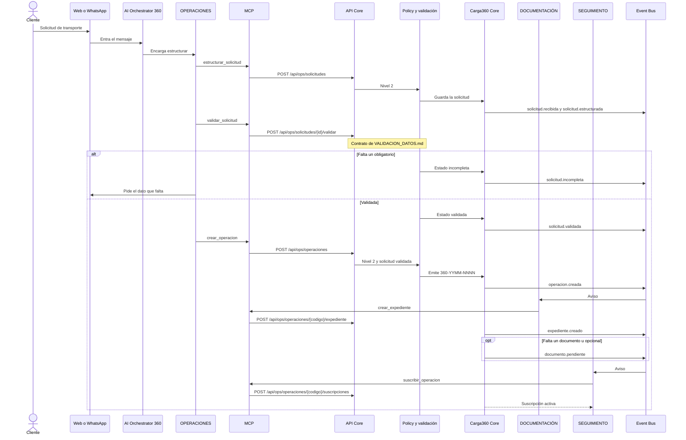

# Carga360go · Primer flujo de extremo a extremo (v1)

**PROPUESTA.** No se implementa, no se fusiona y no se despliega sin OK expreso de Gerencia. Este documento no se le encargó a Cursor: la lista de PR del final es solo una especificación, lista para cuando Gerencia autorice el encargo.

**Fecha:** 17-11-2026, hora de Chile (UTC−3).  
**Arquitectura de referencia:** `ARQUITECTURA_IA_REFERENCIA.md` (misma carpeta).  
**Validación de datos:** el Orquestador IA diseña el detalle en `VALIDACION_DATOS.md`. Aquí solo se fijan los **puntos de contrato** (sección 4).  
**Base de código (solo lectura):** `contacto248/carga360go`, rama `release/2026-11-15`, commit [`84da638`](https://github.com/contacto248/carga360go/commit/84da638fb7a46981c1336492a0e1096debeaf877). Última migración aplicada en ese commit: **028**. Las tablas nuevas de este flujo se citan por nombre de migración (ver §7; la 029 a la 032 ya están ocupadas en la release).

Sin precios, sin comisiones y sin nombres de personas en las tareas. Los flags nuevos quedan **apagados por defecto**. Con el flag apagado, cada ruta nueva responde 404.

---

## 1. Qué cubre este flujo (v1) y qué no

**Cubre, de punta a punta:**

1. Entra una **solicitud de transporte** por la web o por WhatsApp.
2. **OPERACIONES** la deja estructurada (origen, destino, tipo de carga, peso, dimensiones, fecha, requisitos).
3. Core corre la **validación automática** (esquema y completitud).
4. Si está válida, Core **crea la operación** y le asigna el ID público `360-XXXX`.
5. **DOCUMENTACIÓN** crea la **estructura documental** de esa operación.
6. **SEGUIMIENTO** queda **suscrito** a los eventos de esa operación.

**No cubre (queda para fases siguientes):** publicar la carga en la bolsa, calcular o mostrar un valor de flete, asignar transportista, GPS/ETA, POD, pagos, facturas, ni el panel «qué pasa hoy» de INTELIGENCIA DE NEGOCIO (ese bot solo puede leer lo que este flujo deje registrado, cuando exista la API de lectura).

Principios que este flujo respeta: Core es el sistema de registro; el bot no toca la base; operativo primero, revisión después; Nivel 3 no entra sin aprobación humana; Pricing y Matching no participan en la v1 (y cuando participen, seguirán siendo deterministas).

---

## 2. Formato y secuencia del ID de operación

El texto de Gerencia habla de un ID `360-XXXX`. Hoy ese identificador **no existe** en el código. Lo que sí existe, y no se reutiliza, es:

- el UUID interno de `ops_shipments.id` (envío logístico);
- el código de lead comercial `C360-XXXXXX` (seis caracteres, alfabeto sin letras dudosas), que emite el agente en `src/lib/agent/store.ts`.

**Formato público propuesto:** `360-YYMM-NNNN`

| Parte | Significado | Ejemplo |
|---|---|---|
| `360` | Prefijo fijo de Carga360go | `360` |
| `YYMM` | Año y mes en **hora de Chile** (America/Santiago) al crear la operación | `2611` = noviembre 2026 |
| `NNNN` | Correlativo del mes, de 4 dígitos, partiendo en `0001` | `0001` |

Ejemplo completo: **`360-2611-0001`** (primera operación emitida en noviembre 2026, hora de Chile).

Reglas de la secuencia:

- El correlativo es por mes, no global. En diciembre 2026 vuelve a partir en `0001` (`360-2612-0001`).
- Si un mes supera `9999`, el correlativo crece a 5 dígitos (`360-2611-10000`). No se recicla ni se rellena un hueco.
- La emisión es atómica en SQLite (tabla de secuencia; en Core ya existe como `ops_operation_counters`, migración `030-ops-operacion`, PR #52). Si dos pedidos llegan juntos, no se repite el código.
- El código es único, visible y no se reutiliza, ni siquiera si la operación se cancela.
- Por dentro, la fila tiene además un UUID (`id`). Las llaves foráneas usan ese UUID. El código público es lo que ven las personas y los bots.
- No se parece al lead `C360-XXXXXX`: el lead lleva una `C` adelante y no usa año-mes. No se deben intercambiar.

**[POR CONFIRMAR CON EL TEXTO ORIGINAL]** si Gerencia ya había fijado otro patrón (por ejemplo, solo `360-0001` sin mes). Hasta ese contraste, este es el formato de la propuesta.

---

## 3. Pasos del flujo

Estados de la **solicitud:** `recibida` → `estructurada` → `incompleta` o `validada` → `convertida` (cuando nace la operación). También puede pasar a `descartada` (Nivel 2, sin borrar la fila).

Estados de la **operación** en v1: `abierta`, `documentacion_pendiente`, `en_curso`, `cerrada`, `cancelada`.  
`en_curso` queda reservado para cuando más adelante se enlace un `ops_shipments` o una carga; en la v1 la operación nace `abierta` o `documentacion_pendiente`.

1. **Entrada.** La persona deja una solicitud en el formulario web o en WhatsApp. Core (vía API) guarda `ops_requests` y emite `solicitud.recibida`.
2. **Estructuración.** El Orchestrator encarga a OPERACIONES. El bot llama la herramienta MCP `estructurar_solicitud`. La API deja el payload en el esquema acordado con `VALIDACION_DATOS.md` y emite `solicitud.estructurada`. Esto es Nivel 2, operativo de inmediato.
3. **Validación.** OPERACIONES llama `validar_solicitud`. La API corre el motor de validación (o, mientras ese motor no esté, el esqueleto del contrato de la sección 4).  
   - Si falta un **obligatorio** o el formato es inválido: estado `incompleta`, evento `solicitud.incompleta`. **No se crea operación.** El bot pide el dato que falta.  
   - Si lo obligatorio está bien y solo faltan opcionales: estado `validada`, evento `solicitud.validada`, y se anotan advertencias.
4. **Alta de la operación.** Con la solicitud `validada`, OPERACIONES llama `crear_operacion`. Core emite el código `360-YYMM-NNNN`, deja la operación ligada a la solicitud y emite `operacion.creada`. La solicitud pasa a `convertida`. Nivel 2.
5. **Expediente.** Al ver `operacion.creada`, DOCUMENTACIÓN llama `crear_expediente`. Core arma las secciones vacías (sección 8) y emite `expediente.creado`. Si ya hay advertencias de documentos o datos opcionales, emite también `documento.pendiente`. Nivel 2.
6. **Suscripción.** Al ver `operacion.creada` (o `expediente.creado`), SEGUIMIENTO llama `suscribir_operacion`. Core registra la suscripción y, de ahí en adelante, ese bot puede leer los eventos de esa operación. Nivel 2.

Si en el camino aparece un error técnico, la solicitud o la operación no se borra. Queda el registro y una alerta para revisión posterior.

---

## 4. Puntos de contrato con `VALIDACION_DATOS.md`

Este flujo **no diseña** el motor. Solo necesita que el documento del Orquestador IA (o, mientras tanto, el esqueleto de la API) responda de forma estable a lo siguiente.

**Entrada que le entrega OPERACIONES (payload estructurado):**

- `origen` (texto de comuna o ciudad en Chile)
- `destino`
- `tipoCarga` o `equipo` (alineado al catálogo de equipos de Core, cuando se pueda)
- `pesoT` (toneladas)
- `dimensiones` (opcional según tipo de carga)
- `fechaRetiro` (fecha de retiro, `YYYY-MM-DD`, interpretada en hora de Chile)
- `requisitos` (lista libre: peligrosa, refrigerada, minera u otros)
- `notas` (opcional)
- datos de contacto del solicitante, tratados como dato interno, nunca para material público

**Salida que este flujo espera:**

```json
{
  "ok": true,
  "resultado": "validada",
  "faltantes": [],
  "invalidos": [],
  "advertencias": [
    { "campo": "dimensiones", "codigo": "OPCIONAL_AUSENTE", "detalle": "No se indicaron dimensiones." }
  ],
  "schemaVersion": "validacion-v1"
}
```

O, si no pasa:

```json
{
  "ok": false,
  "resultado": "incompleta",
  "faltantes": [{ "campo": "pesoT", "codigo": "OBLIGATORIO_AUSENTE" }],
  "invalidos": [{ "campo": "fechaRetiro", "codigo": "FECHA_PASADA", "detalle": "La fecha de retiro no puede ser anterior a hoy." }],
  "advertencias": [],
  "schemaVersion": "validacion-v1"
}
```

Reglas de frontera, hasta que `VALIDACION_DATOS.md` las precise:

- Obligatorio mínimo para crear operación: origen, destino, tipo de carga o equipo, peso y fecha de retiro.
- Una fecha de retiro anterior a «hoy» en hora de Chile, o un peso que no sea un número mayor que 0, es inválido (el alta de cargas actual en `src/lib/listings.ts` ya usa esa lógica; la validación de solicitudes debería alinearse, sin copiar de más).
- `ok: true` es la única llave que autoriza `POST /api/ops/operaciones`.
- El motor es determinista: no lo resuelve un LLM. Un bot puede ayudar a **completar** el dato con la persona; no puede marcar `ok: true` por su cuenta.

---

## 5. Diagrama de secuencia



---

## 6. Contratos de API propuestos

Todas las rutas viven bajo `/api/ops/...`, usan el guard que ya existe (`opsGuard`) más el flag hijo nuevo `OPS_ORCHESTRATION_ENABLED`. Con el maestro o el hijo apagados: **404** y el mismo mensaje «No encontrado.» que el resto de OPS. Métodos que no son GET exigen same-origin (o el token de servicio, cuando Gerencia lo defina). Sesión obligatoria, salvo que Gerencia autorice un token de bot por entorno.

Errores: el formato actual de `jsonError` / `AppError` (mensaje en español y código HTTP). Códigos previstos: 401 sin sesión, 403 sin permiso o Nivel 3 sin aprobación, 404 flag apagado o recurso inexistente (sin delatar si el id existe), 409 si la solicitud no está `validada` o si el expediente ya existe, 422 si el cuerpo no cumple el esquema.

Permisos nuevos de organización (no se toca `users.role`). El admin de plataforma puede todo, igual que hoy:

- `solicitudes.crear`, `solicitudes.ver`
- `operaciones.crear`, `operaciones.ver`
- `expediente.editar`, `expediente.ver`
- `seguimiento.suscribir`, `alertas.ver`

### 6.1 Crear o estructurar una solicitud

`POST /api/ops/solicitudes`  
Nivel 2. Permiso `solicitudes.crear`. Emite `solicitud.recibida` y, si el cuerpo ya viene estructurado, `solicitud.estructurada`.

Cuerpo:

```json
{
  "canal": "web",
  "leadCode": null,
  "payload": {
    "origen": "Santiago",
    "destino": "Valparaíso",
    "equipo": "camion_3_ejes",
    "pesoT": 12,
    "dimensiones": null,
    "fechaRetiro": "2026-11-25",
    "requisitos": [],
    "notas": null
  }
}
```

`canal` puede ser `web` o `whatsapp`. `leadCode` es opcional: solo si ya existe un lead `C360-XXXXXX` y se quiere dejar el vínculo, sin mezclar los códigos.

Respuesta `201`:

```json
{
  "solicitud": {
    "id": "uuid",
    "canal": "web",
    "estado": "estructurada",
    "leadCode": null,
    "payload": {},
    "validacion": null,
    "operacionId": null,
    "createdAt": "2026-11-17T10:00:00.000-03:00"
  }
}
```

`GET /api/ops/solicitudes/{id}` — Nivel 1, permiso `solicitudes.ver`.

### 6.2 Validar una solicitud

`POST /api/ops/solicitudes/{id}/validar`  
Nivel 2 (escribe el resultado; no crea la operación). El cuerpo puede ir vacío o traer un `payload` corregido.

Respuesta `200`: el objeto `solicitud` actualizado, con `estado` `validada` o `incompleta` y el bloque `validacion` en el formato de la sección 4. Eventos: `solicitud.validada` o `solicitud.incompleta`.

### 6.3 Crear la operación

`POST /api/ops/operaciones`  
Nivel 2. Permiso `operaciones.crear`. Solo si la solicitud está `validada`. Emite `operacion.creada`.

Cuerpo:

```json
{ "solicitudId": "uuid" }
```

Respuesta `201`:

```json
{
  "operacion": {
    "id": "uuid",
    "codigo": "360-2611-0001",
    "solicitudId": "uuid",
    "estado": "abierta",
    "loadId": null,
    "shipmentId": null,
    "leadCode": null,
    "createdAt": "2026-11-17T10:01:00.000-03:00"
  }
}
```

`GET /api/ops/operaciones/{codigo}` — Nivel 1, permiso `operaciones.ver`. También acepta el UUID interno. Si no existe o no hay permiso: 404.

### 6.4 Expediente

`POST /api/ops/operaciones/{codigo}/expediente`  
Nivel 2. Permiso `expediente.editar`. Idempotente: si ya existe, responde `200` con el expediente actual y no lo duplica. Si lo crea, `201` y evento `expediente.creado`. Si alguna sección nace con ítems pendientes, también `documento.pendiente`.

Cuerpo: `{}` (en v1 no se personalizan las secciones).

`GET /api/ops/operaciones/{codigo}/expediente` — Nivel 1, permiso `expediente.ver`.

Respuesta:

```json
{
  "expediente": {
    "operacionCodigo": "360-2611-0001",
    "secciones": [
      { "clave": "cliente", "titulo": "Cliente", "items": [] },
      { "clave": "transportista", "titulo": "Transportista", "items": [] },
      { "clave": "vehiculo", "titulo": "Vehículo", "items": [] },
      { "clave": "conductor", "titulo": "Conductor", "items": [] },
      { "clave": "documentos", "titulo": "Documentos de la operación", "items": [] },
      { "clave": "evidencias", "titulo": "Evidencias", "items": [] },
      { "clave": "incidencias", "titulo": "Incidencias", "items": [] },
      { "clave": "cierre", "titulo": "Cierre", "items": [] }
    ]
  }
}
```

`POST /api/ops/operaciones/{codigo}/expediente/items` — Nivel 2. Registra un ítem pendiente o recibido (metadatos; el archivo, si hay, reutiliza el mecanismo seguro de documentos que ya existe, sin mezclarlo con la acreditación de cuentas). Puede emitir `documento.pendiente` o `documento.recibido`. **Borrar un ítem o un archivo es Nivel 3.**

### 6.5 Suscripción de seguimiento y alertas

`POST /api/ops/operaciones/{codigo}/suscripciones`  
Nivel 2. Permiso `seguimiento.suscribir`. Cuerpo:

```json
{ "consumidor": "seguimiento", "eventos": ["*"] }
```

`consumidor` en v1: `seguimiento`, `documentacion`, `operaciones` o `inteligencia`. `eventos: ["*"]` suscribe a todos los eventos de esa operación. Idempotente.

`GET /api/ops/operaciones/{codigo}/eventos` — Nivel 1. Lista los eventos del bus de esa operación, en orden.

`GET /api/ops/alertas?codigo=360-2611-0001` — Nivel 1, permiso `alertas.ver`. En v1 puede devolver lista vacía si aún no hay reglas de alerta; el contrato existe para que SEGUIMIENTO quede conectado.

### 6.6 Lectura del bus (interna)

`GET /api/ops/bus/eventos?despues=...` — Nivel 1. Pensada para el Orchestrator y los bots, con permiso de lectura. No es una API pública hacia clientes. Flag apagado ⇒ 404.

---

## 7. Tablas y migraciones propuestas (aditivas, citadas por nombre)

> **Actualización 17-11 (alineación v1.1 con [`PLAYBOOK_OPS_DISPATCH.md`](../equipo/operaciones/PLAYBOOK_OPS_DISPATCH.md), hecha por el Orquestador IA a pedido de Gerencia; solo se cambiaron las referencias a migraciones).** Las migraciones se citan **por nombre**, no por número: cada PR toma el siguiente número libre al momento del merge ([`ORQUESTADOR_SPEC_V1.md`](./ORQUESTADOR_SPEC_V1.md) D-30). En `release/2026-11-15` @ `1c03775` (verificado con `git fetch`, solo lectura) ya están ocupadas: **029** `ops-torre` (incluye `ops_alerts`), **030** `ops-operacion` (`ops_operations`, `ops_operation_keys` y `ops_operation_counters`), **031** `ops-alertas-severity` y **032** `ai-router-uso` (`ai_router_usage`, PR #59). Los estados v1.1 de la operación (`en_asignacion`, `asignada`, `entregada`, etc.) y el correlativo de 5 dígitos van en `ops-operacion-estados`.

Mismo patrón que 022–028: solo tablas o índices nuevos, `CREATE TABLE IF NOT EXISTS`, sin filas de ejemplo, sin alterar `users`, `loads`, `offers`, `documents`, `documentos_acreditacion`, `agent_leads` ni las tablas `ops_*` ya creadas. Copia en `docs/migrations/0XX-....sql` y reversa `0XX-....-rollback.sql`. Se aplican solas al arrancar (`src/lib/db.ts`), aunque el flag esté apagado.

### 7.1 Migración `ops-bus-outbox` — Flag, policy y Event Bus

No exige un flag en la base (el flag es de entorno). Crea el outbox y un registro de decisiones de policy (útil para Nivel 3 y para auditar denegaciones).

- `ops_bus_events`: `id`, `occurred_at`, `tipo` (texto del evento), `solicitud_id` (nullable), `operacion_id` (nullable), `payload_json`, `schema_version`, `seq` global monótono.
- `ops_policy_decisions`: `id`, `action`, `nivel`, `resultado` (`permitido`, `denegado`, `espera_aprobacion`), `actor_id`, `aprobador_id` (nullable), `target_type`, `target_id`, `detalle_json`, `created_at`.

Índices: por `tipo+occurred_at`, por `operacion_id`, por `seq`.

### 7.2 Migración `ops-solicitudes-validacion` — Solicitudes

- `ops_requests`: `id` (UUID), `canal` (`web` | `whatsapp`), `lead_code` (texto nullable, sin llave foránea obligatoria a `agent_leads` para no acoplar de más), `estado`, `payload_json`, `validacion_json`, `operacion_id` (nullable, se rellena al convertir), `created_by`, `created_at`, `updated_at`.

Índices: por `estado+updated_at`, por `lead_code`.

### 7.3 Operaciones y secuencia del código (ya fusionada como `030-ops-operacion`; estados en `ops-operacion-estados`)

- `ops_operations`: `id` (UUID), `codigo` (único, `360-YYMM-NNNN`), `solicitud_id` (único: una solicitud produce a lo más una operación), `estado`, `load_id` nullable, `shipment_id` nullable, `lead_code` nullable, `created_by`, `created_at`, `updated_at`. Sin `ON DELETE CASCADE` hacia `loads` o `ops_shipments`: si esos registros se movieran después, la operación no desaparece.
- `ops_operation_seq`: `ym` (texto `YYMM`, clave primaria), `last_n` (entero). Una fila por mes. **En Core se llama `ops_operation_counters`** (`periodo`, `ultimo`).

### 7.4 Migración `ops-expediente` — Expediente

- `ops_dossiers`: `id`, `operacion_id` (único), `created_at`.
- `ops_dossier_sections`: `id`, `dossier_id`, `clave`, `titulo`, `pos`.
- `ops_dossier_items`: `id`, `section_id`, `clave`, `estado` (`pendiente` | `recibido` | `no_aplica`), `detalle`, `document_id` nullable (por si más adelante se apunta a un archivo ya guardado, sin mezclar con acreditación), `created_at`, `updated_at`.  
  En v1 no se borra en duro. Un `DELETE` de ítem queda bloqueado o se reserva a Nivel 3.

### 7.5 Migración `ops-notificaciones-suscripciones` — Suscripciones y alertas

- `ops_subscriptions`: `id`, `operacion_id`, `consumidor`, `eventos_json`, `created_at`, único `(operacion_id, consumidor)`.
- `ops_alerts`: `id`, `operacion_id`, `tipo`, `estado` (`abierta` | `cerrada`), `detalle_json`, `created_at`, `closed_at` nullable. No se borran.

---

## 8. Estructura documental que se crea en v1

Al llamar `crear_expediente`, Core deja estas ocho secciones, vacías, siempre en el mismo orden. No se inventan archivos.

| Clave | Título | Para qué queda lista |
|---|---|---|
| `cliente` | Cliente | Datos de la empresa que pide el transporte y su orden, cuando existan. |
| `transportista` | Transportista | Empresa que más adelante tome el viaje. |
| `vehiculo` | Vehículo | Camión o equipo asignado. |
| `conductor` | Conductor | Quién conduce, cuando corresponda. |
| `documentos` | Documentos de la operación | Guías y papeles del viaje. No se mezcla con la acreditación de la cuenta. |
| `evidencias` | Evidencias | Fotos, comprobantes de retiro o entrega, cuando existan. |
| `incidencias` | Incidencias | Problemas o excepciones del ciclo. |
| `cierre` | Cierre | Cierre formal de la operación. |

Si la validación dejó advertencias (por ejemplo, sin dimensiones o sin un requisito declarado), DOCUMENTACIÓN puede dejar un ítem `pendiente` en la sección que corresponda y se emite `documento.pendiente`. Eso no detiene el alta de la operación.

---

## 9. Herramientas MCP que necesita cada bot

Las herramientas nuevas **no leen la base**. Cada una llama a la API de la sección 6, pasa por Policy, validación y `audit_log`. Si el flag está apagado, no aparecen en `tools/list` (o la llamada responde 404). Se audita el nombre de la herramienta, el actor, el destino y el resultado.

El MCP actual (`resumen`, `listar_cargas`, `detalle_carga`) **no se reescribe en este flujo**. Queda como gap documentado en la arquitectura de referencia, para un PR posterior.

| Bot | Herramientas | Nivel | API |
|---|---|---|---|
| **OPERACIONES** | `estructurar_solicitud` | 2 | `POST /api/ops/solicitudes` |
| | `validar_solicitud` | 2 | `POST /api/ops/solicitudes/{id}/validar` |
| | `crear_operacion` | 2 | `POST /api/ops/operaciones` |
| | `ver_solicitud` | 1 | `GET /api/ops/solicitudes/{id}` |
| | `ver_operacion` | 1 | `GET /api/ops/operaciones/{codigo}` |
| **DOCUMENTACIÓN** | `crear_expediente` | 2 | `POST /api/ops/operaciones/{codigo}/expediente` |
| | `ver_expediente` | 1 | `GET /api/ops/operaciones/{codigo}/expediente` |
| | `registrar_item_expediente` | 2 | `POST /api/ops/operaciones/{codigo}/expediente/items` |
| **SEGUIMIENTO** | `suscribir_operacion` | 2 | `POST /api/ops/operaciones/{codigo}/suscripciones` |
| | `listar_eventos_operacion` | 1 | `GET /api/ops/operaciones/{codigo}/eventos` |
| | `listar_alertas` | 1 | `GET /api/ops/alertas` |
| **INTELIGENCIA DE NEGOCIO** | `ver_operacion` (la misma de lectura) | 1 | `GET /api/ops/operaciones/{codigo}` |
| | `listar_alertas` | 1 | `GET /api/ops/alertas` |
| **Orchestrator / Master Bot** | `listar_eventos_bus` | 1 | `GET /api/ops/bus/eventos` |

Ningún bot de este flujo recibe una herramienta de borrar, de pagar, de cambiar flags ni de confirmar asignaciones.

Identidad de los bots: se propone un token de servicio por entorno (mismo estilo que `MCP_TOKEN`), cargado por Gerencia en el ambiente, nunca por chat, más una sesión o una cuenta de servicio con solo los permisos de arriba. El detalle de credenciales queda fuera de este documento.

---

## 10. Policy y auditoría

Antes de ejecutar, la API pregunta al Policy Engine:

1. ¿El flag maestro y `OPS_ORCHESTRATION_ENABLED` están en `true`? Si no, 404.
2. ¿Hay sesión o token de servicio válido? Si no, 401.
3. ¿El actor tiene el permiso de organización (o es admin de plataforma)? Si no, 403.
4. ¿Cuál es el nivel de la acción?  
   - Nivel 1 o 2: sigue a la validación de esquema y, si corresponde, al motor de `VALIDACION_DATOS.md`.  
   - Nivel 3: ¿hay aprobación humana previa registrada? Si no, 403 y se guarda `espera_aprobacion` o `denegado`. No se ejecuta.
5. Se escribe `ops_policy_decisions` y, al ejecutar, una fila en `audit_log`.

Acciones de auditoría propuestas (etiquetas nuevas en `AUDIT_LABELS`, sin quitar las que ya existen):

| Acción | Etiqueta en español |
|---|---|
| `ops.solicitud_creada` | Solicitud operativa registrada |
| `ops.solicitud_validada` | Solicitud validada |
| `ops.solicitud_incompleta` | Solicitud incompleta |
| `ops.operacion_creada` | Operación creada |
| `ops.expediente_creado` | Expediente documental creado |
| `ops.documento_pendiente` | Documento de operación pendiente |
| `ops.suscripcion_creada` | Suscripción de seguimiento creada |
| `ops.alerta_generada` | Alerta operativa generada |
| `ops.mcp_herramienta` | Herramienta MCP llamada |

El detalle guarda ids y códigos (`360-YYMM-NNNN`), no contraseñas ni tokens. El Event Bus se escribe en la **misma transacción** que el alta en Core. `audit_log` ya está pensado para no tumbar la acción principal si falla (`audit`); en altas de operación se recomienda `auditStrict`, igual que en `ensureShipmentForLoad`.

---

## 11. Criterios de aceptación

Valen con el flag **apagado** y con el flag **encendido** en un ambiente de prueba. No se usa producción ni datos reales de clientes.

1. Con `OPS_ORCHESTRATION_ENABLED` distinto de `true` (o con el maestro apagado), todas las rutas de la sección 6 responden **404**. Las páginas nuevas, si las hubiera, también. El sitio actual no cambia.
2. Las migraciones `ops-bus-outbox`, `ops-solicitudes-validacion`, `ops-operacion-estados`, `ops-expediente` y `ops-notificaciones-suscripciones` son aditivas, idempotentes y tienen reversa. No modifican tablas previas. Se aplican al arrancar aunque el flag esté apagado, igual que 022–028.
3. Una solicitud válida (origen, destino, equipo o tipo de carga, peso y fecha de retiro) produce una operación con código `360-YYMM-NNNN` correcto en hora de Chile, único, y una sola vez por solicitud (repetir el POST no emite otro código: responde la operación ya creada o 409, y se documenta cuál de las dos).
4. Dos altas simultáneas en el mismo mes no repiten correlativo.
5. El código de operación no se confunde con un lead `C360-XXXXXX`. Un test lo deja explícito.
6. Si falta un obligatorio, no nace operación; la solicitud queda `incompleta` y se emite `solicitud.incompleta`.
7. Al crear la operación quedan, en este orden, el expediente con las ocho secciones y la suscripción de SEGUIMIENTO. Se emiten `operacion.creada`, `expediente.creado` y, si corresponde, `documento.pendiente`.
8. No hay camino, en tests, desde una herramienta MCP de este flujo hacia `getDb()` ni hacia un `prepare(` propio. La herramienta llama a la API (o al mismo servicio de aplicación que la API usa, por detrás de Policy).
9. Cada alta y cada llamada MCP deja fila en `audit_log` (y en `ops_policy_decisions`).
10. Un intento de borrar operación, expediente o datos, o cualquier acción de Nivel 3, se rechaza sin aprobación humana previa.
11. Los tests no afirman montos, tarifas ni comisiones. Fixtures de ejemplo, sin datos reales.
12. CI verde en la rama del PR. Una persona puede recorrer el flujo con un cliente de API (sin interfaz pulida, si aún no existe).

---

## 12. Tareas para Cursor

**Estado:** propuesta. **No encargadas.** Cada ítem es un PR pequeño, sobre `release/2026-11-15`, con CI, flag apagado por defecto, migración aditiva cuando corresponda y reversa. No se encienden flags en producción. No se tocan pagos, `.env` reales, DNS, credenciales ni textos legales. No se crean repos nuevos.

Reglas comunes a todos los PR:

- Flag hijo `OPS_ORCHESTRATION_ENABLED`, leído igual que los otros hijos de `OPS_FEATURE_ENABLED` (solo el texto exacto `true`).
- Tests de flag apagado ⇒ 404, y de flag encendido en base temporal.
- Mensajes de la app en español de Chile, simples, sin precios.
- Sin datos de ejemplo en la base.

### PR-ORQ-1 · Flag, Policy Engine mínimo y Event Bus (migración `ops-bus-outbox`)

- **Alcance:** agregar el flag hijo; módulo `src/lib/ops/policy.ts` con niveles 1, 2 y 3; outbox `ops_bus_events`; `ops_policy_decisions`; guard que deja 404 con el flag apagado; `GET /api/ops/bus/eventos`.
- **Archivos previstos:** `src/lib/ops/flags.ts`, `src/lib/ops/http.ts`, `src/lib/ops/policy.ts`, `src/lib/ops/bus.ts`, `src/lib/db.ts`, `docs/migrations/NNN-ops-bus-outbox.sql` y su reversa (NNN = siguiente libre al mergear), `tests/ops-flags.test.ts` (ampliar), `tests/ops-policy.test.ts`, `tests/ops-bus.test.ts`.
- **Tests:** valores raros no encienden el flag; Nivel 3 sin aprobación se deniega; un evento escrito se lee en orden.
- **Flag apagado / migración aditiva:** sí / `ops-bus-outbox`.

### PR-ORQ-2 · Solicitudes (migración `ops-solicitudes-validacion`)

- **Alcance:** tabla `ops_requests`; `POST` y `GET` de `/api/ops/solicitudes`; permiso `solicitudes.*`; eventos `solicitud.recibida` y `solicitud.estructurada`; auditoría.
- **Archivos previstos:** `src/lib/ops/requests.ts`, `src/app/api/ops/solicitudes/route.ts`, `src/app/api/ops/solicitudes/[id]/route.ts`, `src/lib/ops/permissions.ts`, `src/lib/audit.ts`, migración `ops-solicitudes-validacion` y reversa, `tests/ops-requests.test.ts`.
- **Tests:** crea y lee; sin permiso 403; flag apagado 404; no toca `agent_leads` ni `loads`.
- **Flag apagado / migración aditiva:** sí / `ops-solicitudes-validacion`.

### PR-ORQ-3 · Validación automática (esqueleto + contrato)

- **Alcance:** `POST /api/ops/solicitudes/{id}/validar`. Implementa el contrato de la sección 4 (obligatorios, formatos, fecha en hora de Chile). Deja un punto único (`validateRequest`) para que, cuando exista `VALIDACION_DATOS.md`, se reemplace o se extienda el motor **sin cambiar la API**. No usa LLM.
- **Archivos previstos:** `src/lib/ops/validation.ts`, `src/app/api/ops/solicitudes/[id]/validar/route.ts`, `tests/ops-validation.test.ts`. Puede no traer migración si `ops-solicitudes-validacion` ya tiene `validacion_json`.
- **Tests:** caso válido; falta peso; fecha pasada; la respuesta cumple el JSON de la sección 4; no crea operación.
- **Flag apagado / migración aditiva:** sí / sin tabla nueva, salvo que falte una columna (entonces un ALTER aditivo en una migración nueva con nombre propio; se prefiere dejar la columna ya en `ops-solicitudes-validacion`).

### PR-ORQ-4 · Operaciones con ID `360-YYMM-NNNN` (base ya fusionada en `030-ops-operacion`; estados v1.1 en `ops-operacion-estados`)

- **Alcance:** tablas `ops_operations` y `ops_operation_seq`; emisión atómica del código en hora de Chile; `POST` y `GET` de `/api/ops/operaciones`; una solicitud `validada` produce una sola operación; eventos y auditoría.
- **Archivos previstos:** `src/lib/ops/operations.ts`, `src/app/api/ops/operaciones/route.ts`, `src/app/api/ops/operaciones/[codigo]/route.ts`, migración `ops-operacion-estados` y reversa, `tests/ops-operations.test.ts`.
- **Tests:** formato del código; unicidad; dos altas concurrentes; solicitud incompleta ⇒ 409 y sin código; no choca con `C360-XXXXXX`; flag apagado 404.
- **Flag apagado / migración aditiva:** sí / `ops-operacion-estados`.

### PR-ORQ-5 · Expediente documental (migración `ops-expediente`)

- **Alcance:** tablas del expediente; `POST` que crea las ocho secciones vacías (idempotente); `GET`; registrar ítem pendiente o recibido; eventos `expediente.creado` y `documento.pendiente`. Sin borrar ítems.
- **Archivos previstos:** `src/lib/ops/dossier.ts`, rutas bajo `/api/ops/operaciones/[codigo]/expediente`, migración `ops-expediente` y reversa, `tests/ops-dossier.test.ts`.
- **Tests:** las ocho secciones y el orden; la segunda llamada no duplica; no mezcla con `documents` ni `documentos_acreditacion`; flag apagado 404.
- **Flag apagado / migración aditiva:** sí / `ops-expediente`.

### PR-ORQ-6 · Suscripciones y alertas (migración `ops-notificaciones-suscripciones`)

- **Alcance:** `ops_subscriptions` y `ops_alerts`; `POST` de suscripción idempotente; `GET` de eventos por operación y de alertas; consumidor `seguimiento`.
- **Archivos previstos:** `src/lib/ops/subscriptions.ts`, rutas de suscripciones, eventos y alertas, migración `ops-notificaciones-suscripciones` y reversa, `tests/ops-subscriptions.test.ts`.
- **Tests:** la suscripción queda activa después de `operacion.creada`; no se duplica; listar eventos respeta el permiso; flag apagado 404.
- **Flag apagado / migración aditiva:** sí / `ops-notificaciones-suscripciones`.

### PR-ORQ-7 · Herramientas MCP del flujo (sin migración)

- **Alcance:** exponer en `/api/mcp` (o un submódulo claro) las herramientas de la sección 9. Cada una llama a la API o al servicio ya protegido por Policy. `tools/list` no las muestra con el flag apagado. Auditoría `ops.mcp_herramienta`. **No** se reescriben `resumen`, `listar_cargas` ni `detalle_carga` en este PR (salvo una nota en código o en docs de que siguen siendo un gap).
- **Archivos previstos:** `src/app/api/mcp/route.ts` (o `src/lib/ops/mcp-tools.ts` más un cambio mínimo a la ruta), `tests/ops-mcp-orquestacion.test.ts`.
- **Tests:** con flag apagado no se listan ni se ejecutan; con flag encendido, `crear_operacion` no pasa si la solicitud está incompleta; no hay `getDb()` dentro de la herramienta.
- **Flag apagado / migración aditiva:** sí / ninguna.

### PR-ORQ-8 · Canales web y WhatsApp (adaptador fino, al final)

- **Alcance:** que una solicitud llegada por el canal web o por el borrador de WhatsApp ya existente pueda, **con el flag encendido**, llamar a `POST /api/ops/solicitudes` y dejar el `leadCode` cuando corresponda. Con el flag apagado, el comportamiento actual no cambia (el lead `C360-XXXXXX` sigue igual, no se publican cargas solas, no se envían mensajes masivos).
- **Archivos previstos:** puntos mínimos en el alta web y en `create_cargo_draft` / el bot de WhatsApp, más tests de «flag apagado = nada nuevo».
- **Tests:** flag apagado no crea `ops_requests`; flag encendido crea la solicitud y no mezcla los dos códigos.
- **Flag apagado / migración aditiva:** sí / ninguna.

Orden sugerido: 1 → 2 → 3 → 4 → 5 → 6 → 7, y 8 al final. Cada PR se puede revisar y fusionar por separado, siempre contra `release/2026-11-15`, con CI verde.

---

## 13. Tareas para Grok Build

Material de **marca y explicación comercial** del flujo, en **borrador**, para revisión de Gerencia. No se publica. **Sin precios, sin comisiones, sin cifras, sin nombres de personas, sin testimonios inventados y sin presentar el flujo como ya activo en www.carga360go.cl.** Mientras Gerencia no fije otra etiqueta, cada pieza lleva «Próximamente» o «En piloto», igual que el copy operativo ya existente.

1. **Una lámina o una página** que explique, en lenguaje simple, el camino: «Usted pide un transporte → Carga360go ordena los datos → nace una operación con un código 360 → queda un expediente listo → el equipo sigue el ciclo». Un ejemplo de código debe ser claramente de demostración (por ejemplo `360-2611-0001` de ejemplo, no un caso real).
2. **Un esquema visual** (sin captura de pantallas internas) de las ocho secciones del expediente, con los títulos de la sección 8, para que una empresa entienda qué queda ordenado.
3. **Borrador de mensajes de WhatsApp** (solo plantilla, no se envían): confirmación de que la solicitud llegó; pedido de un dato que falta (origen, destino, peso o fecha); aviso de que ya existe la operación con su código; aviso de que falta un documento, sin apurar un pago.
4. **Texto corto para la web** (bloque «cómo funciona», en borrador) alineado con los principios: Carga360go conecta y ordena la operación; no transporta por su cuenta; una persona interviene cuando hay un dato sensible, un pago o un borrado.
5. **Glosario breve** para el equipo comercial: diferencia entre lead `C360-XXXXXX` (conversación comercial) y operación `360-YYMM-NNNN` (expediente operativo). Para no mezclarlos al hablar con un cliente.

Todo queda como borrador en la carpeta que Gerencia o MARKETING indiquen. No se indexa, no se sube a producción y no se dispara ninguna campaña.

---

## 14. Fuera de alcance y riesgos

- No se publica ni se adjudica una carga en este flujo.
- No se llama al motor de asignación ni al de costos.
- No se encienden `OPS_FEATURE_ENABLED`, `OPS_ALLOCATION_ENABLED` ni el flag nuevo en producción desde estos PR.
- No se migran todavía las tres herramientas MCP que hoy leen la base.
- `IA_ASIGNACION.md` sigue siendo la referencia para explicar asignaciones, no para este alta.
- Riesgo de confusión de códigos (`C360-…` vs `360-…`): se mitiga con formato, tests y el glosario de Grok Build.
- Riesgo de crear operación con datos flojos: se mitiga exigiendo `ok: true` del contrato de validación.
- Riesgo de tocar producción por error: cada PR nace con el flag apagado y 404.

**Siguiente paso recomendado:** Gerencia contrasta `ARQUITECTURA_IA_REFERENCIA.md` y este flujo con el texto original, y el Orquestador IA entrega `VALIDACION_DATOS.md`. Con esos OK, se puede encargar a Cursor el PR-ORQ-1, todavía sin desplegar.
