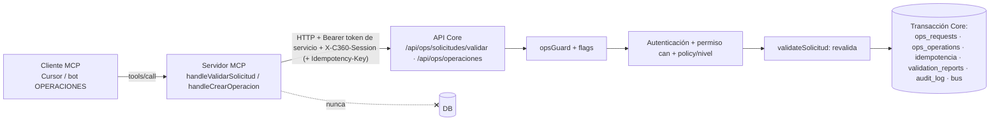

# Motor de validación automática de solicitudes de transporte · Especificación v1.1

**ESPECIFICACIÓN CERRADA, LISTA PARA IMPLEMENTAR.** Redactada el 17-11-2026, hora de Chile (UTC−3), por el bot de orquestación de IA, en modo solo lectura. **Cierre (08:40):** las preguntas técnicas de la §10 quedaron resueltas en [`ORQUESTADOR_SPEC_V1.md` §8 «Decisiones de cierre»](./ORQUESTADOR_SPEC_V1.md) (D-14 a D-29, cada una con su reversa). A Gerencia solo le quedan las decisiones de negocio. El orden de implementación y las migraciones están en la §10 de ese documento. **Alineación v1.1 (después de las 08:32):** alineado con [`PLAYBOOK_OPS_DISPATCH.md`](../equipo/operaciones/PLAYBOOK_OPS_DISPATCH.md) v1.0 de OPERACIONES: schema **1.1.0** con `meta.testData`, reglas `val-v1.1` (79 códigos: los 64 anteriores más 15 del playbook), estados `VALIDA`, `INCOMPLETA` y `BLOQUEADA`, confirmar asignación en **2b con confirmación humana previa** y precio en **Nivel 3** (D-03, D-13, D-14, D-17, D-20, D-24, D-25 y D-31 a D-33 de ORQUESTADOR).

- **Alcance:** solo especificación. No hay commits, PR, issues ni cambios en producción, y no se le encargó nada a Cursor. Las rutas de archivos "nuevos" que aparecen abajo son propuestas.
- **Código revisado:** rama `release/2026-11-15`, que es la más reciente (va 145 commits por delante de `main` y 4 por detrás). Commit [`84da638`](https://github.com/contacto248/carga360go/commit/84da638fb7a46981c1336492a0e1096debeaf877) (merge del PR #48, OPS-404). Los links apuntan a ese commit para que las líneas no se muevan.
- **Actualización de las 07:18 (hora de Chile):** después de mi revisión, la release avanzó a `809e151` (PR #49, OPS-302 a 304: ETA, alertas y seguimiento). Ese PR agregó la migración **029-ops-torre** (`ops_alerts`) y tocó `audit.ts` (+6 líneas), `db.ts` y `ops/*`. **No cambió** los archivos de validación que cito aquí (`listings.ts`, `payload.ts`, `catalog.ts`, `match.ts`, `types.ts`, `format.ts` y `agent/*`). Los links siguen anclados en `84da638`, así que las líneas no se mueven.
- **Migraciones (D-30, v1.1): se citan por nombre, no por número.** En `release/2026-11-15` @ `1c03775` (verificado con `git fetch`, solo lectura) están ocupadas la 029 (`ops-torre`), la 030 (`ops-operacion`), la 031 (`ops-alertas-severity`) y la **032 (`ai-router-uso`, PR #59)**. Las tablas de este motor (`ops_requests` y `validation_reports`) van en la migración **`ops-solicitudes-validacion`**, y la idempotencia genérica en **`idempotencia-auditoria`**. Cada PR toma el siguiente número libre al momento del merge (ver [`ORQUESTADOR_SPEC_V1.md` §10.2](./ORQUESTADOR_SPEC_V1.md)).
- **Convención:** los valores marcados **(config)** son una **propuesta configurable** de Carga360go, no normativa. Cuando cito normativa chilena, va con su fuente.

---

## 0. Resumen

1. Hoy **no existe un esquema formal** de la solicitud: no hay JSON Schema ni zod para las cargas. La validación es imperativa ([`normalizeLoad`](https://github.com/contacto248/carga360go/blob/84da638fb7a46981c1336492a0e1096debeaf877/src/lib/listings.ts#L237-L274), [`cleanSpecs`](https://github.com/contacto248/carga360go/blob/84da638fb7a46981c1336492a0e1096debeaf877/src/lib/listings.ts#L162-L206)), se detiene en el primer error y responde un texto sin código.
2. La propuesta es un **motor puro y determinista** (`validateSolicitud`), sin DB, sin red y sin LLM. Corre **dentro de Carga360 Core**, antes de `createLoad`, y devuelve un informe con **códigos estables**, severidad (BLOQUEA, AVISA o AUTOCOMPLETA) y la ruta del campo.
3. La IA (AI.CARGA360, el agente de WhatsApp o la web) **solo propone** campos marcados en `meta.suggestedFields`. El motor los revalida igual que cualquier otro dato, y algunos campos críticos exigen confirmación de la persona.
4. Los bots **nunca tocan la DB**. Siguen el camino herramienta autorizada → API de Core → policy → validación → escritura y auditoría en la misma transacción.
5. Las acciones se clasifican en **Nivel 1** (lectura y estructuración), **Nivel 2a** (escritura propia: se opera y se revisa si hay avisos), **Nivel 2b** (afecta a terceros: se opera, se avisa a los afectados y se revisa el 100 %) y **Nivel 3** (financiera, borrado o seguridad: aprobación humana **previa**). La división está alineada con `ARQUITECTURA_IA_REFERENCIA.md`.
6. El motor se conecta al flujo de `FLUJO_E2E_V1.md` (`/api/ops/solicitudes`, `validar_solicitud`, migraciones desde la 029) y devuelve su bloque `validacion` (§6.6).

---

## 1. Lo que hay hoy en el repo (hallazgos)

| # | Tema | Estado actual | Archivo |
|---|---|---|---|
| H1 | Esquema de la solicitud | **No existe un JSON Schema ni un zod para las cargas.** El payload se castea a mano en `loadFromPayload` (todo con `String()`/`Number()`) y se valida en `normalizeLoad` con `throw new AppError(texto)`. Se detiene en el primer error. | [`src/lib/payload.ts#L9-L26`](https://github.com/contacto248/carga360go/blob/84da638fb7a46981c1336492a0e1096debeaf877/src/lib/payload.ts#L9-L26), [`src/lib/listings.ts#L208-L274`](https://github.com/contacto248/carga360go/blob/84da638fb7a46981c1336492a0e1096debeaf877/src/lib/listings.ts#L208-L274) |
| H2 | Tipos | `LoadCore` (`equipment`, `weightT`, `origin`, `destination`, `pickupDate`, `specs`), `LoadPublic` y `LoadStatus` = `abierta \| adjudicada \| cerrada`. 12 tipos de equipo en `EQUIPMENT_IDS`. | [`src/lib/types.ts#L7-L20`](https://github.com/contacto248/carga360go/blob/84da638fb7a46981c1336492a0e1096debeaf877/src/lib/types.ts#L7-L20), [`#L91-L98`](https://github.com/contacto248/carga360go/blob/84da638fb7a46981c1336492a0e1096debeaf877/src/lib/types.ts#L91-L98), [`#L121-L147`](https://github.com/contacto248/carga360go/blob/84da638fb7a46981c1336492a0e1096debeaf877/src/lib/types.ts#L121-L147) |
| H3 | Códigos de error | `AppError` ya acepta `code`, y `jsonError` lo devuelve como `{ error, code }`, pero **las cargas no usan códigos**: solo mandan el mensaje. | [`src/lib/errors.ts`](https://github.com/contacto248/carga360go/blob/84da638fb7a46981c1336492a0e1096debeaf877/src/lib/errors.ts), [`src/lib/api.ts#L9-L15`](https://github.com/contacto248/carga360go/blob/84da638fb7a46981c1336492a0e1096debeaf877/src/lib/api.ts#L9-L15) |
| H4 | zod | Ya está instalado (`zod ^3.25.76`) y se usa en OPS (`shipments.ts`, `allocation.ts`), KYC, pagos y GPS, pero **no** en las cargas. **No hay `ajv`** ni otro validador de JSON Schema. | [`package.json`](https://github.com/contacto248/carga360go/blob/84da638fb7a46981c1336492a0e1096debeaf877/package.json), [`src/lib/ops/allocation.ts#L229-L273`](https://github.com/contacto248/carga360go/blob/84da638fb7a46981c1336492a0e1096debeaf877/src/lib/ops/allocation.ts#L229-L273) |
| H5 | Comunas y regiones | `REGIONS` tiene las 16 regiones, con slug y numeral romano pero **sin código CUT**. `CITIES` tiene **93 ciudades** "con movimiento de carga", no las 346 comunas. El origen y el destino tienen que coincidir **exactamente** con un nombre de `CITIES` (`isKnownCity`). No hay alias, no se quitan tildes y **no se guardan la dirección, la comuna CUT ni las coordenadas**. `geo.ts` tiene coordenadas aproximadas por ciudad. | [`src/lib/catalog.ts#L17-L131`](https://github.com/contacto248/carga360go/blob/84da638fb7a46981c1336492a0e1096debeaf877/src/lib/catalog.ts#L17-L131), [`#L501-L503`](https://github.com/contacto248/carga360go/blob/84da638fb7a46981c1336492a0e1096debeaf877/src/lib/catalog.ts#L501-L503), [`src/lib/listings.ts#L153-L156`](https://github.com/contacto248/carga360go/blob/84da638fb7a46981c1336492a0e1096debeaf877/src/lib/listings.ts#L153-L156), [`src/lib/geo.ts`](https://github.com/contacto248/carga360go/blob/84da638fb7a46981c1336492a0e1096debeaf877/src/lib/geo.ts) |
| H6 | Calce con el CUT oficial | Crucé las 93 ciudades con la planilla CUT 2018 de SUBDERE. Hay 88 que calzan exacto. "Los Ángeles" calza solo al quitar la tilde (la planilla dice "Los Angeles"). **Cuatro no son comunas**: La Calera (comuna `Calera`, 05502), Puerto Aysén (`Aysén`, 11201), Puerto Natales (`Natales`, 12401) y Puerto Williams (`Cabo de Hornos`, 12201). | Cruce propio; fuente en §3.1 |
| H7 | Fechas | Solo hay `pickupDate`, como día `YYYY-MM-DD`: no puede ser anterior a hoy en Chile ni estar a más de un año. **La tabla `loads` no tiene ventana de entrega.** `ops_shipments` sí tiene `planned_pickup_at` y `planned_delivery_at`. | [`src/lib/listings.ts#L239-L241`](https://github.com/contacto248/carga360go/blob/84da638fb7a46981c1336492a0e1096debeaf877/src/lib/listings.ts#L239-L241), [`src/lib/format.ts#L11-L18`](https://github.com/contacto248/carga360go/blob/84da638fb7a46981c1336492a0e1096debeaf877/src/lib/format.ts#L11-L18), [`src/lib/db.ts#L295-L310`](https://github.com/contacto248/carga360go/blob/84da638fb7a46981c1336492a0e1096debeaf877/src/lib/db.ts#L295-L310) |
| H8 | Peso | Va solo en toneladas (`weightT`) y debe cumplir 0 < peso ≤ 500 al publicar. El parser del agente (`parseWeightT`) entiende kg o t pero **corta en 200 t**: los dos límites no coinciden. | [`src/lib/listings.ts#L245-L248`](https://github.com/contacto248/carga360go/blob/84da638fb7a46981c1336492a0e1096debeaf877/src/lib/listings.ts#L245-L248), [`src/lib/agent/validate.ts#L82-L93`](https://github.com/contacto248/carga360go/blob/84da638fb7a46981c1336492a0e1096debeaf877/src/lib/agent/validate.ts#L82-L93) |
| H9 | Refrigerada | La carga declara **un solo valor**, `tempReq` (obligatorio, entre −80 y 60 °C). El rango `tempMin`/`tempMax` existe solo en el camión. | [`src/lib/catalog.ts#L225-L242`](https://github.com/contacto248/carga360go/blob/84da638fb7a46981c1336492a0e1096debeaf877/src/lib/catalog.ts#L225-L242), [`src/lib/listings.ts#L180-L183`](https://github.com/contacto248/carga360go/blob/84da638fb7a46981c1336492a0e1096debeaf877/src/lib/listings.ts#L180-L183) |
| H10 | Peligrosa | `clase` es un **entero de 1 a 9**, así que no admite divisiones como 2.1 o 5.1. `onu` es un texto libre y opcional, sin formato. | [`src/lib/catalog.ts#L395-L421`](https://github.com/contacto248/carga360go/blob/84da638fb7a46981c1336492a0e1096debeaf877/src/lib/catalog.ts#L395-L421), [`src/lib/listings.ts#L183-L185`](https://github.com/contacto248/carga360go/blob/84da638fb7a46981c1336492a0e1096debeaf877/src/lib/listings.ts#L183-L185) |
| H11 | **Minera (brecha)** | `isMiningLoad` lee `specs.minera`, `rubro`, `sector` y `faena`, pero **esas claves no están en `loadFields`**, y `cleanSpecs` descarta todo lo que no está ahí. En la práctica, una carga solo cuenta como minera si es una tolva con material "Concentrados". Además, el camión necesita `acreditacionMinera`, que **tampoco está en `truckFields`**. Por lo que leí, el control `CARGA_MINERA` **no se puede levantar desde la UI**, y `confirmAllocation` bloquearía siempre una carga minera. | [`src/lib/match.ts#L207-L231`](https://github.com/contacto248/carga360go/blob/84da638fb7a46981c1336492a0e1096debeaf877/src/lib/match.ts#L207-L231), [`src/lib/listings.ts#L162-L199`](https://github.com/contacto248/carga360go/blob/84da638fb7a46981c1336492a0e1096debeaf877/src/lib/listings.ts#L162-L199), [`src/lib/ops/allocation.ts#L1133`](https://github.com/contacto248/carga360go/blob/84da638fb7a46981c1336492a0e1096debeaf877/src/lib/ops/allocation.ts#L1133) |
| H12 | Acreditaciones | El catálogo de documentos está en `DOC_CATALOG` (licencia A2/A4/A5, inducción, seguro de carga, etc.). Hay etiquetas heredadas como `res_sanitaria`, `aut_peligrosa`, `acred_ingreso` y `permiso_sobredim`. En la carga solo existe `requiereAcreditacion` (booleano, y solo en cama baja). La acreditación de cuentas vive aparte, en `accreditation.ts` (`isAccredited`). | [`src/lib/catalog.ts#L452-L472`](https://github.com/contacto248/carga360go/blob/84da638fb7a46981c1336492a0e1096debeaf877/src/lib/catalog.ts#L452-L472), [`#L281`](https://github.com/contacto248/carga360go/blob/84da638fb7a46981c1336492a0e1096debeaf877/src/lib/catalog.ts#L281), [`src/lib/accreditation.ts`](https://github.com/contacto248/carga360go/blob/84da638fb7a46981c1336492a0e1096debeaf877/src/lib/accreditation.ts) |
| H13 | Contacto | **No hay contacto por solicitud.** La carga muestra el WhatsApp de la cuenta dueña (`users.whatsapp`). Ya existen normalizadores: `normalizeChileMobile` y `normalizeWhatsapp` (devuelven `569XXXXXXXX`, sin `+`), `normalizeChilePhone` (también fijos `56[2-8]…`), `parseContact` e `isValidEmail`. | [`src/lib/format.ts#L46-L51`](https://github.com/contacto248/carga360go/blob/84da638fb7a46981c1336492a0e1096debeaf877/src/lib/format.ts#L46-L51), [`#L123-L130`](https://github.com/contacto248/carga360go/blob/84da638fb7a46981c1336492a0e1096debeaf877/src/lib/format.ts#L123-L130), [`src/lib/backup-contact.ts#L21-L28`](https://github.com/contacto248/carga360go/blob/84da638fb7a46981c1336492a0e1096debeaf877/src/lib/backup-contact.ts#L21-L28), [`src/lib/agent/validate.ts#L27-L37`](https://github.com/contacto248/carga360go/blob/84da638fb7a46981c1336492a0e1096debeaf877/src/lib/agent/validate.ts#L27-L37) |
| H14 | Matching | Es determinista y versionado (`MATCH_VERSION = "match-v1"`). Tiene códigos de descarte (`EQUIPO`, `TONELAJE`, `ANCHO`, `TEMPERATURA`, `CLASE_PELIGRO`, `CORREDOR`, `FECHA`…) y `blockingChecksFor` (`CARGA_PELIGROSA`, `CARGA_REFRIGERADA`, `CARGA_MINERA`). | [`src/lib/match.ts#L183-L231`](https://github.com/contacto248/carga360go/blob/84da638fb7a46981c1336492a0e1096debeaf877/src/lib/match.ts#L183-L231), [`#L233-L337`](https://github.com/contacto248/carga360go/blob/84da638fb7a46981c1336492a0e1096debeaf877/src/lib/match.ts#L233-L337) |
| H15 | Asignación (OPS-203) | **Ya está en la release**: `allocation.ts` siempre propone (`dry_run = 1`), y la confirmación la hace una persona con `asignacion.ejecutar`. *Ojo:* mi documento anterior, `out/equipo/IA_ASIGNACION.md` (base `124b9c4`), decía que el motor 026 no existía. Hoy ya no es así y ese documento hay que actualizarlo. | [`src/lib/ops/allocation.ts#L19-L23`](https://github.com/contacto248/carga360go/blob/84da638fb7a46981c1336492a0e1096debeaf877/src/lib/ops/allocation.ts#L19-L23), [`#L980`](https://github.com/contacto248/carga360go/blob/84da638fb7a46981c1336492a0e1096debeaf877/src/lib/ops/allocation.ts#L980), [`#L1108`](https://github.com/contacto248/carga360go/blob/84da638fb7a46981c1336492a0e1096debeaf877/src/lib/ops/allocation.ts#L1108) |
| H16 | Flags | Hay solo flags OPS: `OPS_FEATURE_ENABLED` (maestro), `OPS_PROCUREMENT_ENABLED`, `OPS_ALLOCATION_ENABLED`, `OPS_ALLOCATION_AUTO` (se ignora) y `OPS_API_V1_ENABLED`. Este último está **declarado pero ninguna ruta lo usa** y **no existe `/api/v1`**. Con un flag apagado, la ruta responde 404 (`opsGuard`). | [`src/lib/ops/flags.ts`](https://github.com/contacto248/carga360go/blob/84da638fb7a46981c1336492a0e1096debeaf877/src/lib/ops/flags.ts), [`src/lib/ops/http.ts`](https://github.com/contacto248/carga360go/blob/84da638fb7a46981c1336492a0e1096debeaf877/src/lib/ops/http.ts) |
| H17 | Permisos | `users.role` (`transportista \| mandante \| admin`) más los roles OPS (`org_admin`, `procurement`, `trafico`, `finanzas`, `auditor`, `lectura`) con `can(user, orgId, permiso)`. Para publicar se usa `assertCanPublish`, y la solo lectura manual se controla con `assertNotManualReadonly`. | [`src/lib/ops/permissions.ts`](https://github.com/contacto248/carga360go/blob/84da638fb7a46981c1336492a0e1096debeaf877/src/lib/ops/permissions.ts), [`src/lib/listings.ts#L470-L476`](https://github.com/contacto248/carga360go/blob/84da638fb7a46981c1336492a0e1096debeaf877/src/lib/listings.ts#L470-L476) |
| H18 | Auditoría | La tabla `audit_log` registra actor, acción, objetivo, detalle e IP. `audit()` nunca lanza error; `auditStrict()` se usa **en la misma transacción** que `createLoad`. El detalle **se corta en 1.000 caracteres**. Para envíos OPS hay además una bitácora con **hash encadenado** (`ops_events`, `eventHash`, `appendEvent`). | [`src/lib/audit.ts#L82-L131`](https://github.com/contacto248/carga360go/blob/84da638fb7a46981c1336492a0e1096debeaf877/src/lib/audit.ts#L82-L131), [`src/app/api/cargas/route.ts#L33-L58`](https://github.com/contacto248/carga360go/blob/84da638fb7a46981c1336492a0e1096debeaf877/src/app/api/cargas/route.ts#L33-L58), [`src/lib/ops/shipments.ts#L111-L114`](https://github.com/contacto248/carga360go/blob/84da638fb7a46981c1336492a0e1096debeaf877/src/lib/ops/shipments.ts#L111-L114), [`#L214`](https://github.com/contacto248/carga360go/blob/84da638fb7a46981c1336492a0e1096debeaf877/src/lib/ops/shipments.ts#L214) |
| H19 | Brechas de auditoría | La app móvil publica con `createLoadMobile` **sin** `carga.publicada`. El `PATCH /api/cargas/[id]` edita **sin auditoría**. `DELETE` hace un **borrado físico** (`DELETE FROM loads`) y audita después, sin transacción. | [`src/lib/mobile.ts#L324-L335`](https://github.com/contacto248/carga360go/blob/84da638fb7a46981c1336492a0e1096debeaf877/src/lib/mobile.ts#L324-L335), [`src/app/api/cargas/[id]/route.ts#L20-L34`](https://github.com/contacto248/carga360go/blob/84da638fb7a46981c1336492a0e1096debeaf877/src/app/api/cargas/%5Bid%5D/route.ts#L20-L34), [`src/lib/listings.ts#L554-L559`](https://github.com/contacto248/carga360go/blob/84da638fb7a46981c1336492a0e1096debeaf877/src/lib/listings.ts#L554-L559) |
| H20 | Idempotencia | **No existe para las cargas.** Solo la usan los pagos con Mercado Pago (`x-idempotency-key`) y los webhooks de KYC (`event_id`). | [`src/lib/pagos/mp-client.ts#L37-L48`](https://github.com/contacto248/carga360go/blob/84da638fb7a46981c1336492a0e1096debeaf877/src/lib/pagos/mp-client.ts#L37-L48) |
| H21 | Bots y canales | `AgentChannel` admite `web`, `whatsapp` y `telefono`. El agente registra **leads** (`agent_leads`, `create_cargo_draft`), no cargas. `publish_cargo_after_confirmation` está **pendiente**. El MCP (`/api/mcp`) usa `MCP_TOKEN` más la sesión de la persona (`X-C360-Session`). | [`src/lib/agent/types.ts`](https://github.com/contacto248/carga360go/blob/84da638fb7a46981c1336492a0e1096debeaf877/src/lib/agent/types.ts), [`src/lib/agent/tools.ts#L34-L48`](https://github.com/contacto248/carga360go/blob/84da638fb7a46981c1336492a0e1096debeaf877/src/lib/agent/tools.ts#L34-L48), [`src/app/api/mcp/route.ts`](https://github.com/contacto248/carga360go/blob/84da638fb7a46981c1336492a0e1096debeaf877/src/app/api/mcp/route.ts) |
| H22 | Pricing | El motor de costos es determinista (`quoteFromCache`, `saveQuote`) y deja un borrador para que lo revise el administrador; nunca bloquea la publicación. `driving-rules.ts` modela la conducción y los descansos (art. 25 bis del Código del Trabajo, según el propio archivo). | [`src/app/api/cargas/route.ts#L48-L57`](https://github.com/contacto248/carga360go/blob/84da638fb7a46981c1336492a0e1096debeaf877/src/app/api/cargas/route.ts#L48-L57), [`src/lib/costos/driving-rules.ts`](https://github.com/contacto248/carga360go/blob/84da638fb7a46981c1336492a0e1096debeaf877/src/lib/costos/driving-rules.ts) |

**No existe en el repo:** un JSON Schema de la solicitud, zod para las cargas, una tabla de comunas con CUT, alias de comunas, una ventana de entrega en `loads`, contacto por solicitud, dirección y coordenadas por solicitud, idempotencia en las cargas, `/api/v1`, un flag de validación ni una clasificación de acciones por niveles.

---

## 2. JSON Schema v1.1 de la solicitud (draft 2020-12)

### 2.1 Criterios

- **Los nombres calzan con el código.** `equipment` usa el mismo enum que `EQUIPMENT_IDS`, `cargo.specs` se pasa tal cual a `cleanSpecs` y `commercial` replica `budgetClp`, `offerHours`, `allowImprove`, `soloVerificados` e `inmediata` de `LoadInput`.
- **El schema valida la forma; las reglas de la §3 validan el contenido.** Por ejemplo, el schema acepta `"comuna": "Stgo"`, y es la normalización la que lo resuelve a Santiago (13101).
- **Compatibilidad con lo que existe:** `pickupWindow.date` equivale a `pickupDate`. Las ventanas con hora (`from` y `to`) son nuevas.
- Copia validable del schema: `out/arquitectura/solicitud-transporte-v1.schema.json` (mismo nombre, ahora **1.1.0**). Lo validé contra el metaschema 2020-12 con `jsonschema` 4.26 y pasa.
- **v1.1 (D-32):** `meta.schemaVersion` acepta `1.0.0` y `1.1.0`. `meta.testData` (boolean) es nuevo y solo vale con `1.1.0` (`if`/`then` en el schema y `refine` en zod). La llave de idempotencia ahora debe empezar con letra o número, igual que en Core.

### 2.2 Schema

```json
{
  "$schema": "https://json-schema.org/draft/2020-12/schema",
  "$id": "https://carga360go.cl/schemas/solicitud-transporte/1.1.0",
  "title": "Solicitud de transporte Carga360go v1.1",
  "description": "PROPUESTA. Entrada al motor de validación. Los nombres siguen LoadInput (src/lib/listings.ts) y EQUIPMENT_IDS (src/lib/types.ts). Los rangos numéricos son propuesta configurable, no normativa.",
  "type": "object",
  "additionalProperties": false,
  "required": [
    "meta",
    "origin",
    "destination",
    "equipment",
    "cargo",
    "pickupWindow"
  ],
  "properties": {
    "meta": {
      "$ref": "#/$defs/meta"
    },
    "origin": {
      "$ref": "#/$defs/place"
    },
    "destination": {
      "$ref": "#/$defs/place"
    },
    "equipment": {
      "description": "Igual a EQUIPMENT_IDS en src/lib/types.ts.",
      "enum": [
        "rampla_plana",
        "sider",
        "furgon_seco",
        "refrigerado",
        "cama_baja",
        "tolva",
        "estanque",
        "portacontenedor",
        "camion_34",
        "portaautos",
        "peligrosa",
        "otro"
      ]
    },
    "cargo": {
      "$ref": "#/$defs/cargo"
    },
    "pickupWindow": {
      "$ref": "#/$defs/window"
    },
    "deliveryWindow": {
      "$ref": "#/$defs/window"
    },
    "requirements": {
      "$ref": "#/$defs/requirements"
    },
    "contact": {
      "$ref": "#/$defs/contact"
    },
    "commercial": {
      "$ref": "#/$defs/commercial"
    },
    "notes": {
      "type": [
        "string",
        "null"
      ],
      "maxLength": 2000
    }
  },
  "$defs": {
    "meta": {
      "type": "object",
      "additionalProperties": false,
      "required": [
        "schemaVersion",
        "channel",
        "idempotencyKey"
      ],
      "properties": {
        "schemaVersion": {
          "enum": [
            "1.0.0",
            "1.1.0"
          ]
        },
        "testData": {
          "type": "boolean",
          "description": "v1.1 (PLAYBOOK_OPS_DISPATCH.md §2.1). Marca de datos de prueba, además de la llave EJEMPLO- y de notes con EJEMPLO. Solo con schemaVersion 1.1.0."
        },
        "channel": {
          "enum": [
            "web",
            "app",
            "whatsapp",
            "bot",
            "telefono",
            "api"
          ]
        },
        "idempotencyKey": {
          "type": "string",
          "pattern": "^[A-Za-z0-9][A-Za-z0-9_-]{15,127}$"
        },
        "submittedAt": {
          "type": "string",
          "format": "date-time"
        },
        "locale": {
          "const": "es-CL"
        },
        "botId": {
          "type": "string",
          "maxLength": 80
        },
        "conversationId": {
          "type": "string",
          "maxLength": 80
        },
        "draftLeadCode": {
          "type": "string",
          "pattern": "^C360-[A-Z0-9]{6}$"
        },
        "suggestedFields": {
          "description": "Campos que propuso la IA o una regla. El motor los revalida como cualquier otro dato.",
          "type": "array",
          "maxItems": 50,
          "items": {
            "type": "object",
            "additionalProperties": false,
            "required": [
              "path",
              "source"
            ],
            "properties": {
              "path": {
                "type": "string",
                "pattern": "^(/[^/]+)+$",
                "description": "JSON Pointer (RFC 6901) al campo sugerido."
              },
              "source": {
                "enum": [
                  "ia",
                  "regla",
                  "cuenta",
                  "historial"
                ]
              },
              "model": {
                "type": "string",
                "maxLength": 80
              },
              "confidence": {
                "type": "number",
                "minimum": 0,
                "maximum": 1
              },
              "confirmedByUser": {
                "type": "boolean",
                "default": false
              }
            }
          }
        }
      },
      "if": {
        "required": [
          "testData"
        ]
      },
      "then": {
        "properties": {
          "schemaVersion": {
            "const": "1.1.0"
          }
        }
      }
    },
    "place": {
      "type": "object",
      "additionalProperties": false,
      "anyOf": [
        {
          "required": [
            "comuna"
          ]
        },
        {
          "required": [
            "comunaCut"
          ]
        }
      ],
      "properties": {
        "address": {
          "type": "string",
          "maxLength": 200
        },
        "comuna": {
          "type": "string",
          "minLength": 2,
          "maxLength": 80
        },
        "comunaCut": {
          "type": "string",
          "pattern": "^[0-9]{5}$"
        },
        "region": {
          "type": "string",
          "maxLength": 80
        },
        "regionCut": {
          "type": "string",
          "pattern": "^[0-9]{2}$"
        },
        "coords": {
          "type": "object",
          "additionalProperties": false,
          "required": [
            "lat",
            "lng"
          ],
          "properties": {
            "lat": {
              "type": "number",
              "minimum": -56.6,
              "maximum": -17.4
            },
            "lng": {
              "type": "number",
              "minimum": -109.5,
              "maximum": -66.0
            },
            "source": {
              "enum": [
                "usuario",
                "gps",
                "geocodificador",
                "catalogo"
              ]
            }
          }
        },
        "siteType": {
          "enum": [
            "bodega",
            "puerto",
            "faena_minera",
            "planta",
            "obra",
            "domicilio",
            "otro"
          ]
        },
        "reference": {
          "type": "string",
          "maxLength": 200
        }
      }
    },
    "quantity": {
      "type": "object",
      "additionalProperties": false,
      "required": [
        "value",
        "unit"
      ],
      "properties": {
        "value": {
          "type": "number",
          "exclusiveMinimum": 0
        },
        "unit": {
          "type": "string",
          "maxLength": 12
        }
      }
    },
    "cargo": {
      "type": "object",
      "additionalProperties": false,
      "required": [
        "description",
        "weight"
      ],
      "properties": {
        "description": {
          "type": "string",
          "minLength": 3,
          "maxLength": 500
        },
        "cargoType": {
          "enum": [
            "general",
            "pallets",
            "granel_solido",
            "granel_liquido",
            "contenedor",
            "maquinaria",
            "vehiculos",
            "refrigerada",
            "peligrosa",
            "mudanza",
            "otro"
          ]
        },
        "weight": {
          "allOf": [
            {
              "$ref": "#/$defs/quantity"
            }
          ],
          "properties": {
            "unit": {
              "enum": [
                "kg",
                "t"
              ]
            }
          }
        },
        "dimensions": {
          "type": "object",
          "additionalProperties": false,
          "required": [
            "length",
            "width",
            "height",
            "unit"
          ],
          "properties": {
            "length": {
              "type": "number",
              "exclusiveMinimum": 0
            },
            "width": {
              "type": "number",
              "exclusiveMinimum": 0
            },
            "height": {
              "type": "number",
              "exclusiveMinimum": 0
            },
            "unit": {
              "enum": [
                "cm",
                "m"
              ]
            }
          }
        },
        "volume": {
          "allOf": [
            {
              "$ref": "#/$defs/quantity"
            }
          ],
          "properties": {
            "unit": {
              "enum": [
                "m3",
                "l"
              ]
            }
          }
        },
        "pallets": {
          "type": "integer",
          "minimum": 0,
          "maximum": 100
        },
        "packages": {
          "type": "integer",
          "minimum": 0,
          "maximum": 100000
        },
        "indivisible": {
          "type": "boolean"
        },
        "specs": {
          "description": "Campos propios del equipo (loadFields de EQUIPMENT en src/lib/catalog.ts). Se pasan a cleanSpecs().",
          "type": "object",
          "additionalProperties": {
            "type": [
              "string",
              "number",
              "boolean"
            ]
          }
        }
      }
    },
    "window": {
      "type": "object",
      "additionalProperties": false,
      "anyOf": [
        {
          "required": [
            "from"
          ]
        },
        {
          "required": [
            "date"
          ]
        }
      ],
      "properties": {
        "date": {
          "type": "string",
          "format": "date",
          "description": "Solo día (YYYY-MM-DD, hora de Chile). Compatible con pickupDate actual."
        },
        "from": {
          "type": "string",
          "format": "date-time",
          "description": "ISO 8601 con offset, ej. 2026-11-20T08:00:00-03:00."
        },
        "to": {
          "type": "string",
          "format": "date-time"
        },
        "flexible": {
          "type": "boolean",
          "default": false
        }
      }
    },
    "accreditation": {
      "type": "object",
      "additionalProperties": false,
      "required": [
        "id"
      ],
      "properties": {
        "id": {
          "description": "Ids de DOC_CATALOG y LEGACY_DOC_LABELS (src/lib/catalog.ts) más los marcados (nuevo) en la sección 2.4.",
          "enum": [
            "licencia",
            "cedula",
            "hoja_vida",
            "antecedentes",
            "manejo_defensivo",
            "induccion",
            "padron",
            "revision",
            "permiso",
            "soap",
            "seguro_carga",
            "gases",
            "acred_ingreso",
            "res_sanitaria",
            "aut_peligrosa",
            "permiso_sobredim",
            "acreditacion_minera",
            "induccion_faena",
            "otra"
          ]
        },
        "detail": {
          "type": "string",
          "maxLength": 120,
          "description": "Ej. clase de licencia A4/A5, nombre de la faena o del recinto."
        }
      }
    },
    "requirements": {
      "type": "object",
      "additionalProperties": false,
      "properties": {
        "dangerous": {
          "type": "object",
          "additionalProperties": false,
          "properties": {
            "unNumber": {
              "type": "string",
              "pattern": "^(UN|ONU)? ?[0-9]{4}$"
            },
            "class": {
              "type": "string",
              "pattern": "^[1-9](\\.[1-6])?$"
            },
            "packingGroup": {
              "enum": [
                "I",
                "II",
                "III"
              ]
            },
            "properShippingName": {
              "type": "string",
              "maxLength": 200
            },
            "sdsAvailable": {
              "type": "boolean",
              "description": "Hoja de Datos de Seguridad disponible (DS 298, art. 30 b)."
            }
          }
        },
        "refrigerated": {
          "type": "object",
          "additionalProperties": false,
          "properties": {
            "targetC": {
              "type": "number",
              "minimum": -80,
              "maximum": 60
            },
            "minC": {
              "type": "number",
              "minimum": -80,
              "maximum": 60
            },
            "maxC": {
              "type": "number",
              "minimum": -80,
              "maximum": 60
            }
          }
        },
        "mining": {
          "type": "object",
          "additionalProperties": false,
          "properties": {
            "enabled": {
              "type": "boolean"
            },
            "faena": {
              "type": "string",
              "maxLength": 120
            },
            "mandanteMinero": {
              "type": "string",
              "maxLength": 120
            },
            "inductionRequired": {
              "type": "boolean"
            },
            "accreditations": {
              "type": "array",
              "maxItems": 20,
              "items": {
                "$ref": "#/$defs/accreditation"
              }
            }
          }
        },
        "accreditations": {
          "type": "array",
          "maxItems": 20,
          "items": {
            "$ref": "#/$defs/accreditation"
          }
        }
      }
    },
    "contact": {
      "type": "object",
      "additionalProperties": false,
      "anyOf": [
        {
          "required": [
            "phone"
          ]
        },
        {
          "required": [
            "email"
          ]
        },
        {
          "required": [
            "useAccountContact"
          ],
          "properties": {
            "useAccountContact": {
              "const": true
            }
          }
        }
      ],
      "properties": {
        "name": {
          "type": "string",
          "minLength": 2,
          "maxLength": 120
        },
        "phone": {
          "type": "string",
          "maxLength": 30
        },
        "email": {
          "type": "string",
          "format": "email",
          "maxLength": 160
        },
        "preferredChannel": {
          "enum": [
            "whatsapp",
            "telefono",
            "email"
          ]
        },
        "useAccountContact": {
          "type": "boolean"
        }
      }
    },
    "commercial": {
      "type": "object",
      "additionalProperties": false,
      "properties": {
        "budgetClp": {
          "type": [
            "integer",
            "null"
          ],
          "minimum": 0
        },
        "offerHours": {
          "type": [
            "integer",
            "null"
          ],
          "minimum": 1,
          "maximum": 720
        },
        "allowImprove": {
          "type": [
            "boolean",
            "null"
          ]
        },
        "soloVerificados": {
          "type": "boolean"
        },
        "inmediata": {
          "type": "boolean"
        }
      }
    }
  }
}
```

### 2.3 De la solicitud v1 a lo que existe hoy

Una vez validada, la solicitud se convierte (`toLoadInput`) en el `LoadInput` actual. **`createLoad` y `normalizeLoad` no se tocan** y siguen como última línea de defensa.

| Campo v1 | Destino actual | Nota |
|---|---|---|
| `origin` y `destination` (comuna normalizada) | `loads.origin` / `loads.destination` (nombre de `CITIES`) | Se usa la tabla `comuna_cut → ciudad del catálogo` (§4.1). Si la comuna no tiene ciudad en el catálogo, se avisa con `COMUNA_FUERA_CATALOGO`. |
| `origin.address`, `comunaCut`, `coords` y `siteType` | **No hay columna** | Propuesta: una tabla nueva, `load_places`, en una migración aditiva con su rollback, siguiendo la convención de `docs/migrations`. |
| `equipment` | `loads.equipment` | El enum es el mismo. |
| `cargo.weight` | `loads.weight_t` | Se convierte a toneladas con 3 decimales. |
| `cargo.dimensions`, `volume` y `pallets` | `specs.largoM`, `anchoM`, `altoM`, `volumenM3` y `pallets` | Se convierten a m y m³ y solo se guardan si el equipo tiene esos `loadFields`. |
| `cargo.description` | `loads.description` | Entre 3 y 500 caracteres, igual que hoy. |
| `pickupWindow` | `loads.pickup_date` (el día de `from`, en hora de Chile) y `ops_shipments.planned_pickup_at` | Por ahora, el detalle de la ventana va a la tabla nueva. |
| `deliveryWindow` | `ops_shipments.planned_delivery_at` | **No hay columna en `loads`.** |
| `requirements.refrigerated` | `specs.tempReq` (= `targetC`) | El rango se guarda en `specs.tempMinC` y `specs.tempMaxC` **si se agregan a `loadFields`**. |
| `requirements.dangerous` | `specs.clase` (entero), `specs.onu` | Las divisiones (5.1) se guardan como texto aparte. `clase` toma la parte entera, para que `match.ts` siga funcionando. |
| `requirements.mining` | `specs.minera`, `specs.faena` | **Hay que agregarlos a `loadFields`**; si no, `cleanSpecs` los borra (H11). |
| `contact` | **No hay columna** | Propuesta: `load_contacts`, o usar el contacto de la cuenta (`useAccountContact`). |
| `commercial.*` | `budget_clp`, `offers_until`, `allow_improve`, `solo_verificados`, `inmediata` | Igual que hoy. |
| `meta.*` | Tablas nuevas `validation_reports` y `request_idempotency` (§6) | |

### 2.4 Acreditaciones admitidas

Los ids salen de `DOC_CATALOG` y `LEGACY_DOC_LABELS`. Hay dos nuevos:

- `acreditacion_minera` **(nuevo):** cierra la brecha H11 y corresponde a la clave `acreditacionMinera` que ya lee `match.ts`.
- `induccion_faena` **(nuevo):** es la inducción de una faena específica, con su nombre en `detail`.

Su vigencia la controla el documento del transportista (`documents.expiry`). La solicitud **solo declara qué se exige**.

---

## 3. Reglas de completitud y coherencia

### 3.1 Severidades

| Severidad | Efecto | HTTP |
|---|---|---|
| **BLOQUEA** | No se crea ni se edita la carga. Se devuelven **todas** las infracciones juntas, no solo la primera. | 422 |
| **AVISA** | La carga se crea y la advertencia se devuelve al usuario. Queda en la cola de **revisión posterior** (Nivel 2a o 2b) y se registra en el informe. | 201 o 200 |
| **AUTOCOMPLETA** | El motor completa o corrige un dato con una regla determinista, nunca con un LLM. El valor original queda en el informe (`from` → `to`) y se avisa al usuario. | 201 o 200 |

- Cada regla tiene un `code` estable en MAYÚSCULAS, una `version` de reglas (`ruleset`, por ejemplo `val-v1.1`) y parámetros en un archivo versionado (§7).
- Una misma regla puede ser AVISA al crear y BLOQUEA en un *gate* posterior, como la publicación o la confirmación de una asignación. Eso se indica en la columna Acción.

### 3.2 Tabla de reglas

Las abreviaturas son: **O/D** = origen o destino, y **(config)** = propuesta configurable.

| Código | Condición | Severidad | Mensaje para el usuario | Acción |
|---|---|---|---|---|
| `SCHEMA_INVALIDO` | El JSON no cumple el schema v1 (tipo, enum o largo). | BLOQUEA | "Revisa los datos marcados." | Se devuelve un error por cada `path`. |
| `SCHEMA_VERSION_NO_SOPORTADA` | `meta.schemaVersion` no está en la lista soportada. | BLOQUEA | "Esta versión del formulario ya no se usa. Actualiza la página o la app." | 422; el cliente se actualiza. |
| `FALTA_IDEMPOTENCIA` | Falta `Idempotency-Key` o no coincide con `meta.idempotencyKey`, en los canales `bot`, `api`, `whatsapp` y `app`. | BLOQUEA | "No pudimos registrar la solicitud. Intenta de nuevo." | 400. En la web, el servidor genera la llave. |
| `IDEMPOTENCIA_CONFLICTO` | Llega la misma llave con un cuerpo distinto (otro hash). | BLOQUEA | "Esta solicitud ya se envió con otros datos." | 409; no se escribe nada. |
| `FALTA_ORIGEN` | No hay `origin`, o no tiene `comuna` ni `comunaCut`. | BLOQUEA | "Indica la comuna de retiro." | Se pide el dato. |
| `FALTA_DESTINO` | Lo mismo, para `destination`. | BLOQUEA | "Indica la comuna de entrega." | Se pide el dato. |
| `COMUNA_DESCONOCIDA` | La comuna no se resuelve a un CUT, ni por nombre ni por alias, tras normalizar. | BLOQUEA | "No reconocemos la comuna «X». Elígela de la lista." | Se ofrecen hasta 3 sugerencias por similitud. La sugerencia la elige la persona. |
| `COMUNA_AMBIGUA` | El texto calza con más de una comuna o alias, por ejemplo "Los Andes" frente a "Los Ángeles" con un error de tipeo. | BLOQUEA | "¿Cuál de estas comunas es?" | Se muestran las opciones. |
| `COMUNA_NORMALIZADA` | La comuna se resolvió por un alias, o quitando tildes y mayúsculas ("Stgo" → Santiago). | AUTOCOMPLETA | "Usamos «Santiago» para «Stgo»." | Se guarda el CUT y el nombre oficial. |
| `REGION_AUTOCOMPLETADA` | Falta la región y la comuna ya se resolvió. | AUTOCOMPLETA | — | Se completa `regionCut` desde la comuna. |
| `REGION_NO_COINCIDE` | La región declarada no es la de la comuna resuelta. | AUTOCOMPLETA + AVISA | "Calama está en la Región de Antofagasta; corregimos la región." | Manda la comuna, que es el dato más específico. Si la comuna vino por alias **y** la región no calza, sube a BLOQUEA y se pregunta. |
| `COMUNA_FUERA_CATALOGO` | La comuna es válida (CUT), pero no tiene ciudad en `CITIES`, el catálogo que usa el match. | AVISA | "Publicamos tu carga; el calce de camiones usará la ciudad más cercana: «Y»." | Se mapea con la tabla `comuna → ciudad catálogo` (§4.1). Revisión posterior. |
| `COORDENADAS_FUERA_COMUNA` | Vienen `coords` y están a más de 30 km **(config)** del centro de la comuna. | AVISA | "La ubicación del mapa no calza con la comuna." | Se pide confirmar; se usa la comuna. |
| `MISMO_ORIGEN_DESTINO` | Misma comuna **y** misma dirección normalizada. | BLOQUEA | "El origen y el destino no pueden ser iguales." | Hoy se bloquea siempre que la ciudad sea la misma ([L155](https://github.com/contacto248/carga360go/blob/84da638fb7a46981c1336492a0e1096debeaf877/src/lib/listings.ts#L155)). Cierre D-17: misma dirección o sin direcciones = BLOQUEA. |
| `MISMA_COMUNA` | Misma comuna con distinta dirección (reparto urbano con `camion_34`). | AVISA para `camion_34`; BLOQUEA para otro equipo | "Origen y destino están en la misma comuna; para ese equipo, revisa las direcciones." | Cierre D-17, v1.1 (PLAYBOOK P-11): solo `camion_34`. |
| `FALTA_TIPO_CARGA` | `equipment` no viene o no está en `EQUIPMENT_IDS`. | BLOQUEA | "Elige un tipo de equipo." | Igual que hoy. |
| `TIPO_CARGA_SUGERIDO` | `cargoType` vacío y la descripción calza con reglas de palabras clave, por ejemplo "pallets" → `pallets`. | AUTOCOMPLETA | — | Es una regla léxica determinista, no un LLM. Queda marcada como sugerida. |
| `FALTA_DESCRIPCION` | La descripción tiene menos de 3 o más de 500 caracteres. | BLOQUEA | "Describe la carga." | Igual que hoy. |
| `FALTA_CAMPO_EQUIPO` | Falta un `loadField` con `required: true` del equipo (por ejemplo `tamano` en portacontenedor o `vehiculos` en portaautos). | BLOQUEA | "Falta: {label}" | Igual que `cleanSpecs`, pero con código. |
| `OPCION_INVALIDA` | Un valor `select` está fuera de sus `options`. | BLOQUEA | "Opción no válida en {label}." | Igual que hoy. |
| `FALTA_PESO` | No viene `cargo.weight`. | BLOQUEA | "Indica el peso de la carga." | Se pide el dato. |
| `UNIDAD_DESCONOCIDA` | La unidad no está en la tabla de §4.2. | BLOQUEA | "Usa kg o toneladas." | Se pide el dato. |
| `UNIDAD_CONVERTIDA` | Se convirtió kg → t, cm → m o L → m³. | AUTOCOMPLETA | "800 kg = 0,8 t." | Se guarda el valor en la unidad canónica. |
| `PESO_FUERA_RANGO` | Peso ≤ 0 o mayor que 500 t **(config; hoy está en el código, [L246](https://github.com/contacto248/carga360go/blob/84da638fb7a46981c1336492a0e1096debeaf877/src/lib/listings.ts#L246))**. | BLOQUEA | "Revisa el peso: debe estar entre 1 kg y 500 t." | Además, alinear `parseWeightT` (hoy corta en 200 t) con el mismo parámetro. |
| `PESO_PROBABLE_KG` | La unidad es `t` y el valor supera la capacidad de referencia del equipo × 3 **(config)**, por ejemplo 800 t en `camion_34`. | AVISA | "¿Quisiste decir 800 kg?" | Se pide confirmar; no se corrige solo. |
| `CAPACIDAD_EXCEDIDA_TIPO_CAMION` | Peso mayor que la capacidad máxima de referencia del equipo **(config, valores iniciales tomados de `EQUIPMENT_CAPACITY`: `camion_34` 5 t; rampla, sider y furgón 28 t; refrigerado 26 t)**. | **BLOQUEA** para `camion_34` sobre 5 t: queda INCOMPLETA hasta cambiar el equipo (v1.1, PLAYBOOK §10.4); AVISA en los demás | "Para 12 t un camión 3/4 no alcanza; te sugerimos rampla o sider." | Se sugiere otro equipo. El cambio lo confirma la persona. [`equipment-capacity.ts`](https://github.com/contacto248/carga360go/blob/84da638fb7a46981c1336492a0e1096debeaf877/src/lib/equipment-capacity.ts) |
| `PESO_SOBRE_LIMITE_VIAL` | Peso de la carga mayor que 45 t **menos una tara de referencia (config)**. | AVISA | "Esta carga podría superar el peso bruto máximo en caminos públicos y necesitar un permiso de Vialidad." | Se marca `permiso_sobredim` como requerido. Referencia: DS MOP 158/1980, PBT de hasta 45 t según configuración ([BCN](https://www.bcn.cl/leychile/Navegar?idNorma=10212)). **El motor no calcula pesos por eje.** |
| `DIMENSIONES_INCOHERENTES` | Alguna dimensión ≤ 0, o viene `volume` y difiere en más de 50 % **(config)** de largo × ancho × alto. | BLOQUEA si es ≤ 0; AVISA si hay diferencia | "Las medidas y el volumen no calzan." | Se pide revisar. |
| `DIMENSION_FUERA_RANGO` | Largo > 30 m, ancho > 6 m o alto > 6 m **(config, se trata como error de tipeo)**. | BLOQUEA | "Revisa las medidas (¿cm o m?)." | Se pide confirmar la unidad. |
| `SOBREDIMENSION` | Carga indivisible con largo > 11 m, ancho > 2,6 m o alto > 4,2 m. | AVISA | "Por sus medidas, esta carga podría requerir permiso especial de Vialidad." | `permiso_sobredim` queda requerido y se exige `cama_baja` o `rampla_plana`. Fuente: [FAQ de Vialidad MOP](https://vialidad.mop.gob.cl/preguntas-frecuentes-permisos-especiales-transporte-pesaje/) y Res. MTT 1/1995 ([BCN](https://www.bcn.cl/leychile/Navegar?idNorma=31779)). |
| `DENSIDAD_IMPROBABLE` | Peso / volumen > 3 t/m³ o < 0,01 t/m³ **(config)**. | AVISA | "El peso y el volumen parecen no calzar." | Revisión posterior. |
| `FALTA_FECHA_RETIRO` | No viene `pickupWindow`. | BLOQUEA | "Indica cuándo se retira." | Se pide el dato. |
| `FECHA_INVALIDA` | La fecha u hora no es ISO 8601, o la fecha no existe (31-02). | BLOQUEA | "{campo} no es una fecha válida." | Se pide el dato. |
| `FECHA_PASADA` | El inicio del retiro es anterior a ahora (o el día, anterior a hoy en Chile, como en `todayChile`). | BLOQUEA | "La fecha de retiro no puede ser anterior a hoy." | Igual que hoy. |
| `FECHA_MUY_LEJANA` | Retiro a más de 1 año **(config; hoy en el código)**. | BLOQUEA | "La fecha de retiro no puede ser a más de un año." | Igual que hoy. |
| `VENTANA_INVERTIDA` | En una ventana, `to` < `from`. | BLOQUEA | "La hora final no puede ser anterior a la inicial." | Se pide corregir. |
| `ENTREGA_ANTES_RETIRO` | La entrega empieza o termina antes del inicio del retiro. | BLOQUEA | "La entrega no puede ser antes del retiro." | Se pide corregir. |
| `RETIRO_MUY_PRONTO` | El retiro es en menos de 2 h **(config)** y `inmediata` no está marcada. | AVISA | "Retiro muy cercano: puede haber pocos camiones." | Se sugiere marcar `inmediata`. |
| `PLAZO_TRANSITO_INSUFICIENTE` | El tiempo entre retiro y entrega es menor que la estimación determinista: `roadKm` ([geo.ts](https://github.com/contacto248/carga360go/blob/84da638fb7a46981c1336492a0e1096debeaf877/src/lib/geo.ts)) dividido por la velocidad de referencia **(config)**, más los descansos de `planDriving` ([driving-rules.ts](https://github.com/contacto248/carga360go/blob/84da638fb7a46981c1336492a0e1096debeaf877/src/lib/costos/driving-rules.ts)). | AVISA | "El plazo de entrega se ve justo para esta distancia." | Revisión posterior; no bloquea. |
| `PLAZO_OFERTAS_FUERA_RANGO` | `offerHours` fuera del rango 1–720. | BLOQUEA | Igual que hoy. | |
| `PRESUPUESTO_INVALIDO` | `budgetClp` no pasa `cleanClp`. | BLOQUEA | Igual que hoy. | [`security.ts#L48`](https://github.com/contacto248/carga360go/blob/84da638fb7a46981c1336492a0e1096debeaf877/src/lib/security.ts#L48) |
| `PELIGROSA_SIN_CLASE` | `equipment = peligrosa`, o hay `requirements.dangerous`, y falta `class`. | BLOQUEA | "Indica la clase de peligro (1 a 9)." | Es obligatoria hoy (`clase` con `required: true`). |
| `PELIGROSA_CLASE_INVALIDA` | La clase no cumple `^[1-9](\.[1-6])?$`. | BLOQUEA | "La clase de peligro debe ser 1 a 9 (ej. 3 o 5.1)." | |
| `PELIGROSA_SIN_ONU` | Falta `unNumber`. | AVISA al crear; **BLOQUEA al confirmar la asignación** | "Indica el número ONU; el transportista debe exigirlo en la guía de despacho." | DS MTT 298/1994, art. 30 a): la guía de despacho detalla la clasificación y el número de Naciones Unidas ([BCN](https://www.bcn.cl/leychile/navegar?idNorma=12087)). |
| `ONU_FORMATO_INVALIDO` | `unNumber` no tiene 4 dígitos, con o sin el prefijo UN u ONU. | BLOQUEA | "El número ONU tiene 4 dígitos (ej. 1202)." | Se normaliza a `UN1202`. |
| `PELIGROSA_SIN_HDS` | `sdsAvailable` ≠ true. | AVISA | "Ten a mano la Hoja de Datos de Seguridad." | DS 298, art. 30 b). |
| `PELIGROSA_EQUIPO_INCOHERENTE` | Hay `requirements.dangerous` y el equipo no es `peligrosa` ni `estanque` con producto "Químicos" o "Combustible". | AVISA | "Una carga peligrosa requiere un equipo autorizado." | Se sugiere cambiar a `peligrosa`. |
| `REFRIGERADA_SIN_RANGO` | `equipment = refrigerado` y no hay `targetC` ni el par `minC`/`maxC`. | BLOQUEA | "Indica la temperatura requerida." | Hoy `tempReq` es obligatoria. |
| `REFRIGERADA_RANGO_INVERTIDO` | `minC` > `maxC`. | BLOQUEA | "La temperatura mínima no puede ser mayor que la máxima." | |
| `REFRIGERADA_OBJETIVO_AUTOCOMPLETADO` | Viene solo el rango. | AUTOCOMPLETA | — | `targetC = (minC + maxC) / 2`, para alimentar `tempReq` mientras `match.ts` no use el rango. |
| `TEMPERATURA_FUERA_RANGO` | Valor fuera de −80 a 60 °C **(config; hoy está en el código)**. | BLOQUEA | Igual que hoy. | |
| `MINERA_DETECTADA` | O/D con `siteType = faena_minera`, material "Concentrados" o palabras clave de minería en la descripción (regla léxica), y `mining.enabled` vacío. | AUTOCOMPLETA (sugerido) | "Marcamos la carga como minera; confírmalo." | `mining.enabled = true`, con `suggestedFields.source = "regla"`. |
| `MINERA_SIN_FAENA` | `mining.enabled` y no hay `faena`. | AVISA al crear; con destino faena, `FAENA_SIN_ACREDITACION` bloquea al confirmar (§3.4) | "Indica la faena de destino o de origen." | D-24 v1.1. |
| `MINERA_SIN_INDUCCION` | `mining.enabled` y `inductionRequired` no está definido. | AVISA | "¿La faena exige inducción?" | |
| `SIN_ACREDITACION` | (a) **Al crear:** se exige acceso a una faena o recinto (`mining.enabled`, `siteType ∈ {faena_minera, puerto, planta}`, o `requiereAcreditacion`) y la lista `accreditations` está vacía. (b) **Al confirmar la asignación:** el transportista no tiene vigente un documento exigido. | (a) AVISA; (b) **BLOQUEA** | (a) "¿Qué acreditaciones exige el recinto?" (b) "El transportista no tiene vigente: {doc}." | (b) amplía `blockingChecksFor`. Depende de cerrar H11. |
| `CONTACTO_INVALIDO` | No hay un teléfono o correo válido y `useAccountContact` ≠ true. | BLOQUEA | "Indica un celular o correo de contacto." | |
| `CONTACTO_DE_CUENTA` | `useAccountContact = true`, o no viene `contact`. | AUTOCOMPLETA | — | Se usa `users.whatsapp` de la cuenta, como hoy. |
| `TELEFONO_INVALIDO` | El teléfono no se normaliza a E.164 chileno (§4.4). | BLOQUEA si es el único contacto; AVISA si también hay un correo válido | "El teléfono debe ser chileno: +56 9 XXXX XXXX o fijo de 9 dígitos." | |
| `TELEFONO_NORMALIZADO` | Llegó "9 8765 4321", "+56 9 8765-4321", "0056…", etc. | AUTOCOMPLETA | — | Se guarda `+56987654321`. |
| `EMAIL_INVALIDO` | El correo no pasa `isValidEmail`. | BLOQUEA si es el único contacto; AVISA si no | "Revisa el correo." | |
| `SUGERIDO_REVALIDADO` | Un campo de `suggestedFields` pasó las reglas. | AVISA (solo informativo) | — | Queda en el informe y en la cola de revisión posterior. |
| `SUGERIDO_REQUIERE_CONFIRMACION` | La IA sugirió un **campo crítico** sin `confirmedByUser = true`. Son críticos: `requirements.dangerous.*`, `cargo.weight`, `contact.*`, `commercial.budgetClp`, `origin` y `destination`. | **BLOQUEA la publicación** (se permite guardar como borrador o lead) | "Confirma estos datos antes de publicar: …" | El bot muestra el resumen y la persona confirma. Igual que `confirmation: true` en [`tools.ts`](https://github.com/contacto248/carga360go/blob/84da638fb7a46981c1336492a0e1096debeaf877/src/lib/agent/tools.ts#L39-L40). |
| `POSIBLE_DUPLICADO` | La misma cuenta tiene, en las últimas 24 h **(config)**, una carga abierta con el mismo O/D, día y equipo, con otra llave de idempotencia. | AVISA | "Ya tienes una solicitud parecida (C360-…)." | Revisión posterior; no bloquea. |

### 3.4 Códigos v1.1 del playbook (`CODIGOS_PLAYBOOK_V11`)

Vienen de [`PLAYBOOK_OPS_DISPATCH.md`](../equipo/operaciones/PLAYBOOK_OPS_DISPATCH.md) §3 y §10. Con ellos, `CODIGOS_REGLA` llega a 79. El estado de la solicitud se deriva con `derivarEstadoValidacion()`: sin BLOQUEA es `VALIDA`; con un motivo de `MOTIVOS_BLOQUEADA` es `BLOQUEADA` (pasa a una persona, 2b o 3); con otros BLOQUEA es `INCOMPLETA`.

| Código | Cuándo | Severidad | Estado |
|---|---|---|---|
| `FALTA_DIRECCION_RETIRO` / `FALTA_DIRECCION_ENTREGA` | Falta la dirección exacta. No impide crear la operación; sí confirmar la asignación. | BLOQUEA al confirmar | INCOMPLETA |
| `FALTA_DIMENSIONES` | Faltan largo, ancho y alto cuando son obligatorios para confirmar: carga indivisible, sospecha de sobredimensión, `cama_baja`, o `camion_34` con bultos voluminosos sin volumen (PLAYBOOK §2). | BLOQUEA al confirmar | INCOMPLETA |
| `FALTA_VENTANA_ENTREGA` | Destino faena minera, puerto o planta sin `deliveryWindow` (D-25). | BLOQUEA al confirmar | INCOMPLETA |
| `CAPACIDAD_VOLUMEN_EXCEDIDA` | Largo o volumen mayor que el del `camion_34` elegible de más capacidad: se sugiere `sider`, `furgon_seco` o `rampla_plana` (PLAYBOOK §10.4; D-20). | AVISA (implementación en Core pendiente) | — |
| `NIVEL3_PRECIO`, `NIVEL3_PAGO`, `NIVEL3_BORRADO`, `NIVEL3_SEGURIDAD` | La solicitud pide fijar, cambiar o negociar un precio o tarifa; cobros, pagos o reembolsos; borrar; o cambiar permisos, roles, flags, credenciales o umbrales. | BLOQUEA | **BLOQUEADA** (3) |
| `DATOS_REALES_NO_AUTORIZADOS` | Mientras rija «solo EJEMPLO»: faltan las marcas `EJEMPLO-`, «EJEMPLO» en `notes` o `testData`, o hay datos que parecen reales (D-32). Se escala a JEFE BASTIAN. | BLOQUEA | **BLOQUEADA** (3) |
| `CUENTA_NO_HABILITADA` | Cuenta bloqueada, en solo lectura o no verificada. | BLOQUEA | **BLOQUEADA** (3) |
| `PELIGROSA_SIN_AUTORIZACION` | Al confirmar: peligrosa sin N.º ONU, sin HDS o sin transportista con `aut_peligrosa` vigente. | BLOQUEA al confirmar | **BLOQUEADA** (2b) |
| `SOBREDIMENSION_SIN_PERMISO` | Al confirmar: `SOBREDIMENSION` o `PESO_SOBRE_LIMITE_VIAL` sin `permiso_sobredim`. | BLOQUEA al confirmar | **BLOQUEADA** (2b) |
| `FAENA_SIN_ACREDITACION` | Destino faena sin el set mínimo de acreditaciones (PLAYBOOK §9.2; D-24). | BLOQUEA al confirmar | **BLOQUEADA** (2b) |
| `FUERA_DE_COBERTURA` | Origen o destino fuera de la cobertura vigente (por defecto, Chile continental). | BLOQUEA | **BLOQUEADA** (2a) |

`TRANSICION_INVALIDA` **no** es un código de producción: está solo en `CODIGOS_SOLO_PRUEBA` para los casos CP (D-33). En producción, una transición no permitida es `POLICY_RECHAZA` con `regla_policy = "transicion_no_permitida"`.

**Lo que no es validación de datos y lo resuelve la policy (§6) antes del motor:** sesión (401), `assertCanPublish` o cuenta no acreditada (403), solo lectura manual (403), flag apagado (404) y rate limit (429). Esos casos se responden con el mismo formato de error.

---

## 4. Normalización

Todo es determinista y sin red. El orden es: **texto → unidades → territorio → fechas → contacto**, y después las reglas.

### 4.1 Comunas y regiones

- **Fuente oficial:** SUBDERE, *Códigos Únicos Territoriales – actualizado al 2018*, fijados por el Decreto Exento N° 1.115 (D.O. 21-09-2018), que incluye Ñuble. Página: <https://www.subdere.gov.cl/documentacion/c%C3%B3digos-%C3%BAnicos-territoriales-actualizados-al-06-de-septiembre-2018>. Planilla: <https://www.subdere.gov.cl/sites/default/files/documentos/CUT_2018_v04.xls>. También está catalogada en el [Geoportal de Chile](https://geoportal.cl/geoportal/catalog/35342/planilla-codigos-unicos-territoriales-cut).
- **Verificado el 17-11-2026:** descargué la planilla (69.120 bytes). Tiene **346 comunas, 56 provincias y 16 regiones**, con las columnas `Código Región`, `Nombre Región`, `Abreviatura Región`, `Código Provincia`, `Nombre Provincia`, `Código Comuna 2018` y `Nombre Comuna`. Ejemplos: Calama 02201, Sierra Gorda 02103, Antofagasta 02101, María Elena 02302, Ollagüe 02202 y Santiago 13101.
- **Ojo con los nombres de la planilla:** algunos vienen sin tilde ("Los Angeles"). Propongo guardar el `nombreOficial` tal como lo trae SUBDERE y un `nombreMostrar` revisado a mano (por ejemplo "Los Ángeles"). Cierre D-21: se usa `cut-2018.v1`, versionado, y una versión nueva entra como `cut-AAAA.vN` con test de conteo.

**Archivo de datos versionado (propuesta):** `src/data/territorio/cut-2018.v1.json`. Es de solo lectura y se genera con un script desde la planilla. Lleva el hash SHA-256 de la planilla de origen.

```json
{
  "version": "cut-2018.v1",
  "fuente": "SUBDERE CUT_2018_v04.xls",
  "fuenteSha256": "d1b7fc3abb93cea3d115861579297d8bbdc9a7c762c958e646cd01b804df1ea0",
  "regiones": [
    { "cut": "02", "nombre": "Antofagasta", "abrev": "ANTOF", "slugCatalogo": "antofagasta" }
  ],
  "comunas": [
    { "cut": "02201", "nombreOficial": "Calama", "nombreMostrar": "Calama", "provinciaCut": "022", "regionCut": "02", "ciudadCatalogo": "Calama" },
    { "cut": "02103", "nombreOficial": "Sierra Gorda", "nombreMostrar": "Sierra Gorda", "provinciaCut": "021", "regionCut": "02", "ciudadCatalogo": "Antofagasta" },
    { "cut": "05502", "nombreOficial": "Calera", "nombreMostrar": "La Calera", "provinciaCut": "055", "regionCut": "05", "ciudadCatalogo": "La Calera" }
  ]
}
```

- `slugCatalogo` une cada región con los ids de `REGIONS` (`antofagasta`, `metropolitana`…).
- `ciudadCatalogo` une cada comuna con uno de los 93 nombres de `CITIES`. Si la comuna no es una ciudad del catálogo, se le asigna la más cercana, calculada **una sola vez** con las coordenadas de `geo.ts` y revisada a mano. Ese mapa es lo que permite aceptar las 346 comunas sin cambiar todavía `match.ts`.
- **Alias:** van en un archivo aparte, `src/data/territorio/alias.v1.json`, que se versiona y se revisa a mano: `{ "alias": "stgo", "cut": "13101" }`. Ejemplos iniciales: `stgo`, `santiago centro` → 13101; `antofa` → 02101; `conce` → 08101; `valpo` → 05101; `viña`, `vina` → 05109; `pto montt` → 10101; `la calera` → 05502; `puerto aysen` → 11201; `puerto natales` → 12401; `puerto williams` → 12201. Verifiqué todos estos códigos contra la planilla el 17-11-2026. La lista de alias es un ejemplo y hay que completarla con el equipo comercial.
- **Algoritmo de calce:**
  1. Se aplica NFC y se quitan los caracteres de control, como en `cleanText` ([agent/validate.ts](https://github.com/contacto248/carga360go/blob/84da638fb7a46981c1336492a0e1096debeaf877/src/lib/agent/validate.ts#L6-L12)).
  2. Se genera la clave con minúsculas, NFD sin diacríticos (ñ → n), puntos y guiones convertidos en espacios, espacios colapsados y prefijos "comuna de" o "región de" eliminados.
  3. Se busca por CUT exacto, luego por la clave del nombre oficial o del nombre a mostrar, y luego por alias.
  4. Si no calza, se buscan sugerencias por distancia de edición ≤ 2 **(config)**. **La sugerencia nunca se aplica sola**: el resultado es `COMUNA_DESCONOCIDA` o `COMUNA_AMBIGUA`.
- **Regiones:** se aceptan el nombre, la abreviatura SUBDERE, el numeral romano (`II`, `RM`) y el slug de `REGIONS`. Todo se guarda como `regionCut`.

### 4.2 Unidades

| Magnitud | Canónica | Se acepta | Conversión |
|---|---|---|---|
| Peso | **t** (3 decimales), por compatibilidad con `weightT` | `kg`, `kilo(s)`, `t`, `ton`, `tonelada(s)` | kg ÷ 1000 |
| Longitud | **m** (2 decimales) | `cm`, `m`, `mt(s)`, `metro(s)` | cm ÷ 100 |
| Volumen | **m³** (2 decimales) | `m3`, `m³`, `l`, `litro(s)` | L ÷ 1000; con estanque, se usa `volumenM3` |
| Temperatura | **°C** | `c`, `°c`, `ºc` | Sin °F en la v1 |

- Para el separador decimal se acepta la coma ("0,8 t"). Si el valor tiene punto de miles y coma decimal ("1.250,5 kg"), se interpreta al estilo chileno.
- Si es ambiguo, como en "1.250 kg", que podría ser mil doscientos cincuenta o 1,25: **se lee 1.250 kg y se avisa** con `UNIDAD_CONVERTIDA`, mostrando el valor resultante.
- `t` se entiende como tonelada métrica. "Tonelada corta" no se acepta.

### 4.3 Fechas

- **Zona:** `America/Santiago`. Es la misma que usa `todayChile`.
- **Se guarda:** en ISO 8601 / RFC 3339 **con offset**, por ejemplo `2026-11-18T09:00:00-03:00`. También se guarda `…Utc` para ordenar. Los días sin hora se guardan como `YYYY-MM-DD`, que es como funciona `pickup_date`.
- **Entrada sin offset**, como "18-11 9:00" o "mañana": se interpreta en la zona del lugar de retiro y se le agrega el offset real de esa fecha, considerando el horario de verano. Nunca se usa un `-03:00` fijo.
- **Excepciones de zona:**
  - La **Región de Magallanes** usa `America/Punta_Arenas`, que está en UTC−3 todo el año desde 2017 ([IANA tzdata 2017a](https://www.iana.org/time-zones/releases/2017a)) y quedó así de forma indefinida por el [decreto publicado en el D.O. del 31-03-2022](https://www.diariooficial.interior.gob.cl/publicaciones/2022/03/31/43217-B/01/2108910.pdf).
  - **Isla de Pascua** usa `Pacific/Easter`.
  - Propuesta: la zona se elige por `regionCut` (12 → `America/Punta_Arenas`) y por la comuna Isla de Pascua (05201).
- **Lenguaje natural:** se reutiliza `parseDate` ("hoy", "mañana", "pasado mañana", dd-mm, dd-mm-aaaa) ([agent/validate.ts#L40-L80](https://github.com/contacto248/carga360go/blob/84da638fb7a46981c1336492a0e1096debeaf877/src/lib/agent/validate.ts#L40-L80)). "Lo antes posible" se traduce en `inmediata = true` más el retiro de hoy, con AVISA `RETIRO_MUY_PRONTO`.

### 4.4 Teléfonos (E.164)

- **Formato que se guarda:** `+56` seguido de 9 dígitos nacionales (E.164, UIT-T). Los celulares son `+569XXXXXXXX` y los fijos `+56` + código de área + número, también con 9 dígitos en total.
- **Fuente:** desde el 6-02-2016 en Chile se marcan 9 dígitos, y los celulares anteponen un 9 ([Subtel](https://www.subtel.gob.cl/de-manera-exitosa-ya-opera-en-chile-la-nueva-forma-de-marcar-desde-telefonos-moviles/)).
- **Implementación:** se reutiliza `normalizeChilePhone` ([backup-contact.ts#L21-L28](https://github.com/contacto248/carga360go/blob/84da638fb7a46981c1336492a0e1096debeaf877/src/lib/backup-contact.ts#L21-L28)) y se le antepone `+`. Hoy esa función devuelve `56…` sin el `+`, y `users.whatsapp` también se guarda sin `+`. **No cambiar el formato de las columnas existentes**: convertir solo en el borde (`toE164` y `fromE164`).
- **WhatsApp:** solo celulares (`^\+569\d{8}$`), igual que `normalizeWhatsapp`.

---

## 5. Clasificación de acciones (Niveles 1, 2 y 3)

**Alineado con [`ARQUITECTURA_IA_REFERENCIA.md`](./ARQUITECTURA_IA_REFERENCIA.md)** (misma carpeta, §"Niveles"):

- Nivel 1 es lectura y estructuración.
- Nivel 2 es escritura operativa: **primero se opera y después se revisa**.
- Nivel 3 requiere aprobación humana **previa**.

**Lo que propongo aquí** es dividir el Nivel 2 en **2a** y **2b**. El criterio es si la acción afecta a terceros o si revertirla tiene costo. **Ninguno de los dos subniveles pide aprobación previa**, para respetar el principio de que se opera primero salvo en el Nivel 3. Lo que cambia entre ellos es quién la puede iniciar y qué tan estricta es la revisión posterior.

### 5.1 Definiciones

| Nivel | Definición | Control | Quién la puede ejecutar |
|---|---|---|---|
| **Nivel 1 · Lectura y estructuración** | No cambia ningún estado que vean otros: consultar, estructurar en memoria o validar en seco. | Se ejecuta. Se audita solo si toca datos personales o si es una herramienta MCP. | Cualquier actor con permiso de lectura, incluidos los bots. |
| **Nivel 2a · Escritura operativa propia** | Escribe datos propios o internos, se revierte sin costo para terceros y no mueve dinero. | **Se ejecuta de inmediato.** Hay revisión posterior **solo si** el informe trae AVISA o AUTOCOMPLETA, más un muestreo **(config)**. | El dueño o un rol OPS. Un bot puede hacerla con la sesión del usuario, y con su confirmación cuando la herramienta la exige. |
| **Nivel 2b · Escritura que afecta a terceros o se revierte con costo** (propuesta) | Cambia lo que ven o reciben otros (transportistas con ofertas, organizaciones o contactos), o revertirla tiene costo (un aviso ya enviado, ofertas que quedan obsoletas, la obligación de reofertar). No mueve dinero ni borra. | **Se ejecuta de inmediato** (operativo primero). Lleva tres obligaciones: (1) **avisar a los afectados** en la misma operación; (2) **revisar el 100 %** de estas acciones dentro de 24 h **(config)**, por una persona distinta de quien la ejecutó; (3) dejar en la auditoría **cómo se revierte**. Un bot solo la ejecuta si el **usuario dueño la pidió de forma explícita** en la conversación, y nunca por iniciativa propia. Eso es una instrucción del propio usuario, no una aprobación de terceros. | El dueño o un rol OPS (`trafico`, `org_admin`), o admin. |
| **Nivel 3 · Financiera, borrado o seguridad** | Mueve o compromete dinero (adjudicación, tarifas, pagos, reembolsos), **borra** datos o cambia **permisos, seguridad, verificación o umbrales del motor**. | **Aprobación humana previa**, registrada (`ops_policy_decisions`, según `FLUJO_E2E_V1.md` §7.1). La IA nunca la ejecuta; solo prepara el antecedente. | Una persona con el permiso específico, o admin, más 2FA cuando aplique ([`admin-2fa.ts`](https://github.com/contacto248/carga360go/blob/84da638fb7a46981c1336492a0e1096debeaf877/src/lib/admin-2fa.ts)). |

### 5.2 Acciones concretas

| Acción | Endpoint o función | Nivel | Nota |
|---|---|---|---|
| Validar una solicitud en seco, sin guardar | Motor `validateSolicitud` (librería); **nuevo** `POST /api/ops/solicitudes/validar` sin `id` | 1 | No escribe nada. |
| Consultar una solicitud, una carga o el estado de un viaje propio | `GET /api/ops/solicitudes/{id}`, herramientas de lectura del agente | 1 | |
| Calcular el costo de referencia sin guardarlo (Pricing) | `quoteFromCache` | 1 | Determinista. |
| Registrar o estructurar una solicitud | `POST /api/ops/solicitudes` (`estructurar_solicitud`), `create_cargo_draft` → `agent_leads` | 2a | |
| Guardar el resultado de la validación | `POST /api/ops/solicitudes/{id}/validar` (`validar_solicitud`) | 2a | Escribe `validacion_json`. |
| Autocompletar región, unidades, E.164 o el objetivo de temperatura | Motor, dentro de la escritura anterior | 2a | Queda en el informe. |
| Publicar en el marketplace una carga propia validada | `POST /api/cargas`, `createLoadMobile`, `publish_cargo_after_confirmation` (pendiente) | **2b** | Queda visible para los transportistas y dispara `queueAlert`. La IA solo la publica con la confirmación del usuario y sin `SUGERIDO_REQUIERE_CONFIRMACION`. |
| Crear la operación desde una solicitud `validada` | `POST /api/ops/operaciones` (`crear_operacion`) | 2a | Solo con `ok: true`. |
| Editar campos de una carga **sin ofertas activas** | `PATCH /api/cargas/[id]` | 2a | **Hoy no se audita (H19).** |
| Guardar el costo de referencia como borrador | `saveQuote` | 2a | |
| Proponer una asignación | `POST /api/ops/asignacion` (`proposeAllocation`, `dry_run = 1`) | 2a | Solo propone. |
| Registrar un evento en la bitácora o anotar una incidencia | `appendEvent` (`ops.evento`) | 2a | |
| Editar una carga **con ofertas activas** (fecha, ruta, peso, equipo o requisitos) | `PATCH /api/cargas/[id]` | **2b** | Se avisa a los oferentes y sus ofertas quedan marcadas para revisión. |
| Cerrar o descartar una solicitud que tiene ofertas | `POST /api/cargas/[id]/cerrar`; estado `descartada` | **2b** | Sin ofertas, es 2a. |
| Fijar el plazo de ofertas (admin) | `carga.plazo` | 2b | |
| Invitar o notificar transportistas por WhatsApp o correo | Paso `invitar` de la asignación; `queueAlert` | **2b** | Un aviso ya enviado no se puede deshacer. |
| Cambiar el estado del viaje | `POST /api/cargas/[id]/viaje` | 2b | Lo ven el mandante y el transportista. |
| Guardar o editar una regla de asignación | `POST /api/ops/reglas` (`ops.asignacion_regla`) | 2b | Cambia las propuestas futuras de la organización. |
| Agregar un miembro a una organización OPS, sin cambiar roles | `POST /api/ops/organizaciones/[id]/miembros` | 2b | Si cambia permisos, pasa a Nivel 3. |
| **Confirmar una asignación o reasignar** | `confirmAllocation` | **2b con confirmación humana previa** | v1.1 (PLAYBOOK §7.4, D-03): la ejecuta una persona con `asignacion.ejecutar`, nunca un agente ni el sistema. Si la tarifa difiere de la del motor, es **Nivel 3** (CP-134). Encender `OPS_ALLOCATION_AUTO` es Nivel 3. |
| **Cambiar un precio o una tarifa** (incluido `budgetClp` de una carga con ofertas) | `PATCH /api/cargas/[id]`, tarifas | **3** | Financiera (PLAYBOOK §8, D-03). El `budgetClp` de una carga sin ofertas es 2a. |
| Aprobar o importar tarifas, o aprobar contratos | `/api/ops/tarifas/[id]/aprobar`, `/api/ops/tarifas/importar`, `/api/ops/contratos/[id]/aprobar` | **3** | |
| Pagos, cobros y reembolsos (Mercado Pago) | `src/lib/pagos/*` | **3** | |
| Cambiar parámetros de costos | `costos.parametro` | **3** | Afecta los precios de referencia. |
| **Borrar una carga, un camión, una cuenta o un documento** | `DELETE /api/cargas/[id]`, `usuario.borrado` | **3** | Hoy el dueño borra de forma física y directa (H19). Cierre D-16: el dueño **cierra o archiva** (2a o 2b) y el borrado físico es Nivel 3. |
| Aprobar o rechazar cuentas o documentos, y la solo lectura manual | `usuario.aprobado`, `documento.revisado`, `usuario.solo_lectura_otorgada` | **3** | Seguridad y confianza. |
| Cambiar roles OPS, flags, ajustes, 2FA o dispositivos de confianza | `miembros.editar`, `ajustes.editados`, variables de entorno | **3** | |
| Cambiar los umbrales o el *ruleset* del motor de validación | **Nuevo:** `validacion.umbrales` | **3** | Bajar un umbral es una decisión de seguridad. |
| Exportar datos personales | — | **3** | Privacidad (D-22; plazo y texto legal: Gerencia, G-3). |
| **Cancelar una operación** (`shipment.cancel`) | Persona OPS | 2 en `abierta` o `documentacion_pendiente`; **2b con confirmación previa** en `asignada` o `en_curso`; **3** si hay cobros | v1.1 (PLAYBOOK §6 y §8, D-13). Ningún agente tiene `shipment.cancel`. `entregada`, `cerrada` y `cancelada` no se cancelan. Conflicto con IAM v1 §5 (Approval Engine) reportado. |

---

## 6. Flujo bot → herramienta → API de Core → policy → validación → auditoría

### 6.1 Diagrama

```mermaid
sequenceDiagram
    autonumber
    actor U as Persona (mandante)
    participant B as Bot (AI.CARGA360 / agente WhatsApp / web)
    participant T as Herramienta autorizada<br/>(registro en src/lib/agent/tools.ts)
    participant G as API Carga360 Core<br/>/api/ops/solicitudes (opsGuard + OPS_ORCHESTRATION_ENABLED)
    participant P as Policy<br/>(sesión, rol, can(), nivel, rate limit)
    participant N as Normalización<br/>(territorio, unidades, fechas, E.164)
    participant V as Validación<br/>(schema v1 + reglas val-v1)
    participant C as Core (createLoad) + DB
    participant A as Auditoría<br/>(audit_log + validation_reports + ops_events)
    participant R as Cola de revisión posterior

    U->>B: "Necesito un 3/4 de Stgo a Puente Alto mañana, 800 kilos"
    B->>B: Extrae campos y marca suggestedFields (la IA solo propone)
    B->>U: Resumen para confirmar
    U->>B: "Sí, confirmo"
    B->>T: estructurar_solicitud / validar_solicitud (json v1, Idempotency-Key)
    T->>G: POST con Bearer de la sesión del usuario (nunca acceso a la DB)
    G->>P: ¿Flag activo? ¿Sesión? ¿assertCanPublish? ¿Nivel de la acción?
    alt Nivel 3
        P-->>G: 403 REQUIERE_APROBACION (se crea la solicitud de aprobación)
    end
    G->>G: Idempotencia: ¿misma llave? → repite la respuesta guardada / 409 si cambió el hash
    G->>N: normalizar(input)
    N->>V: validar(normalizado, ctx{now, catálogo, cuenta})
    alt Hay BLOQUEA
        V-->>G: issues[]
        G->>A: audit("solicitud.rechazada", resumen sin PII)
        G-->>T: 422 { code: VALIDACION_FALLIDA, issues[] }
        T-->>B: Mensajes por campo
        B-->>U: "Falta X / revisa Y"
    else Sin BLOQUEA
        G->>C: transacción: ops_requests.validacion_json (o createLoad(toLoadInput) en el marketplace) + validation_report + idempotencia + auditStrict
        C-->>G: carga creada
        G->>R: Encola AVISA y AUTOCOMPLETA (Nivel 2a/2b: se revisa después)
        G-->>T: 200/201 { solicitud|load, validacion{ok, resultado, issues...} }
        T-->>B: OK + avisos
        B-->>U: "Publicada C360-…; ojo con …"
        G-)C: Matching y Pricing deterministas (queueAlert, quoteFromCache)
    end
```

### 6.2 Dónde vive cada componente (propuesta)

| Componente | Ubicación propuesta | Notas |
|---|---|---|
| JSON Schema v1 | `src/lib/validacion/schema/solicitud-v1.json` | Es la fuente de verdad del contrato. Copia en `out/arquitectura/`. |
| Validador de schema | `src/lib/validacion/schema.ts` | Dos caminos: **(a)** agregar `ajv` como dependencia, o **(b)** escribir un espejo en zod 3 con un test que compare los dos contra los mismos casos. zod 3 no genera JSON Schema de forma nativa. Cierre D-19: opción (b) en runtime, y `ajv` solo como devDependency para el test de paridad. |
| Normalizadores | `src/lib/validacion/normalizar/{territorio,unidades,fechas,telefono}.ts` | Reutilizan `todayChile`, `parseDate`, `parseWeightT`, `normalizeChilePhone` e `isValidEmail`. |
| Datos territoriales | `src/data/territorio/cut-2018.v1.json`, `alias.v1.json` | Se generan con el script `scripts/territorio-cut.ts`, con el hash de la fuente y un test que exige 346 comunas y 16 regiones. |
| Reglas | `src/lib/validacion/reglas.ts` | Funciones puras: sin DB, sin red, sin LLM y sin `Date.now()` directo (`ctx.now`). |
| Umbrales | `src/lib/validacion/umbrales.v1.json` | Versionados. Cambiarlos es Nivel 3 (§5). |
| Motor | `src/lib/validacion/motor.ts` → `validateSolicitud(input, ctx): ValidationReport` | Determinista: la misma entrada y la misma versión dan el mismo informe. |
| Adaptador | `src/lib/validacion/a-load-input.ts` → `toLoadInput()` | `normalizeLoad` sigue siendo la última barrera. |
| Policy | `src/lib/validacion/policy.ts` → `nivelDe(accion, contexto)` | Usa `assertCanPublish`, `can()` y `assertNotManualReadonly`. |
| API | Rutas de `FLUJO_E2E_V1.md` §6: `POST /api/ops/solicitudes`, `POST /api/ops/solicitudes/{id}/validar` y, como propuesta mía, `POST /api/ops/solicitudes/validar` para el *dry-run* sin guardar. En el marketplace, `POST /api/cargas` y `createLoadMobile` llaman al mismo motor, primero en modo *shadow*. | Detrás de `OPS_FEATURE_ENABLED` + `OPS_ORCHESTRATION_ENABLED`, el flag hijo que propone `FLUJO_E2E_V1.md` y que queda apagado por defecto. `OPS_API_V1_ENABLED` existe pero no se usa (H16); no propongo usarlo para esto. |
| Herramientas del bot | Las de `FLUJO_E2E_V1.md` §9 (`estructurar_solicitud`, `validar_solicitud`, `crear_operacion`), más `publish_cargo_after_confirmation` en [`tools.ts`](https://github.com/contacto248/carga360go/blob/84da638fb7a46981c1336492a0e1096debeaf877/src/lib/agent/tools.ts#L40), que hoy está pendiente. | El bot **solo** llama a la API, nunca a `getDb()`. |
| Auditoría | `audit_log` (existe), una tabla nueva `validation_reports` y `ops_events` cuando hay envío | Detalle abajo. |
| Cola de revisión | Vista en `/admin/auditoria` o `/admin/ops`, con filtro por `validation_reports.has_warnings` | |

### 6.3 Respuesta estándar (validación y error)

El formato es **una sola estructura que sirve a dos contratos que ya existen**:

- Mantiene `error` y `code` en el primer nivel, que es lo que devuelve [`jsonError`](https://github.com/contacto248/carga360go/blob/84da638fb7a46981c1336492a0e1096debeaf877/src/lib/api.ts#L9-L15), así que los clientes actuales siguen funcionando.
- El bloque `validacion` es un **superconjunto** del contrato de `FLUJO_E2E_V1.md` §4 (`ok`, `resultado`, `faltantes`, `invalidos`, `advertencias`, `schemaVersion: "validacion-v1"`).
- Cada ítem agrega `severidad`, `accion` y `params`. El campo `campo` es un JSON Pointer.

**Respuesta 422 (hay un BLOQUEA):**

```json
{
  "error": "Revisa los datos de la solicitud.",
  "code": "VALIDACION_FALLIDA",
  "requestId": "req_01JD6Q9V8K3M",
  "validacion": {
    "ok": false,
    "resultado": "incompleta",
    "schemaVersion": "validacion-v1",
    "solicitudSchemaVersion": "1.1.0",
    "ruleset": "val-v1.1",
    "territorio": "cut-2018.v1",
    "faltantes": [
      { "campo": "/cargo/weight", "codigo": "FALTA_PESO", "severidad": "BLOQUEA", "detalle": "Indica el peso de la carga.", "accion": "pedir_dato" }
    ],
    "invalidos": [
      { "campo": "/deliveryWindow/from", "codigo": "ENTREGA_ANTES_RETIRO", "severidad": "BLOQUEA",
        "detalle": "La entrega no puede ser antes del retiro.", "accion": "corregir",
        "params": { "pickupFrom": "2026-11-20T09:00:00-03:00", "deliveryFrom": "2026-11-19T18:00:00-03:00" } },
      { "campo": "/destination/comuna", "codigo": "COMUNA_DESCONOCIDA", "severidad": "BLOQUEA",
        "detalle": "No reconocemos la comuna «Sierra Gorga». Elígela de la lista.", "accion": "elegir",
        "params": { "sugerencias": [{ "cut": "02103", "nombre": "Sierra Gorda" }] } }
    ],
    "advertencias": [],
    "autocompletados": [
      { "campo": "/cargo/weight", "codigo": "UNIDAD_CONVERTIDA", "severidad": "AUTOCOMPLETA",
        "desde": { "value": 800, "unit": "kg" }, "hacia": { "value": 0.8, "unit": "t" } }
    ],
    "reportId": "vr_…"
  }
}
```

**Respuesta 200/201 (sin BLOQUEA):** `{ "solicitud": {…} }` (flujo OPS) o `{ "load": {…} }` (marketplace). En los dos casos se incluye `validacion` con `ok: true` y `resultado` igual a `validada`, o a `validada_con_avisos` si hay ítems en `advertencias`.

- **Reglas del bloque:**
  - `faltantes` reúne las reglas `FALTA_*`.
  - `invalidos` reúne los demás BLOQUEA.
  - `advertencias` reúne los AVISA.
  - `autocompletados` reúne los AUTOCOMPLETA.
- **`ok: true` solo si no hay ningún BLOQUEA.** Es la única llave que autoriza `POST /api/ops/operaciones` (`FLUJO_E2E_V1.md` §4). El bot no puede marcar `ok` por su cuenta.
- **Equivalencia con los códigos genéricos del flujo:** `OBLIGATORIO_AUSENTE` corresponde al `FALTA_*` específico (por ejemplo `FALTA_PESO`), y `OPCIONAL_AUSENTE` queda como AVISA genérico para un campo opcional vacío.
- **Códigos de primer nivel:**
  - `VALIDACION_FALLIDA` (422)
  - `JSON_INVALIDO` (400, hoy es el mensaje de `readJson`)
  - `FALTA_IDEMPOTENCIA` (400)
  - `IDEMPOTENCIA_CONFLICTO` (409)
  - `SOLICITUD_NO_VALIDADA` (409, al crear una operación sin `ok`)
  - `NO_AUTENTICADO` (401)
  - `SIN_PERMISO` (403)
  - `REQUIERE_APROBACION` (403, Nivel 3)
  - `CUENTA_SOLO_LECTURA` (403)
  - `NO_ENCONTRADO` (404, también con el flag apagado)
  - `LIMITE_EXCEDIDO` (429)
  - `ERROR_INTERNO` (500, sin detalles)
- **Sin datos personales:** `detalle` y `params` nunca devuelven el teléfono ni el correo completos (por ejemplo `+56 9 **** 4321`).

### 6.4 Idempotencia

- Header `Idempotency-Key`, que debe ser igual a `meta.idempotencyKey`. Es **obligatorio** en los canales `bot`, `api`, `whatsapp` y `app`. En la web, el formulario genera un UUID por intento.
- **Alcance:** `(actor_id, ruta, llave)`, con una vigencia de 24 h **(config)**.
- **Hash:** SHA-256 del JSON canónico del cuerpo, con las claves ordenadas, siguiendo la idea de `stableStringify` y `canonicalize` de [`shipments.ts`](https://github.com/contacto248/carga360go/blob/84da638fb7a46981c1336492a0e1096debeaf877/src/lib/ops/shipments.ts#L90-L104).
- **Comportamiento:**
  - Llave nueva: se procesa, y la respuesta (status y cuerpo) se guarda **en la misma transacción** que `createLoad` y `auditStrict`.
  - Misma llave y mismo hash: se devuelve la respuesta guardada, con el header `Idempotent-Replay: true`. No se crea nada ni se audita de nuevo.
  - Misma llave con otro hash: 409 `IDEMPOTENCIA_CONFLICTO`.
  - Petición en curso con la misma llave: 409, con `Retry-After`.
- **Tabla propuesta,** en una migración aditiva con su rollback:

```sql
-- PROPUESTA (no aplicar). Va en la migración ops-solicitudes-validacion (D-30): el número lo toma el PR al mergear.
CREATE TABLE IF NOT EXISTS request_idempotency (
  actor_id TEXT NOT NULL,
  route TEXT NOT NULL,
  idem_key TEXT NOT NULL,
  body_sha256 TEXT NOT NULL,
  status INTEGER,
  response_json TEXT,
  created_at TEXT NOT NULL,
  expires_at TEXT NOT NULL,
  PRIMARY KEY (actor_id, route, idem_key)
);
CREATE TABLE IF NOT EXISTS validation_reports (
  id TEXT PRIMARY KEY,
  load_id TEXT REFERENCES loads(id) ON DELETE SET NULL,
  solicitud_id TEXT,
  lead_id TEXT,
  actor_id TEXT,
  channel TEXT NOT NULL,
  schema_version TEXT NOT NULL,
  ruleset TEXT NOT NULL,
  territorio_version TEXT NOT NULL,
  input_sha256 TEXT NOT NULL,
  outcome TEXT NOT NULL CHECK (outcome IN ('aceptada','aceptada_con_avisos','rechazada')),
  issues_json TEXT NOT NULL,
  suggested_json TEXT NOT NULL DEFAULT '[]',
  reviewed_by TEXT,
  reviewed_at TEXT,
  created_at TEXT NOT NULL
);
```

**Migración (D-30):** va en `ops-solicitudes-validacion`, con su rollback; el número es el siguiente libre al mergear (hoy, 029 a 032 ocupadas). En el flujo OPS, `validation_reports.solicitud_id` apunta a `ops_requests.id`, y `ops_requests.validacion_json` guarda el último bloque. `ops_requests.estado` usa los estados v1.1 de la solicitud (incluido `bloqueada`) y lleva `test_data`.

### 6.5 Registro de auditoría

| Evento (`audit_log.action`) | Cuándo | Escritura | Detalle (≤ 1.000 caracteres, sin datos personales) |
|---|---|---|---|
| `ops.solicitud_validada` (nombre de FLUJO §10) / `solicitud.validada` en el marketplace | En `/validar` | `audit()`, que no lanza, con muestreo **(config)** | `{ reportId, outcome, codes[] }` |
| `ops.solicitud_incompleta` (FLUJO §10) / `solicitud.rechazada` en el marketplace | Cuando hay un BLOQUEA | `audit()`, que no lanza | `{ reportId, codes[], channel }` |
| `carga.publicada` (existe) | Al crear | `auditStrict()` en la transacción | Se agregan `{ reportId, warnings: n, autocompleted: n, channel, suggested: n }` |
| `carga.editada` (**nuevo**, cierra H19) | En el PATCH | `auditStrict()` | `{ reportId, campos[] , nivel }` |
| `solicitud.autocompletada` | No es un evento aparte: va dentro del informe | — | — |
| `solicitud.revisada` (**nuevo**) | Cuando una persona revisa los avisos (Nivel 2a o 2b) | `auditStrict()` | `{ reportId, decision }` |
| `aprobacion.solicitada` y `aprobacion.resuelta` (**nuevos**) | En el Nivel 3 | `auditStrict()` | `{ accion, objetivo, aprobador }` |
| `ops.evento` → `solicitud.validada` | Si la carga tiene `ops_shipments` | `appendEvent` (con hash encadenado) | `{ reportId, outcome }` |

- **Etiquetas:** se agregan a `AUDIT_LABELS`, y `TARGETS` suma `solicitud`.
- **Informe completo:** vive en `validation_reports`, porque `audit_log.detail` se corta en 1.000 caracteres.
- **Bots:** el actor es el usuario de la sesión. Además se registran `meta.channel` y `meta.botId`, para saber qué bot lo hizo.

### 6.6 Alineación con los otros documentos de esta carpeta

[`FLUJO_E2E_V1.md`](./FLUJO_E2E_V1.md) y [`ARQUITECTURA_IA_REFERENCIA.md`](./ARQUITECTURA_IA_REFERENCIA.md) los preparó otro agente hoy, el 17-11-2026, y dejaron puntos de contrato para este documento. Así quedan resueltos:

| Punto | Lo que fija el otro documento | Lo que propone este | Estado |
|---|---|---|---|
| Payload mínimo | Nombres en castellano: `origen`, `destino`, `equipo`, `pesoT`, `dimensiones`, `fechaRetiro`, `requisitos[]`, `notas` | Schema v1 completo con nombres en inglés, como `LoadInput` y `loads` (`origin`, `weightT`, `pickupDate`) | **Un adaptador `desdePayloadFlujo()`** traduce: `origen` → `origin.comuna`, `pesoT` → `cargo.weight {value, unit: "t"}`, `fechaRetiro` → `pickupWindow.date`, `requisitos[]` → `requirements.*` y `equipo` → `equipment`. **Cierre D-27:** la API va en inglés; el MCP y los eventos, en castellano, con el adaptador `desdePayloadFlujo()`. |
| `equipo` del ejemplo | `"camion_3_ejes"` (FLUJO §6.1) | `equipment` ∈ `EQUIPMENT_IDS` | **Incoherencia:** `camion_3_ejes` es un `VehicleClassId` del motor de costos ([`vehicles.ts`](https://github.com/contacto248/carga360go/blob/84da638fb7a46981c1336492a0e1096debeaf877/src/lib/costos/vehicles.ts#L8)), no un equipo del catálogo. Con el motor, ese ejemplo daría `FALTA_TIPO_CARGA`. Cierre D-28: el adaptador lo rechaza con `OPCION_INVALIDA`; FLUJO lo corrige su dueño. |
| Respuesta | `ok`, `resultado`, `faltantes`, `invalidos`, `advertencias`, `schemaVersion: "validacion-v1"` | Superconjunto (§6.3) | Compatible. |
| Obligatorio mínimo | Origen, destino, tipo de carga o equipo, peso y fecha de retiro | Lo mismo, más `cargo.description` (hoy obligatoria en `normalizeLoad`) y `meta` | Cierre D-27: también es obligatoria en OPS. |
| Rutas y flag | `/api/ops/solicitudes…`, `OPS_ORCHESTRATION_ENABLED` | Las mismas, más un *dry-run* sin `id` | Alineado. |
| Herramientas MCP | `estructurar_solicitud`, `validar_solicitud` y `crear_operacion` como Nivel 2 | Las mismas, como Nivel 2a | Alineado. Lo único que agrego es la división 2a/2b. |
| Niveles | N1 lectura, N2 escritura operativa y N3 con aprobación previa | Divido N2 en 2a y 2b (§5) y propongo **confirmar la asignación como 2b con confirmación humana previa** (v1.1) | Cierre D-03 y D-15 (v1.1): confirmar es 2b; precio, Nivel 3. |
| Migraciones | Por número en INTEGRACION_CURSOR (superado) | `request_idempotency` y `validation_reports` | Por nombre (D-30): `idempotencia-auditoria` y `ops-solicitudes-validacion`. |
| Auditoría | `ops.solicitud_validada` y `ops.solicitud_incompleta` | `solicitud.validada` y `solicitud.rechazada` (§6.5) | **Adopto los nombres del flujo** (`ops.solicitud_validada` y `ops.solicitud_incompleta`) para no duplicar. Los de la §6.5 aplican solo al marketplace (`carga.*`). |

---

## 7. Parámetros configurables iniciales (`umbrales.v1.json`, propuesta)

```json
{
  "version": "umbrales-v1",
  "pesoMaxT": 500,
  "pesoMinT": 0.001,
  "capacidadRefT": { "camion_34": 5, "rampla_plana": 28, "sider": 28, "furgon_seco": 28, "refrigerado": 26 },
  "capacidadBloqueaPara": ["camion_34"],
  "factorProbableKg": 3,
  "taraRefT": 15,
  "pbtRefT": 45,
  "sobredimension": { "largoM": 11, "anchoM": 2.6, "altoM": 4.2 },
  "dimensionMaxTipeo": { "largoM": 30, "anchoM": 6, "altoM": 6 },
  "volumenToleranciaPct": 50,
  "densidadTm3": { "min": 0.01, "max": 3 },
  "retiroMinHoras": 2,
  "retiroMaxDias": 365,
  "velocidadRefKmH": 60,
  "temperaturaC": { "min": -80, "max": 60 },
  "coordsToleranciaKm": 30,
  "duplicadoVentanaH": 24,
  "idempotenciaTtlH": 24,
  "comunaEditDistMax": 2
}
```

- `pbtRefT`, `sobredimension.*` y el ancho y alto vienen de la normativa citada en §3.2.
- `taraRefT` y todos los demás valores son **propuestas** de Carga360go.

---

## 8. Casos de prueba (EJEMPLO)

Supuestos: el reloj del test está fijo en **`ctx.now = 2026-11-17T10:00:00-03:00`**, con `ruleset val-v1` y `cut-2018.v1`. Todos los casos son **EJEMPLO**, con datos ficticios. Usan la forma 1.0.0, que sigue aceptada. En los tests de `evals/` y en cualquier ambiente de prueba se les antepone `EJEMPLO-` a la llave y se agrega `meta.testData = true` con `schemaVersion` 1.1.0 (D-32); sin esas marcas, el playbook los deja en `BLOQUEADA` (`DATOS_REALES_NO_AUTORIZADOS`).

### EJEMPLO 1 · Reparto 3/4 en la RM por WhatsApp (pasa, con autocompletados)

```json
{
  "meta": { "schemaVersion": "1.0.0", "channel": "whatsapp", "idempotencyKey": "wa-3f9c2a7e-20261117-0001",
            "submittedAt": "2026-11-17T10:15:00-03:00", "locale": "es-CL", "botId": "agente-comercial",
            "suggestedFields": [ { "path": "/cargo/cargoType", "source": "ia", "model": "grok", "confidence": 0.82, "confirmedByUser": false } ] },
  "origin": { "address": "Av. Vicuña Mackenna 1000", "comuna": "Stgo", "siteType": "bodega" },
  "destination": { "address": "Concha y Toro 3000", "comuna": "puente alto" },
  "equipment": "camion_34",
  "cargo": { "description": "Electrodomésticos embalados, 20 bultos", "cargoType": "general",
             "weight": { "value": 800, "unit": "kg" },
             "dimensions": { "length": 300, "width": 180, "height": 150, "unit": "cm" },
             "packages": 20, "specs": { "bultos": 20 } },
  "pickupWindow": { "from": "2026-11-18T09:00:00-03:00", "to": "2026-11-18T12:00:00-03:00" },
  "deliveryWindow": { "from": "2026-11-18T13:00:00-03:00", "to": "2026-11-18T18:00:00-03:00" },
  "contact": { "name": "María Soto", "phone": "9 8765 4321", "preferredChannel": "whatsapp" },
  "commercial": { "budgetClp": 120000, "offerHours": 24, "soloVerificados": true }
}
```

**Resultado esperado:** 201 `aceptada_con_avisos`.

- **AUTOCOMPLETA:**
  - `COMUNA_NORMALIZADA` (Stgo → Santiago 13101; puente alto → Puente Alto 13201)
  - `REGION_AUTOCOMPLETADA` ×2 (13)
  - `UNIDAD_CONVERTIDA` (0,8 t; 3,00 × 1,80 × 1,50 m)
  - `TELEFONO_NORMALIZADO` (+56987654321)
- **AVISA:**
  - `COMUNA_FUERA_CATALOGO`, si Puente Alto no tiene ciudad en `CITIES`. Se mapea a "Santiago" o a la ciudad que se defina.
  - `SUGERIDO_REVALIDADO` (`cargoType`)
- **No aparece** `SUGERIDO_REQUIERE_CONFIRMACION`, porque `cargoType` no es un campo crítico.
- Validé este JSON contra el schema v1 y pasa.

### Resto de los casos

| # | Caso (EJEMPLO) | Entrada relevante | Resultado esperado |
|---|---|---|---|
| 2 | Fecha pasada | `pickupWindow.date = "2026-11-16"` | 422 · `FECHA_PASADA` (BLOQUEA) |
| 3 | Entrega antes que el retiro | Retiro desde `2026-11-20T09:00-03:00`, entrega desde `2026-11-19T18:00-03:00` | 422 · `ENTREGA_ANTES_RETIRO` |
| 4 | Peligrosa sin clase | `equipment: "peligrosa"`, `requirements.dangerous: { "unNumber": "1202" }` | 422 · `PELIGROSA_SIN_CLASE`; además, `UN1202` queda normalizado |
| 5 | Peligrosa sin número ONU | `class: "3"` y sin `unNumber` | 201 · AVISA `PELIGROSA_SIN_ONU` y `PELIGROSA_SIN_HDS`. Al confirmar la asignación pasa a BLOQUEA. |
| 6 | Refrigerada sin rango | `equipment: "refrigerado"` y sin `refrigerated` | 422 · `REFRIGERADA_SIN_RANGO` |
| 7 | Refrigerada solo con rango | `minC: 2, maxC: 8` | 201 · AUTOCOMPLETA `REFRIGERADA_OBJETIVO_AUTOCOMPLETADO` (`targetC = 5` → `specs.tempReq = 5`) |
| 8 | Minera Antofagasta → Sierra Gorda sin acreditaciones | `destination.siteType: "faena_minera"`, `mining.enabled: true`, `inductionRequired: true` y sin `accreditations` (también validado contra el schema) | 201 · AVISA `SIN_ACREDITACION`(a) y `MINERA_SIN_FAENA` si `faena` viene vacía. Al confirmar la asignación con un transportista sin `induccion_faena` vigente: 409 `SIN_ACREDITACION`(b). |
| 9 | Región que no coincide | `origin: { "comuna": "Calama", "region": "Atacama" }` | 201 · AUTOCOMPLETA + AVISA `REGION_NO_COINCIDE` (→ 02 Antofagasta) |
| 10 | Región que no coincide con comuna por alias | `origin: { "comuna": "antofa", "region": "Coquimbo" }` | 422 · `REGION_NO_COINCIDE`, que sube a BLOQUEA |
| 11 | Comuna desconocida | `destination.comuna: "Sierra Gorga"` | 422 · `COMUNA_DESCONOCIDA` con la sugerencia 02103 Sierra Gorda, que no se aplica sola |
| 12 | 3/4 sobrecargado | `equipment: "camion_34"`, `weight: { "value": 12, "unit": "t" }` | 422 · `CAPACIDAD_EXCEDIDA_TIPO_CAMION` (BLOQUEA por la configuración de `camion_34`), con la sugerencia de rampla o sider |
| 13 | Probable confusión kg/t | `equipment: "camion_34"`, `weight: { "value": 800, "unit": "t" }` | 422 · `PESO_PROBABLE_KG` (AVISA) más `PESO_FUERA_RANGO` (> 500 t, BLOQUEA) |
| 14 | Teléfono inválido como único contacto | `contact: { "phone": "12345" }` | 422 · `TELEFONO_INVALIDO` (BLOQUEA) |
| 15 | Teléfono inválido con correo válido | `phone: "12345"`, `email: "ops@empresa.cl"` | 201 · AVISA `TELEFONO_INVALIDO` |
| 16 | Sobredimensión | `equipment: "cama_baja"`, `indivisible: true`, ancho 3,5 m | 201 · AVISA `SOBREDIMENSION`; `permiso_sobredim` queda requerido |
| 17 | La IA sugiere la clase de peligro sin confirmar | `suggestedFields: [{ "path": "/requirements/dangerous/class", "source": "ia", "confirmedByUser": false }]` | 422 · `SUGERIDO_REQUIERE_CONFIRMACION`. Se puede guardar como lead (`create_cargo_draft`), pero no publicar. |
| 18 | Reintento idempotente | Mismo `Idempotency-Key` y mismo cuerpo, enviado dos veces | La segunda vez responde 201 con la respuesta guardada e `Idempotent-Replay: true`. Hay una sola carga y un solo `carga.publicada`. |
| 19 | Conflicto de idempotencia | Misma llave con el peso cambiado | 409 · `IDEMPOTENCIA_CONFLICTO` |
| 20 | Bot sin llave | `channel: "bot"` y sin el header | 400 · `FALTA_IDEMPOTENCIA` |
| 21 | Schema inválido | `schemaVersion: "2.0.0"`, `channel: "fax"`, `weight.unit: "lb"` | 422 · `SCHEMA_INVALIDO` ×n y `SCHEMA_VERSION_NO_SOPORTADA`. Comprobé contra el schema que se reportan **todos** los errores juntos. |
| 22 | Zona de Magallanes | Retiro en Punta Arenas `"18-11 9:00"` sin offset | Se guarda `2026-11-18T09:00:00-03:00` con zona `America/Punta_Arenas`, sin depender del horario de verano de Santiago. |
| 23 | Determinismo | El mismo caso 1 corrido 100 veces | Informe idéntico, byte a byte, sin incluir `requestId`. |
| 24 | Sin LLM en el motor | Test estático: `src/lib/validacion/**` no importa `assistant/ai`, `agente360/grok`, `whatsapp/ai` ni `fetch` | Pasa. |

---

## 9. Pasos siguientes (propuesta, en orden)

1. **Cerrado:** las preguntas técnicas quedaron resueltas (D-14 a D-29). El orden de PR que sigue corresponde a PR-6 y PR-7 de [`ORQUESTADOR_SPEC_V1.md` §10.2](./ORQUESTADOR_SPEC_V1.md), que es la guía vigente.
2. **G · JEFE BASTIAN decide si se lo encarga a Cursor, y cómo.** Este bot no le encarga nada a Cursor. Sugiero dividirlo en PR pequeños, todos detrás de flags apagados:
   - **PR-A:** datos territoriales (`cut-2018.v1.json`, alias, script generador y tests de conteo 346/16) más normalizadores puros con tests. No cambia ningún comportamiento.
   - **PR-B:** schema v1, motor `validateSolicitud`, reglas `val-v1` y el adaptador `desdePayloadFlujo()`, con los casos de la §8 como tests. **Corresponde a PR-ORQ-3 de `FLUJO_E2E_V1.md` (validación automática)**: el esqueleto de contrato de ese PR se reemplaza por este motor.
   - **PR-C:** `validation_reports` (migración `ops-solicitudes-validacion`) y la idempotencia genérica `idempotency_keys` (migración `idempotencia-auditoria`; reemplaza a `request_idempotency`) con su rollback, más la idempotencia en `POST /api/ops/solicitudes` y `/validar`.
   - **PR-D:** brechas que se pueden corregir sin el motor: H11 (agregar `minera` y `faena` a `loadFields` y `acreditacionMinera` a `truckFields`), H19 (auditar el PATCH y la publicación móvil) y alinear `parseWeightT` con `normalizeLoad` (H8).
   - **PR-F:** servidor MCP con `validar_solicitud` y `crear_operacion` según la §12, llamando solo a la API. Corresponde a PR-ORQ-7 de FLUJO.
   - **PR-E:** el motor en *shadow* dentro de `POST /api/cargas` y `createLoadMobile`: registra el informe sin bloquear.
3. **Piloto en staging** con el corredor Calama–Antofagasta y el reparto 3/4 en la RM: medir el % de BLOQUEA, AVISA y AUTOCOMPLETA por código y ajustar los umbrales. Cada ajuste de umbral es Nivel 3.
4. **Activar en producción** solo con el OK de Gerencia, primero en modo *shadow*: el motor corre y registra, pero no bloquea. Después se pasa a modo *enforce*.
5. **Actualizar `out/equipo/IA_ASIGNACION.md`**, que todavía dice que el 026 no existe (H15).

---

## 10. Preguntas abiertas: resueltas en el cierre

Las 15 preguntas de la versión anterior de esta sección eran técnicas en su mayoría. Las cerré según lo que encargó Gerencia, eligiendo en cada caso la mejor opción técnica. El detalle, la justificación y cómo revertir cada una están en [`ORQUESTADOR_SPEC_V1.md` §8.2](./ORQUESTADOR_SPEC_V1.md).

| Pregunta | Decisión | Resumen |
|---|---|---|
| P1 · Niveles 2a/2b; confirmar asignación | D-15 = D-03 (v1.1) | Subniveles 2a y 2b. Confirmar asignación es **2b con confirmación humana previa** (PLAYBOOK §7.4); cambiar precio o tarifa es **Nivel 3**. |
| P2 · Borrado | D-16 | El dueño cierra o archiva. El borrado físico es Nivel 3. |
| P3 · Mismo origen y destino | D-17 (v1.1) | Misma comuna con direcciones distintas solo para `camion_34` (AVISA); otro equipo, BLOQUEA. Si la dirección es la misma, BLOQUEA. |
| P4 · Comunas | D-18 | Se aceptan las 346 en la entrada y se mapean a las 93 de `CITIES` (`COMUNA_FUERA_CATALOGO` AVISA). |
| P5 · Validador | D-19 | zod en runtime. `ajv` solo como devDependency para el test de paridad. `zod-to-json-schema` como dependencia. |
| P6 · Capacidad | D-20 (v1.1) | El 3/4 con más de 5 t BLOQUEA (PLAYBOOK §10.2). No se inventan topes para tolva, estanque ni cama baja. |
| P7 · Fuente CUT | D-21 | `cut-2018.v1`, versionado. Las versiones nuevas entran con test de conteo. |
| P8 · Privacidad | D-22 (técnico) + **G-3 (legal)** | Enmascarar y usar un parámetro de retención sin valor por defecto. El plazo y el texto legal los decide Gerencia. |
| P9 · Carga peligrosa | D-23 | Sin número ONU o sin HDS: AVISA al crear y BLOQUEA al confirmar. |
| P10 · Minería | D-24 (v1.1) + **G-2 (comercial)** | Set mínimo por defecto del PLAYBOOK §9.2; `FAENA_SIN_ACREDITACION` bloquea al confirmar. Lo que exige cada faena lo define Gerencia. |
| P11 · Ventana de entrega | D-25 (v1.1) | Obligatoria para confirmar si el destino es faena, puerto o planta; opcional en los demás casos. |
| P12 · Modo shadow | D-26 | Mínimo 14 días y 200 solicitudes, y menos de 2 % de falsos BLOQUEA. El paso a enforce es Nivel 3. |
| P13 · Idioma y descripción | D-27 | La API va en inglés y el MCP y los eventos en castellano. La descripción es obligatoria también en OPS. |
| P14 · Ejemplo de FLUJO | D-28 | `camion_3_ejes` no es un `equipment` (`OPCION_INVALIDA`). En FLUJO solo cambié las migraciones. |
| P15 · `crear_operacion` directo | D-29 = D-14 | Una sola transacción en Core. El adaptador `aCuerpoCoreOperacion()` traduce al cuerpo plano del #52. ID con 4 dígitos que crecen a 5 sobre 9999 (v1.1). |
| v1.1 · Estados, marca de prueba y código de test | D-31, D-32 y D-33 | Estados `bloqueada`, `en_asignacion`, `asignada` y `entregada`; `meta.testData` con schema 1.1.0; `TRANSICION_INVALIDA` solo en pruebas. |

**Pendientes para Gerencia (solo negocio):** G-2 (acreditaciones por faena) y G-3 (retención y aviso de privacidad). El resto de las decisiones de negocio del sistema (G-1, precios de IA, y G-4, claves) están en [`ORQUESTADOR_SPEC_V1.md` §9](./ORQUESTADOR_SPEC_V1.md).

---

## 11. Lo que no pude verificar

- **Pesos por eje y tara reales.** El motor no los calcula. La regla `PESO_SOBRE_LIMITE_VIAL` es solo un aviso de referencia, y `taraRefT` es una propuesta.
- **Si existe un CUT más nuevo que el de 2018.** La planilla que verifiqué (SHA-256 `d1b7fc3a…`) es de 2018.
- **Requisitos de acreditación de las faenas mineras.** Dependen de cada mandante, no son normativa general. Por eso no los fijé.
- **El comportamiento en producción.** Todo lo revisé leyendo el código de la release. No ejecuté tests ni toqué producción.
- **Un caso real de H11.** Que el control `CARGA_MINERA` no se pueda levantar desde la UI lo deduzco del código (`cleanSpecs` + `truckFields`). No lo probé con datos.
- **Divisiones de clase ONU y grupos de embalaje.** Se basan en las Recomendaciones ONU que referencia el DS 298 (art. 7). No validé una tabla de números ONU por clase, así que no hay regla de coherencia entre número ONU y clase.

---

## 12. Integración MCP con Cursor

**PROPUESTA, solo especificación.** No se le encargó nada a Cursor y no se toca producción. Archivo aparte: [`mcp_tools_contrato.ts`](./mcp_tools_contrato.ts), en esta misma carpeta.

**Compilación verificada el 17-11-2026:** el archivo compila con `tsc --noEmit` en modo estricto, más `noUncheckedIndexedAccess`. Lo probé en un directorio temporal (`/tmp/mcpcheck`) con `typescript 5.9.3`, `zod 3.25.76` (la misma versión del repo), `zod-to-json-schema 3.25.2` y `@types/node 20`. **Nueva verificación en el cierre (08:40):** se volvió a compilar, sin errores, con `moduleResolution` node10, NodeNext y bundler, junto con `orquestador_contratos.ts` y los evals. [`evals/contrato_mcp.eval.test.ts`](./evals/contrato_mcp.eval.test.ts) pasa entero; la suite completa de `evals/` da 36 pass, 0 fail y 30 todo. La primera vez también lo compilé a JS y comprobé en ejecución lo siguiente:

- Los 7 EJEMPLO pasan su `safeParse`.
- `yymmChile(2026-12-01T02:30Z)` devuelve `2611`, porque en Chile todavía es 30-11.
- `formatOperacionId("2611", 1)` devuelve `360-2611-0001`. Con 10000 devuelve `360-2611-10000` (v1.1, CP-122) y con 100000 lanza un error (D-14).
- **Verificación v1.1:** `node --test` sobre `evals/` da **108 tests: 78 pass, 0 fail, 30 todo** (incluye CP-100 a CP-115, CP-121, CP-122, CP-125 y CP-130 a CP-138 del playbook).
- `resolveIdempotency` responde `reutilizada` y `conflicto` según corresponde.
- Los dos descriptores generan su `inputSchema` y su `outputSchema`.

### 12.1 ID de operación: qué hay en el repo

**Cierre:** el formato **ya existe** en Core desde el PR #52 (fusionado el 17-11 a las 07:48) y el #58 (YYMM en America/Santiago, 08:20): [`src/lib/ops/operacion.ts`](https://github.com/contacto248/carga360go/blob/89cb8a5/src/lib/ops/operacion.ts) (`codigoOperacion`, `MAX_CORRELATIVO = 9999`, tablas `ops_operation_counters` y `ops_operation_keys`, migración 030). Este contrato lo replica tal cual (D-14). Cuando escribí esta sección, en el código había solo identificadores parecidos, que **no se reutilizan**:

- el lead comercial `C360-XXXXXX`, de seis caracteres y sin 0, O, 1 ni I ([`store.ts#L236-L243`](https://github.com/contacto248/carga360go/blob/84da638fb7a46981c1336492a0e1096debeaf877/src/lib/agent/store.ts#L236-L243));
- el código de seguimiento `SEG-XXXXXX` ([`tracking.ts#L25-L51`](https://github.com/contacto248/carga360go/blob/84da638fb7a46981c1336492a0e1096debeaf877/src/lib/agent/tracking.ts#L25-L51));
- el folio del PDF de inscripción, `C360-YYYYMMDD-XXXXXXXX` ([`registration-pdf.ts#L88`](https://github.com/contacto248/carga360go/blob/84da638fb7a46981c1336492a0e1096debeaf877/src/lib/registration-pdf.ts#L88));
- los UUID internos (`ops_shipments.id` y otros).

**Me alineo con [`FLUJO_E2E_V1.md` §2](./FLUJO_E2E_V1.md)**, que ya fija `360-YYMM-NNNN`:

- **Regex (D-14, v1.1):** `^360-\d{2}(0[1-9]|1[0-2])-\d{4,5}$`. Son 4 dígitos que **crecen a 5 sobre 9999** (PLAYBOOK §4 y FLUJO §2). Core hoy topa en 9999 (`MAX_CORRELATIVO`): lo sube a 99999 la migración `ops-operacion-estados` (D-31).
- **Generación, solo en el servidor y dentro de la transacción:**
  1. `periodo = YYMM` en America/Santiago.
  2. UPSERT atómico en `ops_operation_counters` (migración 030, ya fusionada) que suma 1 al correlativo.
  3. Se rellena a 4 dígitos.
- El correlativo es por mes y parte en 0001.
- No se recicla ni se rellenan huecos, aunque la operación se cancele.
- El cliente nunca propone el ID.

### 12.2 Herramientas

| | `validar_solicitud` | `crear_operacion` |
|---|---|---|
| Entrada | `solicitud` (zod `SolicitudV1`, espejo del JSON Schema v1 de la §2.2), `canal` y `modo` (`solo_validar` o `validar_y_normalizar`) | `solicitud` (`SolicitudNormalizada`), `idempotency_key` (obligatorio), `actor` (`tipo` bot o usuario, `bot_id`, `usuario_id`, `canal`), y `validacion_ref` o `validacion_hash` (al menos uno) |
| Salida | `valido`, `errores[]`, `avisos[]` (cada uno con `codigo` del enum de **los 79 códigos** (63 de la §3.2, `OPCIONAL_AUSENTE` y 15 del playbook, §3.4), `severidad`, `campo` como JSON Pointer, `mensaje` y `sugerencia`), `normalizada`, `autocompletados[]` (`valorOrigen` → `valorDestino`), `nivel_accion` (1, 2 o 3) más `subnivel_accion` (2a o 2b), `version_reglas` (`val-v1`), `validacion_hash` y `resultado` (puente con FLUJO §4) | Si sale bien: `operacion_id` (360-YYMM-NNNN), `operacion_uuid`, `estado` (los estados de FLUJO §3), `idempotente_reutilizada`, `audit_id`, `created_at` (ISO con offset), `avisos`, `nivel_accion` y `version_reglas`. Si falla, un `code` de entre: `VALIDACION_FALLIDA`, `NO_AUTORIZADO`, `POLICY_RECHAZA`, `REQUIERE_APROBACION` (con `approval_request_id`), `IDEMPOTENCIA_CONFLICTO` o `SERVICIO_NO_DISPONIBLE` |
| Efectos | **Ninguno.** Es de solo lectura y no escribe `validation_reports`. Si Gerencia quiere un registro, se audita aparte con muestreo. | Escribe una solicitud `convertida`, la operación, la idempotencia, el informe y la auditoría, **en una sola transacción** |
| Nivel | 1 | 2a. Pasa a 3 si la policy lo escala; por ejemplo, propongo escalar las clases ONU 1 y 7, explosivos y radiactivos, porque tienen normas propias según el art. 1 del DS 298 |
| Annotations MCP | `readOnlyHint: true`, `idempotentHint: true`, `destructiveHint: false`, `openWorldHint: false` | `readOnlyHint: false`, `idempotentHint: true` (por clave), `destructiveHint: false`, `openWorldHint: false` |
| API de Core | `POST /api/ops/solicitudes/validar` (*dry-run*) | `POST /api/ops/operaciones` (FLUJO §6.3) con `Idempotency-Key` |

- **Unidades en la salida normalizada:** se usa el SI (`pesoKg`, metros, m³ y °C), como pidió Gerencia. El campo derivado `pesoT = pesoKg / 1000` alimenta `loads.weight_t`. Es decir, internamente se conserva la tonelada de la §4.2 por compatibilidad con Core.
- **Idempotencia:**
  - Misma clave y mismo hash (JSON canónico de `solicitud` + `usuario_id`): devuelve **la misma respuesta**, con `idempotente_reutilizada: true`.
  - Misma clave con otro hash: `IDEMPOTENCIA_CONFLICTO`, con `operacion_id_existente`.
  - La función pura `resolveIdempotency` lo implementa.
- **El servidor revalida siempre.** Core vuelve a correr `validateSolicitud` sobre la solicitud recibida. `validacion_hash` y `validacion_ref` son solo una referencia: si no coinciden, se anota en la auditoría, pero **nunca autorizan nada**.

### 12.3 Cómo se conecta con Carga360 Core



- Las credenciales son las del MCP actual ([`src/app/api/mcp/route.ts`](https://github.com/contacto248/carga360go/blob/84da638fb7a46981c1336492a0e1096debeaf877/src/app/api/mcp/route.ts)): un token de servicio que identifica **al cliente MCP**, más `X-C360-Session`, que identifica **a la persona**.
- El token lo carga Gerencia en el entorno, nunca por chat. Este documento no contiene secretos.
- El orden en el servidor es: `flag → autenticación → permiso → idempotencia → revalidación → policy → transacción` (`ORDEN_SERVIDOR_CREAR_OPERACION`).
- Los errores de negocio vuelven en `structuredContent`, con `isError: true`, según la especificación MCP 2025-06-18 ([Tools](https://modelcontextprotocol.io/specification/2025-06-18/server/tools)).

### 12.4 Permisos por actor

| Actor | `validar_solicitud` | `crear_operacion` | Nota |
|---|---|---|---|
| Bot OPERACIONES | Sí | Sí | Solo en nombre de un usuario con `operaciones.crear`. Nunca Nivel 3. |
| Otros bots (DOCUMENTACIÓN, SEGUIMIENTO, INTELIGENCIA) | Sí | No | |
| Mandante | Sí | Sí | Solo sus solicitudes. Requiere `assertCanPublish` y no estar en solo lectura. |
| Transportista | No | No | |
| Admin de plataforma | Sí | Sí | Queda auditado. |
| OPS `org_admin` / `trafico` | Sí | Sí | En su organización. A `trafico` habría que otorgarle `operaciones.crear` (propuesta). |
| OPS `procurement` / `auditor` | Sí | No | |
| OPS `finanzas` / `lectura` | No | No | |

### 12.5 Registro de auditoría

`RegistroAuditoria` contiene:

- `quien`: `actor_tipo`, `usuario_id`, `bot_id`, `canal` y `origen`;
- `que`: `accion`, `herramienta`, `target` e `idempotency_key`;
- `cuando`: ISO con offset;
- `antes` y `despues`: JSON con los datos personales enmascarados;
- `nivel` y `subnivel`;
- `version_reglas`;
- `hash`, `prev_hash` y `seq`: el hash va encadenado, igual que `eventHash` en [`shipments.ts`](https://github.com/contacto248/carga360go/blob/84da638fb7a46981c1336492a0e1096debeaf877/src/lib/ops/shipments.ts#L111-L114).

En `audit_log` va un resumen con `auditStrict`, y el registro completo en su tabla, porque `detail` se corta en 1.000 caracteres.

### 12.6 EJEMPLOS

Todo lo que sigue es **EJEMPLO**, con datos ficticios. Los mismos objetos están en el `.ts` y pasan la compilación y el `safeParse`.

**Request `validar_solicitud` (EJEMPLO):**

```json
{ "canal": "whatsapp", "modo": "validar_y_normalizar",
  "solicitud": { "meta": { "schemaVersion": "1.1.0", "channel": "whatsapp", "testData": true, "idempotencyKey": "EJEMPLO-wa-3f9c2a7e-20261117-0001", "botId": "operaciones" },
    "origin": { "address": "Av. Vicuña Mackenna 1000", "comuna": "Stgo", "siteType": "bodega" },
    "destination": { "address": "Concha y Toro 3000", "comuna": "puente alto" },
    "equipment": "camion_34",
    "cargo": { "description": "Electrodomésticos embalados, 20 bultos", "weight": { "value": 800, "unit": "kg" }, "packages": 20 },
    "pickupWindow": { "from": "2026-11-18T09:00:00-03:00", "to": "2026-11-18T12:00:00-03:00" },
    "deliveryWindow": { "from": "2026-11-18T13:00:00-03:00", "to": "2026-11-18T18:00:00-03:00" },
    "contact": { "name": "María Soto", "phone": "9 8765 4321" },
    "notes": "EJEMPLO · datos ficticios" } }
```

**Response `validar_solicitud` (EJEMPLO, resumido):**

```json
{ "valido": true, "errores": [],
  "avisos": [ { "codigo": "COMUNA_FUERA_CATALOGO", "severidad": "AVISA", "campo": "/destination/comuna", "mensaje": "El calce de camiones usará la ciudad más cercana: «Santiago».", "sugerencia": null } ],
  "normalizada": { "origen": { "comuna": { "cut": "13101", "nombre": "Santiago" }, "region": { "cut": "13", "nombre": "Metropolitana de Santiago", "slugCatalogo": "metropolitana" }, "…": "…" },
                   "carga": { "pesoKg": 800, "pesoT": 0.8, "…": "…" },
                   "retiro": { "dia": "2026-11-18", "desde": "2026-11-18T09:00:00-03:00", "hasta": "2026-11-18T12:00:00-03:00", "flexible": false },
                   "contacto": { "telefonoE164": "+56987654321", "…": "…" } },
  "autocompletados": [ { "codigo": "TELEFONO_NORMALIZADO", "campo": "/contact/phone", "valorOrigen": "9 8765 4321", "valorDestino": "+56987654321" } ],
  "nivel_accion": 2, "subnivel_accion": "2a", "version_reglas": "val-v1.1",
  "validacion_hash": "4f2a…2233", "resultado": "validada_con_avisos" }
```

**Request `crear_operacion` (EJEMPLO):**

```json
{ "solicitud": { "…": "la normalizada de arriba" },
  "idempotency_key": "EJEMPLO-op-wa-3f9c2a7e-20261117-0001",
  "actor": { "tipo": "bot", "bot_id": "operaciones", "usuario_id": "7b0c2f9e-1d2a-4c3b-9e8f-112233445566", "canal": "whatsapp" },
  "validacion_hash": "4f2a…2233" }
```

**Responses `crear_operacion` (EJEMPLO):**

```json
{ "ok": true, "operacion_id": "360-2611-0001", "operacion_uuid": "0f1e2d3c-…", "estado": "abierta",
  "idempotente_reutilizada": false, "audit_id": "a1b2c3d4-…", "created_at": "2026-11-17T10:16:02-03:00",
  "avisos": [], "nivel_accion": 2, "version_reglas": "val-v1.1" }
```

```json
{ "ok": false, "code": "IDEMPOTENCIA_CONFLICTO", "error": "Esta clave ya se usó con otros datos. Usa una clave nueva si es otra solicitud.", "operacion_id_existente": "360-2611-0001" }
```

```json
{ "ok": false, "code": "REQUIERE_APROBACION", "error": "Esta operación requiere aprobación de una persona autorizada antes de crearse.", "approval_request_id": "9c8b7a6f-…", "nivel_accion": 3 }
```

### 12.7 Notas y pendientes

- **Códigos de error:** los de las herramientas MCP (`NO_AUTORIZADO`, `POLICY_RECHAZA`, `SERVICIO_NO_DISPONIBLE`) son la cara MCP de los de la §6.3. `NO_AUTORIZADO` equivale a `NO_AUTENTICADO` (401) o `SIN_PERMISO` (403); `POLICY_RECHAZA`, a un 403 de policy; y `SERVICIO_NO_DISPONIBLE`, a un 5xx o a un timeout.
- **`crear_operacion` acepta directamente la solicitud normalizada**, mientras que FLUJO §6 separa el paso `estructurar` del paso `validar`. Core resuelve esa diferencia: crea o actualiza el `ops_request` en la misma transacción. Resuelto en el cierre (D-14 y D-29): Core lo hace en una sola transacción, y la herramienta traduce al cuerpo plano con `aCuerpoCoreOperacion()`.
- **`zod-to-json-schema`** no es dependencia del repo. **Cierre D-19:** se agrega como dependencia en el PR-0. Si se quiere revertir, la alternativa es `z.toJSONSchema` de `zod/v4`, que viene incluido en zod 3.25.
- **Annotations MCP:** son pistas, no garantías. La especificación indica que el cliente debe tratarlas como no confiables salvo que vengan de servidores de confianza. Por eso la seguridad vive en Core.

### 12.8 Contrato completo (copia de `mcp_tools_contrato.ts`)

```ts
/**
 * Carga360go · Contrato de dos herramientas MCP: `validar_solicitud` y `crear_operacion`.
 *
 * Contrato v1.1 (schema de solicitud 1.1.0, reglas val-v1.1), cerrado el 17-11-2026 (hora de Chile, UTC−3). No está en el repo ni en producción,
 * y este bot no se lo encargó a Cursor. Alineado con out/equipo/operaciones/PLAYBOOK_OPS_DISPATCH.md v1.0 (§2.1 marca de prueba, §3 estados de
 * validación, §4 ID, §6 máquina de estados, §8 niveles). Decisiones: ORQUESTADOR_SPEC_V1.md §8.
 * Acompaña a out/arquitectura/VALIDACION_DATOS.md (§12) y sigue a FLUJO_E2E_V1.md (§2 ID de operación, §6 API, §9 MCP).
 * Base del repo: contacto248/carga360go, release/2026-11-15 @ 84da638 (revisado de nuevo @ b290274).
 *
 * Reglas de diseño:
 *  - Las herramientas MCP **solo llaman a la API de Carga360 Core** (CoreApiClient). Nunca a la DB.
 *  - El servidor **revalida siempre**. Nunca confía en lo que mande el cliente MCP (ni en `valido`, ni en `normalizada`, ni en el hash).
 *  - Motor determinista, sin LLM. La IA solo propone campos (`meta.suggestedFields`).
 *  - zod 3 (el repo usa zod ^3.25.76). El JSON Schema del inputSchema sale de zod-to-json-schema.
 *
 * Verificado: compila con `tsc --noEmit --strict` (typescript 5.9.3, zod 3.25.76, zod-to-json-schema 3.25.2).
 */
import { createHash } from "node:crypto";
import { z } from "zod";
import { zodToJsonSchema } from "zod-to-json-schema";

// ─────────────────────────────────────────────────────────────────────────────
// 1. Catálogos compartidos (calzan con el repo)
// ─────────────────────────────────────────────────────────────────────────────

/** Igual a EQUIPMENT_IDS en src/lib/types.ts. */
export const EQUIPMENT_IDS = [
  "rampla_plana", "sider", "furgon_seco", "refrigerado", "cama_baja", "tolva",
  "estanque", "portacontenedor", "camion_34", "portaautos", "peligrosa", "otro",
] as const;
export const EquipmentId = z.enum(EQUIPMENT_IDS);

export const Canal = z.enum(["web", "app", "whatsapp", "bot", "telefono", "api"]);
export type Canal = z.infer<typeof Canal>;

export const Severidad = z.enum(["BLOQUEA", "AVISA", "AUTOCOMPLETA"]);
export type Severidad = z.infer<typeof Severidad>;

/** Todos los códigos de la tabla de reglas (VALIDACION_DATOS.md §3.2), más OPCIONAL_AUSENTE (contrato de FLUJO_E2E_V1.md §4). */
export const CODIGOS_REGLA = [
  "SCHEMA_INVALIDO", "SCHEMA_VERSION_NO_SOPORTADA", "FALTA_IDEMPOTENCIA", "IDEMPOTENCIA_CONFLICTO",
  "FALTA_ORIGEN", "FALTA_DESTINO", "COMUNA_DESCONOCIDA", "COMUNA_AMBIGUA", "COMUNA_NORMALIZADA",
  "REGION_AUTOCOMPLETADA", "REGION_NO_COINCIDE", "COMUNA_FUERA_CATALOGO", "COORDENADAS_FUERA_COMUNA",
  "MISMO_ORIGEN_DESTINO", "MISMA_COMUNA", "FALTA_TIPO_CARGA", "TIPO_CARGA_SUGERIDO", "FALTA_DESCRIPCION",
  "FALTA_CAMPO_EQUIPO", "OPCION_INVALIDA", "FALTA_PESO", "UNIDAD_DESCONOCIDA", "UNIDAD_CONVERTIDA",
  "PESO_FUERA_RANGO", "PESO_PROBABLE_KG", "CAPACIDAD_EXCEDIDA_TIPO_CAMION", "PESO_SOBRE_LIMITE_VIAL",
  "DIMENSIONES_INCOHERENTES", "DIMENSION_FUERA_RANGO", "SOBREDIMENSION", "DENSIDAD_IMPROBABLE",
  "FALTA_FECHA_RETIRO", "FECHA_INVALIDA", "FECHA_PASADA", "FECHA_MUY_LEJANA", "VENTANA_INVERTIDA",
  "ENTREGA_ANTES_RETIRO", "RETIRO_MUY_PRONTO", "PLAZO_TRANSITO_INSUFICIENTE", "PLAZO_OFERTAS_FUERA_RANGO",
  "PRESUPUESTO_INVALIDO", "PELIGROSA_SIN_CLASE", "PELIGROSA_CLASE_INVALIDA", "PELIGROSA_SIN_ONU",
  "ONU_FORMATO_INVALIDO", "PELIGROSA_SIN_HDS", "PELIGROSA_EQUIPO_INCOHERENTE", "REFRIGERADA_SIN_RANGO",
  "REFRIGERADA_RANGO_INVERTIDO", "REFRIGERADA_OBJETIVO_AUTOCOMPLETADO", "TEMPERATURA_FUERA_RANGO",
  "MINERA_DETECTADA", "MINERA_SIN_FAENA", "MINERA_SIN_INDUCCION", "SIN_ACREDITACION", "CONTACTO_INVALIDO",
  "CONTACTO_DE_CUENTA", "TELEFONO_INVALIDO", "TELEFONO_NORMALIZADO", "EMAIL_INVALIDO",
  "SUGERIDO_REVALIDADO", "SUGERIDO_REQUIERE_CONFIRMACION", "POSIBLE_DUPLICADO", "OPCIONAL_AUSENTE",
  // v1.1 · códigos vigentes del PLAYBOOK_OPS_DISPATCH.md (§3.2, §3.3, §10.4; decisión P-02)
  "FALTA_DIRECCION_RETIRO", "FALTA_DIRECCION_ENTREGA", "FALTA_DIMENSIONES", "FALTA_VENTANA_ENTREGA", "CAPACIDAD_VOLUMEN_EXCEDIDA",
  "NIVEL3_PRECIO", "NIVEL3_PAGO", "NIVEL3_BORRADO", "NIVEL3_SEGURIDAD", "DATOS_REALES_NO_AUTORIZADOS", "CUENTA_NO_HABILITADA",
  "PELIGROSA_SIN_AUTORIZACION", "SOBREDIMENSION_SIN_PERMISO", "FAENA_SIN_ACREDITACION", "FUERA_DE_COBERTURA",
] as const;
/** Los 15 códigos que agrega el playbook en v1.1 (los 63 de VALIDACION §3.2 + OPCIONAL_AUSENTE son los anteriores). */
export const CODIGOS_PLAYBOOK_V11 = CODIGOS_REGLA.slice(64);
export const CodigoRegla = z.enum(CODIGOS_REGLA);
export type CodigoRegla = z.infer<typeof CodigoRegla>;

/** Errores estándar de las herramientas (primer nivel de la respuesta). */
export const CODIGOS_ERROR_HERRAMIENTA = [
  "VALIDACION_FALLIDA", "NO_AUTORIZADO", "POLICY_RECHAZA", "REQUIERE_APROBACION",
  "IDEMPOTENCIA_CONFLICTO", "SERVICIO_NO_DISPONIBLE",
] as const;
export const CodigoErrorHerramienta = z.enum(CODIGOS_ERROR_HERRAMIENTA);

/**
 * SOLO PRUEBAS. Códigos que usan los sets de prueba (CASOS_PRUEBA_DISPATCH.md) para nombrar un rechazo.
 * NO forman parte de ningún enum de producción (CODIGOS_REGLA, CODIGOS_ERROR_HERRAMIENTA, CODIGOS_ERROR_ORQUESTADOR):
 * en producción una transición inválida es POLICY_RECHAZA con regla_policy = "transicion_no_permitida".
 */
export const CODIGOS_SOLO_PRUEBA = ["TRANSICION_INVALIDA"] as const;

/** Nivel de la acción (VALIDACION_DATOS.md §5): 1 lectura; 2 escritura operativa (2a propia, 2b afecta a terceros); 3 con aprobación previa. */
export const NivelAccion = z.union([z.literal(1), z.literal(2), z.literal(3)]);
export const SubnivelAccion = z.enum(["1", "2a", "2b", "3"]);

export const VERSION_REGLAS = "val-v1.1" as const;
/** v1.1 agrega meta.testData (PLAYBOOK §2.1, P-07). 1.0.0 se sigue aceptando en la entrada. */
export const VERSION_SCHEMA_SOLICITUD = "1.1.0" as const;
export const VERSIONES_SCHEMA_SOPORTADAS = ["1.0.0", "1.1.0"] as const;
export const VERSION_TERRITORIO = "cut-2018.v1" as const;

// Formatos
const RE_ISO_OFFSET = /^\d{4}-\d{2}-\d{2}T\d{2}:\d{2}(:\d{2}(\.\d{1,3})?)?(Z|[+-]\d{2}:\d{2})$/;
const RE_DIA = /^\d{4}-\d{2}-\d{2}$/;
const RE_E164_CL = /^\+56\d{9}$/;
const RE_CUT_COMUNA = /^\d{5}$/;
const RE_CUT_REGION = /^\d{2}$/;
const RE_SHA256 = /^[a-f0-9]{64}$/;
/** Subconjunto estricto del regex de Core (operacion.ts: empieza alfanumérico, 8 a 128). D-14. */
const RE_IDEMPOTENCIA = /^[A-Za-z0-9][A-Za-z0-9_-]{15,127}$/;
const RE_JSON_POINTER = /^(\/[^/]+)+$|^$/;

/**
 * ID público de operación: 360-YYMM-NNNN (FLUJO_E2E_V1.md §2).
 * Desde el PR #52 (fusionado el 17-11 07:48) y el #58 (YYMM en America/Santiago, 08:20) el formato existe en src/lib/ops/operacion.ts
 * (codigoOperacion, MAX_CORRELATIVO = 9999). El contrato v1.1 sigue al PLAYBOOK §4 (5 dígitos sobre 9999); Core debe subir su tope (D-14). No se confunde con el lead `C360-XXXXXX`
 * (src/lib/agent/store.ts), el seguimiento `SEG-XXXXXX` (src/lib/agent/tracking.ts) ni el folio `C360-YYYYMMDD-XXXXXXXX` (src/lib/registration-pdf.ts).
 */
/** D-14 (v1.1, PLAYBOOK §4): 4 dígitos y, sobre 9999, 5 (360-2611-10000). Core hoy topa en 9999 (MAX_CORRELATIVO): se sube en el PR ops-operacion-estados. */
export const RE_OPERACION_ID = /^360-\d{2}(0[1-9]|1[0-2])-\d{4,5}$/;
export const OperacionId = z.string().regex(RE_OPERACION_ID, "Formato 360-YYMM-NNNN");

// ─────────────────────────────────────────────────────────────────────────────
// 2. Solicitud de entrada (espejo zod del JSON Schema v1, VALIDACION_DATOS.md §2.2)
// ─────────────────────────────────────────────────────────────────────────────

const Coords = z.object({
  lat: z.number().min(-56.6).max(-17.4),
  lng: z.number().min(-109.5).max(-66.0),
  source: z.enum(["usuario", "gps", "geocodificador", "catalogo"]).optional(),
}).strict();

const Place = z.object({
  address: z.string().max(200).optional(),
  comuna: z.string().min(2).max(80).optional(),
  comunaCut: z.string().regex(RE_CUT_COMUNA).optional(),
  region: z.string().max(80).optional(),
  regionCut: z.string().regex(RE_CUT_REGION).optional(),
  coords: Coords.optional(),
  siteType: z.enum(["bodega", "puerto", "faena_minera", "planta", "obra", "domicilio", "otro"]).optional(),
  reference: z.string().max(200).optional(),
}).strict().refine((p) => Boolean(p.comuna || p.comunaCut), { message: "Indica comuna o comunaCut." });

const Window = z.object({
  date: z.string().regex(RE_DIA).optional(),
  from: z.string().regex(RE_ISO_OFFSET).optional(),
  to: z.string().regex(RE_ISO_OFFSET).optional(),
  flexible: z.boolean().optional(),
}).strict().refine((w) => Boolean(w.date || w.from), { message: "Indica date o from." });

const Accreditation = z.object({
  id: z.enum([
    "licencia", "cedula", "hoja_vida", "antecedentes", "manejo_defensivo", "induccion", "padron", "revision",
    "permiso", "soap", "seguro_carga", "gases", "acred_ingreso", "res_sanitaria", "aut_peligrosa",
    "permiso_sobredim", "acreditacion_minera", "induccion_faena", "otra",
  ]),
  detail: z.string().max(120).optional(),
}).strict();

const SuggestedField = z.object({
  path: z.string().regex(RE_JSON_POINTER),
  source: z.enum(["ia", "regla", "cuenta", "historial"]),
  model: z.string().max(80).optional(),
  confidence: z.number().min(0).max(1).optional(),
  confirmedByUser: z.boolean().default(false),
}).strict();

const Quantity = <U extends [string, ...string[]]>(units: U) =>
  z.object({ value: z.number().positive(), unit: z.enum(units) }).strict();

export const SolicitudV1 = z.object({
  meta: z.object({
    schemaVersion: z.enum(VERSIONES_SCHEMA_SOPORTADAS),
    channel: Canal,
    /** v1.1 (PLAYBOOK §2.1). Se usa además de la llave EJEMPLO- y de notes con EJEMPLO. Solo con schemaVersion 1.1.0. */
    testData: z.boolean().optional(),
    idempotencyKey: z.string().regex(RE_IDEMPOTENCIA),
    submittedAt: z.string().regex(RE_ISO_OFFSET).optional(),
    locale: z.literal("es-CL").optional(),
    botId: z.string().max(80).optional(),
    conversationId: z.string().max(80).optional(),
    draftLeadCode: z.string().regex(/^C360-[A-Z0-9]{6}$/).optional(),
    suggestedFields: z.array(SuggestedField).max(50).optional(),
  }).strict(),
  origin: Place,
  destination: Place,
  equipment: EquipmentId,
  cargo: z.object({
    description: z.string().min(3).max(500),
    cargoType: z.enum(["general", "pallets", "granel_solido", "granel_liquido", "contenedor", "maquinaria", "vehiculos", "refrigerada", "peligrosa", "mudanza", "otro"]).optional(),
    weight: Quantity(["kg", "t"]),
    dimensions: z.object({
      length: z.number().positive(), width: z.number().positive(), height: z.number().positive(), unit: z.enum(["cm", "m"]),
    }).strict().optional(),
    volume: Quantity(["m3", "l"]).optional(),
    pallets: z.number().int().min(0).max(100).optional(),
    packages: z.number().int().min(0).max(100000).optional(),
    indivisible: z.boolean().optional(),
    specs: z.record(z.string(), z.union([z.string(), z.number(), z.boolean()])).optional(),
  }).strict(),
  pickupWindow: Window,
  deliveryWindow: Window.optional(),
  requirements: z.object({
    dangerous: z.object({
      unNumber: z.string().regex(/^(UN|ONU)? ?[0-9]{4}$/).optional(),
      class: z.string().regex(/^[1-9](\.[1-6])?$/).optional(),
      packingGroup: z.enum(["I", "II", "III"]).optional(),
      properShippingName: z.string().max(200).optional(),
      sdsAvailable: z.boolean().optional(),
    }).strict().optional(),
    refrigerated: z.object({
      targetC: z.number().min(-80).max(60).optional(),
      minC: z.number().min(-80).max(60).optional(),
      maxC: z.number().min(-80).max(60).optional(),
    }).strict().optional(),
    mining: z.object({
      enabled: z.boolean().optional(),
      faena: z.string().max(120).optional(),
      mandanteMinero: z.string().max(120).optional(),
      inductionRequired: z.boolean().optional(),
      accreditations: z.array(Accreditation).max(20).optional(),
    }).strict().optional(),
    accreditations: z.array(Accreditation).max(20).optional(),
  }).strict().optional(),
  contact: z.object({
    name: z.string().min(2).max(120).optional(),
    phone: z.string().max(30).optional(),
    email: z.string().email().max(160).optional(),
    preferredChannel: z.enum(["whatsapp", "telefono", "email"]).optional(),
    useAccountContact: z.boolean().optional(),
  }).strict().refine((c) => Boolean(c.phone || c.email || c.useAccountContact === true), { message: "Indica teléfono, correo o useAccountContact." }).optional(),
  commercial: z.object({
    budgetClp: z.number().int().min(0).nullable().optional(),
    offerHours: z.number().int().min(1).max(720).nullable().optional(),
    allowImprove: z.boolean().nullable().optional(),
    soloVerificados: z.boolean().optional(),
    inmediata: z.boolean().optional(),
  }).strict().optional(),
  notes: z.string().max(2000).nullable().optional(),
}).strict().refine((x) => x.meta.testData === undefined || x.meta.schemaVersion === "1.1.0", { message: "meta.testData exige schemaVersion 1.1.0.", path: ["meta", "testData"] });
export type SolicitudV1 = z.infer<typeof SolicitudV1>;

// ─────────────────────────────────────────────────────────────────────────────
// 3. Solicitud normalizada (salida de validar_solicitud y entrada de crear_operacion)
//    Comuna y región con CUT. Unidades SI: kg, m, m³ y °C. Fechas ISO 8601 con offset
//    (America/Santiago, o America/Punta_Arenas en Magallanes y Pacific/Easter en Isla de Pascua). Teléfono E.164.
// ─────────────────────────────────────────────────────────────────────────────

const LugarNormalizado = z.object({
  comuna: z.object({ cut: z.string().regex(RE_CUT_COMUNA), nombre: z.string().min(2) }).strict(),
  region: z.object({ cut: z.string().regex(RE_CUT_REGION), nombre: z.string().min(2), slugCatalogo: z.string().min(2) }).strict(),
  /** Nombre de CITIES (src/lib/catalog.ts) que usa match.ts. */
  ciudadCatalogo: z.string().min(2),
  zonaHoraria: z.enum(["America/Santiago", "America/Punta_Arenas", "Pacific/Easter"]),
  direccion: z.string().max(200).nullable(),
  coords: Coords.nullable(),
  tipoSitio: z.enum(["bodega", "puerto", "faena_minera", "planta", "obra", "domicilio", "otro"]).nullable(),
}).strict();

const VentanaNormalizada = z.object({
  /** Día en hora local (compatibilidad con loads.pickup_date). */
  dia: z.string().regex(RE_DIA),
  desde: z.string().regex(RE_ISO_OFFSET).nullable(),
  hasta: z.string().regex(RE_ISO_OFFSET).nullable(),
  flexible: z.boolean(),
}).strict();

export const SolicitudNormalizada = z.object({
  schemaVersion: z.literal(VERSION_SCHEMA_SOLICITUD),
  /** v1.1: true si la solicitud lleva las marcas de prueba (esSolicitudDePrueba). */
  testData: z.boolean(),
  versionTerritorio: z.literal(VERSION_TERRITORIO),
  canal: Canal,
  origen: LugarNormalizado,
  destino: LugarNormalizado,
  equipo: EquipmentId,
  carga: z.object({
    descripcion: z.string().min(3).max(500),
    tipo: z.string().nullable(),
    pesoKg: z.number().positive(),
    /** Derivado para Core (loads.weight_t = pesoKg / 1000, con 3 decimales). */
    pesoT: z.number().positive(),
    dimensionesM: z.object({ largo: z.number().positive(), ancho: z.number().positive(), alto: z.number().positive() }).strict().nullable(),
    volumenM3: z.number().positive().nullable(),
    pallets: z.number().int().min(0).nullable(),
    bultos: z.number().int().min(0).nullable(),
    indivisible: z.boolean(),
    specs: z.record(z.string(), z.union([z.string(), z.number(), z.boolean()])),
  }).strict(),
  retiro: VentanaNormalizada,
  entrega: VentanaNormalizada.nullable(),
  requisitos: z.object({
    peligrosa: z.object({ numeroOnu: z.string().regex(/^UN\d{4}$/).nullable(), clase: z.string().regex(/^[1-9](\.[1-6])?$/), grupoEmbalaje: z.enum(["I", "II", "III"]).nullable(), hds: z.boolean() }).strict().nullable(),
    refrigerada: z.object({ objetivoC: z.number(), minC: z.number().nullable(), maxC: z.number().nullable() }).strict().nullable(),
    minera: z.object({ faena: z.string().nullable(), induccion: z.boolean().nullable(), acreditaciones: z.array(Accreditation) }).strict().nullable(),
    acreditaciones: z.array(Accreditation),
  }).strict(),
  contacto: z.object({
    nombre: z.string().nullable(),
    telefonoE164: z.string().regex(RE_E164_CL).nullable(),
    email: z.string().email().nullable(),
    canalPreferido: z.enum(["whatsapp", "telefono", "email"]).nullable(),
    usaContactoCuenta: z.boolean(),
  }).strict(),
  comercial: z.object({
    presupuestoClp: z.number().int().min(0).nullable(),
    horasOfertas: z.number().int().min(1).max(720).nullable(),
    permiteMejorar: z.boolean().nullable(),
    soloVerificados: z.boolean(),
    inmediata: z.boolean(),
  }).strict(),
  notas: z.string().max(2000).nullable(),
  sugeridos: z.array(SuggestedField),
}).strict();
export type SolicitudNormalizada = z.infer<typeof SolicitudNormalizada>;

// ─────────────────────────────────────────────────────────────────────────────
// 4. Herramienta 1: validar_solicitud (solo lectura, sin efectos secundarios)
// ─────────────────────────────────────────────────────────────────────────────

export const ValidarSolicitudInput = z.object({
  solicitud: SolicitudV1,
  canal: Canal,
  modo: z.enum(["solo_validar", "validar_y_normalizar"]).default("validar_y_normalizar"),
}).strict();
export type ValidarSolicitudInput = z.input<typeof ValidarSolicitudInput>;

export const Hallazgo = z.object({
  codigo: CodigoRegla,
  severidad: Severidad,
  /** JSON Pointer (RFC 6901) al campo de la solicitud de entrada. "" = la solicitud completa. */
  campo: z.string().regex(RE_JSON_POINTER),
  mensaje: z.string().min(1).max(300),
  /** Qué hacer, en palabras simples. Una sugerencia nunca se aplica sola. */
  sugerencia: z.string().max(300).nullable(),
  params: z.record(z.string(), z.unknown()).optional(),
}).strict();
export type Hallazgo = z.infer<typeof Hallazgo>;

export const Autocompletado = z.object({
  codigo: CodigoRegla,
  campo: z.string().regex(RE_JSON_POINTER),
  valorOrigen: z.unknown(),
  valorDestino: z.unknown(),
}).strict();

export const ValidarSolicitudOutput = z.object({
  /** true solo si no hay ningún BLOQUEA. */
  valido: z.boolean(),
  /** Hallazgos BLOQUEA. */
  errores: z.array(Hallazgo.extend({ severidad: z.literal("BLOQUEA") })),
  /** Hallazgos AVISA (y AUTOCOMPLETA con mensaje al usuario). */
  avisos: z.array(Hallazgo.extend({ severidad: z.enum(["AVISA", "AUTOCOMPLETA"]) })),
  /** null si modo = solo_validar o si valido = false. */
  normalizada: SolicitudNormalizada.nullable(),
  autocompletados: z.array(Autocompletado),
  /** Nivel que tendría la acción siguiente (crear la operación). Lo calcula la policy del servidor. */
  nivel_accion: NivelAccion,
  subnivel_accion: SubnivelAccion,
  version_reglas: z.literal(VERSION_REGLAS),
  /** sha256 del JSON canónico de `normalizada` (o de la entrada si no hay normalizada) + version_reglas. Es una referencia, no una autorización. */
  validacion_hash: z.string().regex(RE_SHA256),
  /** Puente al contrato de FLUJO_E2E_V1.md §4. */
  resultado: z.enum(["validada", "validada_con_avisos", "incompleta"]),
}).strict().superRefine((o, ctx) => {
  if (o.valido !== (o.errores.length === 0)) ctx.addIssue({ code: z.ZodIssueCode.custom, message: "valido debe ser igual a (errores.length === 0)." });
  if (!o.valido && o.normalizada !== null) ctx.addIssue({ code: z.ZodIssueCode.custom, message: "Sin validez no se entrega normalizada." });
});
export type ValidarSolicitudOutput = z.infer<typeof ValidarSolicitudOutput>;

// ─────────────────────────────────────────────────────────────────────────────
// 5. Herramienta 2: crear_operacion (escritura Nivel 2a, idempotente por clave)
// ─────────────────────────────────────────────────────────────────────────────

export const Actor = z.object({
  tipo: z.enum(["bot", "usuario"]),
  /** Bot que llama (ej. "operaciones"). Obligatorio si tipo = bot. */
  bot_id: z.string().min(2).max(80).nullable(),
  /** Persona en cuyo nombre se actúa (sesión X-C360-Session). Siempre obligatorio: un bot no actúa sin un usuario responsable. */
  usuario_id: z.string().uuid(),
  canal: Canal,
}).strict().refine((a) => a.tipo !== "bot" || Boolean(a.bot_id), { message: "bot_id es obligatorio para tipo = bot." });

export const CrearOperacionInput = z.object({
  solicitud: SolicitudNormalizada,
  idempotency_key: z.string().regex(RE_IDEMPOTENCIA),
  actor: Actor,
  /** Id del informe de validación (validation_reports.id) o de la solicitud OPS (ops_requests.id). */
  validacion_ref: z.string().min(8).max(80).optional(),
  /** Hash que devolvió validar_solicitud. */
  validacion_hash: z.string().regex(RE_SHA256).optional(),
  lead_code: z.string().regex(/^C360-[A-Z0-9]{6}$/).nullable().optional(),
}).strict().refine((i) => Boolean(i.validacion_ref || i.validacion_hash), { message: "Indica validacion_ref o validacion_hash." });
export type CrearOperacionInput = z.input<typeof CrearOperacionInput>;

/** Estados v1.1: FLUJO_E2E_V1.md §3 ampliado por PLAYBOOK_OPS_DISPATCH.md §6 (en_asignacion, asignada, entregada; bloqueada en la solicitud). */
export const ESTADOS_OPERACION = ["abierta", "documentacion_pendiente", "en_asignacion", "asignada", "en_curso", "entregada", "cerrada", "cancelada"] as const;
export const EstadoOperacion = z.enum(ESTADOS_OPERACION);
export const ESTADOS_SOLICITUD = ["recibida", "estructurada", "incompleta", "validada", "bloqueada", "convertida", "descartada"] as const;
export const EstadoSolicitud = z.enum(ESTADOS_SOLICITUD);
/** Subestados del viaje (src/lib/viaje.ts) dentro de en_curso. */
export const ESTADOS_VIAJE = ["asignado", "en_camino", "retirado", "en_transito", "entregado", "incidencia"] as const;
export const EstadoViaje = z.enum(ESTADOS_VIAJE);

type Transiciones<E extends string> = Readonly<Record<E, readonly E[]>>;
/** PLAYBOOK §6 (diagrama). Todo lo que no está aquí se rechaza. */
export const TRANSICIONES_SOLICITUD: Transiciones<(typeof ESTADOS_SOLICITUD)[number]> = {
  recibida: ["estructurada"],
  estructurada: ["incompleta", "validada", "bloqueada"],
  incompleta: ["estructurada", "descartada"],
  validada: ["convertida"],
  bloqueada: ["estructurada", "descartada"],
  convertida: [],
  descartada: [],
};
/**
 * PLAYBOOK §6. en_curso → cancelada sale del texto de §6 («cancelar una operación asignada o en_curso … Nivel 2b»),
 * aunque el diagrama no la dibuja. en_curso → entregada exige viaje «entregado» + POD aceptado (§7.7); lo valida Core.
 */
export const TRANSICIONES_OPERACION: Transiciones<(typeof ESTADOS_OPERACION)[number]> = {
  abierta: ["documentacion_pendiente", "en_asignacion", "cancelada"],
  documentacion_pendiente: ["abierta"],
  en_asignacion: ["asignada", "abierta", "cancelada"],
  asignada: ["en_curso", "cancelada"],
  en_curso: ["entregada", "cancelada"],
  entregada: ["cerrada"],
  cerrada: [],
  cancelada: [],
};
export const TRANSICIONES_VIAJE: Transiciones<(typeof ESTADOS_VIAJE)[number]> = {
  asignado: ["en_camino", "incidencia"],
  en_camino: ["retirado", "incidencia"],
  retirado: ["en_transito", "incidencia"],
  en_transito: ["entregado", "incidencia"],
  incidencia: ["en_camino", "retirado", "en_transito", "entregado"],
  entregado: [],
};
export type Maquina = "solicitud" | "operacion" | "viaje";
const TABLAS = { solicitud: TRANSICIONES_SOLICITUD, operacion: TRANSICIONES_OPERACION, viaje: TRANSICIONES_VIAJE } as const;

/** Función pura. En producción un rechazo se informa como POLICY_RECHAZA (regla_policy "transicion_no_permitida"); nunca con un código solo de pruebas. */
export function transicionPermitida(maquina: Maquina, desde: string, hacia: string): boolean {
  const t = TABLAS[maquina] as Readonly<Record<string, readonly string[]>>;
  return (t[desde] ?? []).includes(hacia);
}

/** PLAYBOOK §3.3: motivos que dejan la solicitud BLOQUEADA (no se resuelve completando un dato). */
export const MOTIVOS_BLOQUEADA = [
  "IDEMPOTENCIA_CONFLICTO", "SCHEMA_VERSION_NO_SOPORTADA", "NIVEL3_PRECIO", "NIVEL3_PAGO", "NIVEL3_BORRADO", "NIVEL3_SEGURIDAD",
  "DATOS_REALES_NO_AUTORIZADOS", "CUENTA_NO_HABILITADA", "PELIGROSA_SIN_AUTORIZACION", "SOBREDIMENSION_SIN_PERMISO",
  "FAENA_SIN_ACREDITACION", "FUERA_DE_COBERTURA",
] as const satisfies readonly CodigoRegla[];
/** PLAYBOOK §3.1: derivación determinista. Si hay códigos de ambas familias, gana BLOQUEADA. REQUIERE_APROBACION (de Core) también bloquea. */
export function derivarEstadoValidacion(hallazgos: readonly { codigo: string; severidad: "BLOQUEA" | "AVISA" | "AUTOCOMPLETA" }[], coreRequiereAprobacion = false): "VALIDA" | "INCOMPLETA" | "BLOQUEADA" {
  if (coreRequiereAprobacion || hallazgos.some((h) => (MOTIVOS_BLOQUEADA as readonly string[]).includes(h.codigo))) return "BLOQUEADA";
  if (hallazgos.some((h) => h.severidad === "BLOQUEA")) return "INCOMPLETA";
  return "VALIDA";
}

/** PLAYBOOK §2.1: llave EJEMPLO- + notes que empieza con EJEMPLO + (v1.1) meta.testData = true. Sin las marcas ⇒ BLOQUEADA DATOS_REALES_NO_AUTORIZADOS. */
export function esSolicitudDePrueba(meta: { idempotencyKey: string; testData?: boolean | undefined }, notes: string | null | undefined): boolean {
  return meta.idempotencyKey.startsWith("EJEMPLO-") && (notes ?? "").trimStart().startsWith("EJEMPLO") && meta.testData !== false;
}

/**
 * Niveles de acciones clave (PLAYBOOK §7.4, §8 y P-04; reemplaza a D-03 anterior).
 * confirmacion_humana_previa: la ejecuta una persona con el permiso indicado, antes; ningún agente ni el sistema la ejecuta.
 */
export const NIVEL_ACCIONES = {
  proponer_asignacion: { subnivel: "2a", confirmacion_humana_previa: false, aprobacion_previa: false, ejecuta: "agente", permiso_persona: null },
  confirmar_asignacion: { subnivel: "2b", confirmacion_humana_previa: true, aprobacion_previa: false, ejecuta: "persona", permiso_persona: "asignacion.ejecutar" },
  reasignar: { subnivel: "2b", confirmacion_humana_previa: true, aprobacion_previa: false, ejecuta: "persona", permiso_persona: "asignacion.ejecutar" },
  cancelar_operacion_asignada: { subnivel: "2b", confirmacion_humana_previa: false, aprobacion_previa: false, ejecuta: "persona", permiso_persona: "shipment.cancel" },
  cambiar_precio_o_tarifa: { subnivel: "3", confirmacion_humana_previa: true, aprobacion_previa: true, ejecuta: "persona", permiso_persona: "approval.approve" },
  confirmar_con_tarifa_modificada: { subnivel: "3", confirmacion_humana_previa: true, aprobacion_previa: true, ejecuta: "persona", permiso_persona: "approval.approve" },
  cobro_pago_reembolso: { subnivel: "3", confirmacion_humana_previa: true, aprobacion_previa: true, ejecuta: "persona", permiso_persona: "approval.approve" },
  borrar_datos: { subnivel: "3", confirmacion_humana_previa: true, aprobacion_previa: true, ejecuta: "persona", permiso_persona: "approval.approve" },
  encender_flag: { subnivel: "3", confirmacion_humana_previa: true, aprobacion_previa: true, ejecuta: "persona", permiso_persona: "approval.approve" },
} as const satisfies Record<string, { subnivel: z.infer<typeof SubnivelAccion>; confirmacion_humana_previa: boolean; aprobacion_previa: boolean; ejecuta: "agente" | "persona"; permiso_persona: string | null }>;

/** PLAYBOOK §7.4 + CP-130…CP-138: decisión de Core ante una confirmación de asignación. Función pura. */
export function decidirConfirmacionAsignacion(i: {
  actor: "persona" | "bot" | "sistema"; permiso: boolean; run: "propuesta" | "en_cascada" | "agotada"; candidato_vigente: boolean;
  tarifa_modificada: boolean; flag_auto: boolean; accion: "confirmar" | "autoconfirmar" | "encender_flag_auto";
}): { resultado: "confirmada" | "rechazada" | "frenada" | "escalada"; codigos: ("POLICY_RECHAZA" | "SIN_PERMISO" | "REQUIERE_APROBACION")[]; nivel: "2b" | "3"; alerta: boolean } {
  if (i.accion === "encender_flag_auto") return { resultado: "frenada", codigos: ["REQUIERE_APROBACION"], nivel: "3", alerta: true };
  if (i.accion === "autoconfirmar") return { resultado: "rechazada", codigos: ["POLICY_RECHAZA"], nivel: "2b", alerta: i.flag_auto };
  if (i.actor !== "persona") return { resultado: "rechazada", codigos: ["POLICY_RECHAZA"], nivel: "2b", alerta: false };
  if (!i.permiso) return { resultado: "rechazada", codigos: ["SIN_PERMISO"], nivel: "2b", alerta: false };
  if (i.run === "agotada") return { resultado: "escalada", codigos: [], nivel: "2b", alerta: true };
  if (i.tarifa_modificada) return { resultado: "frenada", codigos: ["REQUIERE_APROBACION"], nivel: "3", alerta: true };
  if (!i.candidato_vigente) return { resultado: "rechazada", codigos: ["POLICY_RECHAZA"], nivel: "2b", alerta: false };
  return { resultado: "confirmada", codigos: [], nivel: "2b", alerta: false };
}

export const CrearOperacionOk = z.object({
  ok: z.literal(true),
  operacion_id: OperacionId,
  /** UUID interno (ops_operations.id). Las llaves foráneas usan este. */
  operacion_uuid: z.string().uuid(),
  estado: EstadoOperacion,
  idempotente_reutilizada: z.boolean(),
  audit_id: z.string().uuid(),
  created_at: z.string().regex(RE_ISO_OFFSET),
  /** Avisos de la revalidación en el servidor. Se crea igual (se opera primero) y entran a la revisión posterior. */
  avisos: z.array(Hallazgo),
  nivel_accion: NivelAccion,
  version_reglas: z.literal(VERSION_REGLAS),
}).strict();

export const CrearOperacionError = z.discriminatedUnion("code", [
  z.object({ ok: z.literal(false), code: z.literal("VALIDACION_FALLIDA"), error: z.string(), errores: z.array(Hallazgo), version_reglas: z.literal(VERSION_REGLAS) }).strict(),
  z.object({ ok: z.literal(false), code: z.literal("NO_AUTORIZADO"), error: z.string(), http: z.union([z.literal(401), z.literal(403)]) }).strict(),
  z.object({ ok: z.literal(false), code: z.literal("POLICY_RECHAZA"), error: z.string(), regla_policy: z.string(), nivel_accion: NivelAccion }).strict(),
  z.object({ ok: z.literal(false), code: z.literal("REQUIERE_APROBACION"), error: z.string(), approval_request_id: z.string().uuid(), nivel_accion: z.literal(3) }).strict(),
  z.object({ ok: z.literal(false), code: z.literal("IDEMPOTENCIA_CONFLICTO"), error: z.string(), operacion_id_existente: OperacionId.nullable() }).strict(),
  z.object({ ok: z.literal(false), code: z.literal("SERVICIO_NO_DISPONIBLE"), error: z.string(), retry_after_s: z.number().int().min(1).max(3600) }).strict(),
]);

export const CrearOperacionOutput = z.union([CrearOperacionOk, CrearOperacionError]);
export type CrearOperacionOutput = z.infer<typeof CrearOperacionOutput>;

/** HTTP de cada error al pasar por la API de Core. */
export const HTTP_POR_ERROR: Record<z.infer<typeof CodigoErrorHerramienta>, number> = {
  VALIDACION_FALLIDA: 422,
  NO_AUTORIZADO: 403, // 401 si no hay sesión
  POLICY_RECHAZA: 403,
  REQUIERE_APROBACION: 403,
  IDEMPOTENCIA_CONFLICTO: 409,
  SERVICIO_NO_DISPONIBLE: 503, // también con el flag apagado se responde 404 "No encontrado." (opsGuard), sin delatar la ruta
};

// ─────────────────────────────────────────────────────────────────────────────
// 6. Registro de auditoría (quién, qué, cuándo, antes/después, hash y nivel)
//    Se escribe en audit_log (auditStrict, en la misma transacción) y el cuerpo completo en una tabla propia con hash encadenado,
//    igual que ops_events (eventHash en src/lib/ops/shipments.ts).
// ─────────────────────────────────────────────────────────────────────────────

export const RegistroAuditoria = z.object({
  audit_id: z.string().uuid(),
  quien: z.object({
    actor_tipo: z.enum(["bot", "usuario", "sistema"]),
    usuario_id: z.string().uuid().nullable(),
    bot_id: z.string().nullable(),
    canal: Canal,
    /** IP o "mcp" si es servidor a servidor. */
    origen: z.string().max(64).nullable(),
  }).strict(),
  que: z.object({
    accion: z.enum(["ops.solicitud_validada", "ops.solicitud_incompleta", "ops.operacion_creada", "ops.operacion_reutilizada", "ops.operacion_rechazada", "aprobacion.solicitada"]),
    herramienta: z.enum(["validar_solicitud", "crear_operacion"]),
    target_type: z.enum(["ops_solicitud", "ops_operacion"]),
    target_id: z.string().nullable(),
    idempotency_key: z.string().nullable(),
  }).strict(),
  cuando: z.string().regex(RE_ISO_OFFSET),
  /** Estado anterior y posterior (JSON con datos personales enmascarados: teléfono +56 9 **** 4321). */
  antes: z.record(z.string(), z.unknown()).nullable(),
  despues: z.record(z.string(), z.unknown()).nullable(),
  nivel: NivelAccion,
  subnivel: SubnivelAccion,
  version_reglas: z.literal(VERSION_REGLAS),
  /** sha256 del JSON canónico [prev_hash, seq, accion, antes, despues, cuando]. */
  hash: z.string().regex(RE_SHA256),
  prev_hash: z.string().regex(RE_SHA256).or(z.literal("")),
  seq: z.number().int().min(1),
}).strict();
export type RegistroAuditoria = z.infer<typeof RegistroAuditoria>;

// ─────────────────────────────────────────────────────────────────────────────
// 7. Reglas del servidor: ID de operación, hash canónico e idempotencia (funciones puras)
// ─────────────────────────────────────────────────────────────────────────────

/** YYMM en la zona indicada (por defecto America/Santiago), igual que todayChile() en src/lib/format.ts. */
export function yymmChile(now: Date, timeZone: "America/Santiago" = "America/Santiago"): string {
  const parts = new Intl.DateTimeFormat("en-CA", { timeZone, year: "2-digit", month: "2-digit" }).formatToParts(now);
  const yy = parts.find((p) => p.type === "year")?.value ?? "";
  const mm = parts.find((p) => p.type === "month")?.value ?? "";
  return `${yy}${mm}`;
}

/**
 * Regla de generación (solo en el servidor, dentro de la transacción de alta):
 *   1. periodo = yymmChile(now).
 *   2. UPSERT atómico en ops_operation_counters (periodo PK, ultimo INTEGER; migración 030 ya fusionada, PR #52), sumando 1 → n. Es por mes y parte en 1.
 *   3. id = `360-${periodo}-${n con relleno a 4 dígitos}`. Sobre 9999 crece a 5 dígitos (PLAYBOOK §4, D-14 v1.1); tope 99999.
 *      No se recicla ni se rellenan huecos, aunque la operación se cancele.
 * El cliente MCP nunca propone el id.
 */
export function formatOperacionId(periodoYYMM: string, correlativo: number): string {
  if (!/^\d{2}(0[1-9]|1[0-2])$/.test(periodoYYMM)) throw new Error("Periodo YYMM inválido.");
  if (!Number.isInteger(correlativo) || correlativo < 1 || correlativo > 99999) throw new Error("Correlativo fuera de rango.");
  const id = `360-${periodoYYMM}-${String(correlativo).padStart(4, "0")}`;
  if (!RE_OPERACION_ID.test(id)) throw new Error("ID de operación inválido.");
  return id;
}

/**
 * D-14 · Adaptador MCP → Core. POST /api/ops/operaciones (src/lib/ops/operacion.ts, createSchema .strict()) recibe un cuerpo plano.
 * La herramienta crear_operacion recibe la SolicitudNormalizada, la valida y la traduce aquí. `cliente` sale de la organización
 * de la sesión (nunca del texto del usuario). origen y destino llevan la dirección para que el reparto dentro de una misma comuna
 * (D-17) no choque con la regla «origen distinto de destino» de Core.
 */
export type CuerpoCoreOperacion = { cliente: string; origen: string; destino: string; tipoCarga: string; pesoKg: number; idempotencyKey: string };
export function aCuerpoCoreOperacion(s: SolicitudNormalizada, idempotencyKey: string, clienteSesion: string): CuerpoCoreOperacion {
  const lugar = (l: SolicitudNormalizada["origen"]) => (l.direccion ? `${l.comuna.nombre}, ${l.direccion}` : l.comuna.nombre).slice(0, 120);
  const tipo = (s.carga.tipo ?? s.carga.descripcion).trim().slice(0, 80);
  return { cliente: clienteSesion.trim().slice(0, 160), origen: lugar(s.origen), destino: lugar(s.destino), tipoCarga: tipo.length >= 2 ? tipo : s.equipo, pesoKg: s.carga.pesoKg, idempotencyKey };
}

/** JSON canónico (claves ordenadas), como stableStringify/canonicalize en src/lib/ops/shipments.ts. */
export function canonicalJson(value: unknown): string {
  const canon = (v: unknown): unknown => {
    if (Array.isArray(v)) return v.map(canon);
    if (v && typeof v === "object") {
      return Object.fromEntries(Object.keys(v as Record<string, unknown>).sort().map((k) => [k, canon((v as Record<string, unknown>)[k])]));
    }
    return v;
  };
  return JSON.stringify(canon(value === undefined ? {} : value));
}

export function sha256Hex(text: string): string {
  return createHash("sha256").update(text, "utf8").digest("hex");
}

/** Hash del cuerpo para la idempotencia: sólo `solicitud` + `actor.usuario_id` (no el bot ni la hora). */
export function idempotencyBodyHash(input: z.infer<typeof CrearOperacionInput>): string {
  return sha256Hex(canonicalJson({ solicitud: input.solicitud, usuario_id: input.actor.usuario_id }));
}

/** Semántica: misma clave + mismo hash ⇒ misma respuesta (idempotente_reutilizada = true). Misma clave + otro hash ⇒ IDEMPOTENCIA_CONFLICTO. */
export type IdempotencyRecord = { key: string; bodyHash: string; response: z.infer<typeof CrearOperacionOk> };
export function resolveIdempotency(
  existing: IdempotencyRecord | null,
  key: string,
  bodyHash: string,
): { kind: "nueva" } | { kind: "reutilizada"; response: z.infer<typeof CrearOperacionOk> } | { kind: "conflicto"; operacionId: string } {
  if (!existing || existing.key !== key) return { kind: "nueva" };
  if (existing.bodyHash === bodyHash) return { kind: "reutilizada", response: { ...existing.response, idempotente_reutilizada: true } };
  return { kind: "conflicto", operacionId: existing.response.operacion_id };
}

// ─────────────────────────────────────────────────────────────────────────────
// 8. Conexión con la API de Carga360 Core (la herramienta MCP solo llama a la API)
// ─────────────────────────────────────────────────────────────────────────────

/**
 * Cliente HTTP hacia Core. Lo implementa el servidor MCP con fetch.
 *  - validar → POST /api/ops/solicitudes/validar (dry-run, sin escritura; ruta propuesta en VALIDACION_DATOS.md §5.2).
 *  - crear   → POST /api/ops/operaciones (FLUJO_E2E_V1.md §6.3), con el header Idempotency-Key.
 * Credenciales: token de servicio del cliente MCP (estilo MCP_TOKEN, cargado por Gerencia en el entorno, nunca por chat)
 * más X-C360-Session con la sesión de la persona (igual que src/app/api/mcp/route.ts). Las dos rutas van detrás de
 * OPS_FEATURE_ENABLED + OPS_ORCHESTRATION_ENABLED (opsGuard ⇒ 404 si están apagados).
 */
export interface CoreApiClient {
  post(path: "/api/ops/solicitudes/validar", body: z.infer<typeof ValidarSolicitudInput>, headers: CoreHeaders): Promise<CoreResponse>;
  post(path: "/api/ops/operaciones", body: z.infer<typeof CrearOperacionInput>, headers: CoreHeaders & { "Idempotency-Key": string }): Promise<CoreResponse>;
}
export type CoreHeaders = { Authorization: `Bearer ${string}`; "X-C360-Session": string; "X-C360-Bot"?: string };
export type CoreResponse = { status: number; json: unknown };

/** Handler MCP: valida la forma, llama a Core y valida la respuesta. No hay lógica de negocio aquí: Core revalida todo. */
export async function handleValidarSolicitud(raw: unknown, core: CoreApiClient, headers: CoreHeaders): Promise<ValidarSolicitudOutput> {
  const input = ValidarSolicitudInput.parse(raw);
  const res = await core.post("/api/ops/solicitudes/validar", input, headers);
  if (res.status >= 500) throw new Error("SERVICIO_NO_DISPONIBLE");
  return ValidarSolicitudOutput.parse(res.json);
}

export async function handleCrearOperacion(raw: unknown, core: CoreApiClient, headers: CoreHeaders): Promise<CrearOperacionOutput> {
  const input = CrearOperacionInput.parse(raw);
  const res = await core.post("/api/ops/operaciones", input, { ...headers, "Idempotency-Key": input.idempotency_key });
  if (res.status >= 500) {
    return { ok: false, code: "SERVICIO_NO_DISPONIBLE", error: "Carga360 Core no responde. Intenta de nuevo con la misma idempotency_key.", retry_after_s: 30 };
  }
  return CrearOperacionOutput.parse(res.json);
}

/**
 * Lo que hace Core en POST /api/ops/operaciones (orden obligatorio):
 *   1. opsGuard + flags → 2. sesión/token (NO_AUTORIZADO) → 3. permiso can(user, orgId, "operaciones.crear")
 *   4. Idempotencia (resolveIdempotency): reutilizada ⇒ devuelve la respuesta guardada; conflicto ⇒ IDEMPOTENCIA_CONFLICTO
 *   5. **Revalidación completa** con validateSolicitud() sobre `solicitud`. Nunca confía en validacion_hash: solo lo compara y,
 *      si difiere, lo anota en la auditoría. Si hay BLOQUEA ⇒ VALIDACION_FALLIDA.
 *   6. Policy → nivel. Nivel 3 (ej. clase ONU 1 o 7, explosivos o radiactivos, que tienen normas propias según DS 298 art. 1; propuesta)
 *      ⇒ crea la aprobación (ops_policy_decisions = espera_aprobacion) y responde REQUIERE_APROBACION con approval_request_id.
 *   7. Transacción: ops_requests (convertida) + ops_operations (id 360-YYMM-NNNN) + request_idempotency + validation_reports
 *      + auditStrict("ops.operacion_creada") + bus. Si algo falla, se revierte todo.
 */
export const ORDEN_SERVIDOR_CREAR_OPERACION = [
  "flag", "autenticacion", "permiso", "idempotencia", "revalidacion", "policy", "transaccion",
] as const;

// ─────────────────────────────────────────────────────────────────────────────
// 9. Permisos por actor
// ─────────────────────────────────────────────────────────────────────────────

export type ActorRol =
  | "bot_operaciones" | "bot_otros" | "mandante" | "transportista" | "admin"
  | "ops_org_admin" | "ops_trafico" | "ops_procurement" | "ops_finanzas" | "ops_auditor" | "ops_lectura";

/** true = permitido (sujeto a la policy y a que sea de su organización). Los permisos de organización vienen de FLUJO_E2E_V1.md §6. */
export const PERMISOS_HERRAMIENTAS: Record<ActorRol, { validar_solicitud: boolean; crear_operacion: boolean; nota: string }> = {
  bot_operaciones: { validar_solicitud: true, crear_operacion: true, nota: "Solo en nombre de un usuario con operaciones.crear (X-C360-Session). Nunca Nivel 3." },
  bot_otros: { validar_solicitud: true, crear_operacion: false, nota: "DOCUMENTACIÓN, SEGUIMIENTO e INTELIGENCIA solo validan o leen." },
  mandante: { validar_solicitud: true, crear_operacion: true, nota: "Sus propias solicitudes, con cuenta acreditada (assertCanPublish) y sin solo lectura manual." },
  transportista: { validar_solicitud: false, crear_operacion: false, nota: "No crea solicitudes de transporte." },
  admin: { validar_solicitud: true, crear_operacion: true, nota: "Admin de plataforma; queda auditado." },
  ops_org_admin: { validar_solicitud: true, crear_operacion: true, nota: "En su organización." },
  ops_trafico: { validar_solicitud: true, crear_operacion: true, nota: "En su organización (propuesta: otorgar operaciones.crear)." },
  ops_procurement: { validar_solicitud: true, crear_operacion: false, nota: "Solo valida." },
  ops_finanzas: { validar_solicitud: false, crear_operacion: false, nota: "Fuera de alcance." },
  ops_auditor: { validar_solicitud: true, crear_operacion: false, nota: "Solo lectura y auditoría." },
  ops_lectura: { validar_solicitud: false, crear_operacion: false, nota: "Solo lectura." },
};

// ─────────────────────────────────────────────────────────────────────────────
// 10. Descriptores MCP (tools/list)
//     Campos según la especificación MCP 2025-06-18 (name, title, description, inputSchema, outputSchema, annotations).
//     Resultado de tools/call: structuredContent = salida validada por zod, más el mismo JSON en un TextContent.
//     Los errores de negocio (ok: false o valido: false) van con isError: true. Los argumentos inválidos van como error JSON-RPC -32602.
//     Ojo: zod-to-json-schema no es dependencia del repo; zod 3.25 también trae zod/v4 con z.toJSONSchema (decisión de Cursor/Bastián).
// ─────────────────────────────────────────────────────────────────────────────

export type McpToolDescriptor = {
  name: string;
  title: string;
  description: string;
  inputSchema: Record<string, unknown>;
  outputSchema?: Record<string, unknown>;
  annotations: { readOnlyHint: boolean; destructiveHint: boolean; idempotentHint: boolean; openWorldHint: boolean };
};

/** Firma simple a propósito: evita el TS2589 ("excessively deep") que aparece con moduleResolution node10. */
const zodToJsonSchemaSimple = zodToJsonSchema as unknown as (schema: z.ZodTypeAny, options: { target: "jsonSchema7"; $refStrategy: "none" }) => unknown;
const toJson = (schema: z.ZodTypeAny): Record<string, unknown> =>
  zodToJsonSchemaSimple(schema, { target: "jsonSchema7", $refStrategy: "none" }) as Record<string, unknown>;

export const MCP_TOOLS: readonly McpToolDescriptor[] = [
  {
    name: "validar_solicitud",
    title: "Validar solicitud de transporte",
    description:
      "Valida y normaliza una solicitud de transporte de Carga360go (schema v1.1, reglas val-v1.1). Es de solo lectura: no crea ni modifica nada. " +
      "Devuelve errores (BLOQUEA), avisos, la solicitud normalizada (CUT, SI, ISO 8601 con offset y E.164), autocompletados, nivel de acción y versión de reglas. " +
      "Si valido = false, pide a la persona los datos marcados; no inventes valores.",
    inputSchema: toJson(ValidarSolicitudInput),
    outputSchema: toJson(ValidarSolicitudOutput),
    annotations: { readOnlyHint: true, destructiveHint: false, idempotentHint: true, openWorldHint: false },
  },
  {
    name: "crear_operacion",
    title: "Crear operación desde una solicitud validada",
    description:
      "Crea en Carga360 Core una operación 360-YYMM-NNNN desde una solicitud normalizada. El servidor revalida todo y aplica la policy. " +
      "Requiere una idempotency_key única por intento: si reintentas, usa la misma clave y el mismo contenido. " +
      "No crea nada si hay errores, si falta permiso o si la acción es de Nivel 3 (en ese caso devuelve approval_request_id y espera la aprobación de una persona).",
    inputSchema: toJson(CrearOperacionInput),
    outputSchema: toJson(CrearOperacionOutput),
    annotations: { readOnlyHint: false, destructiveHint: false, idempotentHint: true, openWorldHint: false },
  },
] as const;

// ─────────────────────────────────────────────────────────────────────────────
// 11. EJEMPLOS (datos ficticios, chequeados por tipos)
// ─────────────────────────────────────────────────────────────────────────────

/** EJEMPLO · request validar_solicitud. */
export const EJEMPLO_VALIDAR_REQUEST = {
  canal: "whatsapp",
  modo: "validar_y_normalizar",
  solicitud: {
    meta: { schemaVersion: "1.1.0", channel: "whatsapp", testData: true, idempotencyKey: "EJEMPLO-wa-3f9c2a7e-20261117-0001", submittedAt: "2026-11-17T10:15:00-03:00", botId: "operaciones" },
    origin: { address: "Av. Vicuña Mackenna 1000", comuna: "Stgo", siteType: "bodega" },
    destination: { address: "Concha y Toro 3000", comuna: "puente alto" },
    equipment: "camion_34",
    cargo: { description: "Electrodomésticos embalados, 20 bultos", weight: { value: 800, unit: "kg" }, packages: 20 },
    pickupWindow: { from: "2026-11-18T09:00:00-03:00", to: "2026-11-18T12:00:00-03:00" },
    deliveryWindow: { from: "2026-11-18T13:00:00-03:00", to: "2026-11-18T18:00:00-03:00" },
    contact: { name: "María Soto", phone: "9 8765 4321" },
    notes: "EJEMPLO · datos ficticios",
  },
} satisfies ValidarSolicitudInput;

const EJEMPLO_NORMALIZADA: SolicitudNormalizada = {
  schemaVersion: "1.1.0",
  testData: true,
  versionTerritorio: "cut-2018.v1",
  canal: "whatsapp",
  origen: { comuna: { cut: "13101", nombre: "Santiago" }, region: { cut: "13", nombre: "Metropolitana de Santiago", slugCatalogo: "metropolitana" }, ciudadCatalogo: "Santiago", zonaHoraria: "America/Santiago", direccion: "Av. Vicuña Mackenna 1000", coords: null, tipoSitio: "bodega" },
  destino: { comuna: { cut: "13201", nombre: "Puente Alto" }, region: { cut: "13", nombre: "Metropolitana de Santiago", slugCatalogo: "metropolitana" }, ciudadCatalogo: "Santiago", zonaHoraria: "America/Santiago", direccion: "Concha y Toro 3000", coords: null, tipoSitio: null },
  equipo: "camion_34",
  carga: { descripcion: "Electrodomésticos embalados, 20 bultos", tipo: null, pesoKg: 800, pesoT: 0.8, dimensionesM: null, volumenM3: null, pallets: null, bultos: 20, indivisible: false, specs: { bultos: 20 } },
  retiro: { dia: "2026-11-18", desde: "2026-11-18T09:00:00-03:00", hasta: "2026-11-18T12:00:00-03:00", flexible: false },
  entrega: { dia: "2026-11-18", desde: "2026-11-18T13:00:00-03:00", hasta: "2026-11-18T18:00:00-03:00", flexible: false },
  requisitos: { peligrosa: null, refrigerada: null, minera: null, acreditaciones: [] },
  contacto: { nombre: "María Soto", telefonoE164: "+56987654321", email: null, canalPreferido: null, usaContactoCuenta: false },
  comercial: { presupuestoClp: null, horasOfertas: null, permiteMejorar: null, soloVerificados: false, inmediata: false },
  notas: "EJEMPLO · datos ficticios",
  sugeridos: [],
};

/** EJEMPLO · response validar_solicitud (válida, con autocompletados y un aviso). */
export const EJEMPLO_VALIDAR_RESPONSE: ValidarSolicitudOutput = {
  valido: true,
  errores: [],
  avisos: [
    { codigo: "COMUNA_FUERA_CATALOGO", severidad: "AVISA", campo: "/destination/comuna", mensaje: "El calce de camiones usará la ciudad más cercana: «Santiago».", sugerencia: null },
    { codigo: "COMUNA_NORMALIZADA", severidad: "AUTOCOMPLETA", campo: "/origin/comuna", mensaje: "Usamos «Santiago» para «Stgo».", sugerencia: null },
  ],
  normalizada: EJEMPLO_NORMALIZADA,
  autocompletados: [
    { codigo: "COMUNA_NORMALIZADA", campo: "/origin/comuna", valorOrigen: "Stgo", valorDestino: { cut: "13101", nombre: "Santiago" } },
    { codigo: "UNIDAD_CONVERTIDA", campo: "/cargo/weight", valorOrigen: { value: 800, unit: "kg" }, valorDestino: { pesoKg: 800, pesoT: 0.8 } },
    { codigo: "TELEFONO_NORMALIZADO", campo: "/contact/phone", valorOrigen: "9 8765 4321", valorDestino: "+56987654321" },
  ],
  nivel_accion: 2,
  subnivel_accion: "2a",
  version_reglas: "val-v1.1",
  validacion_hash: "4f2a0c1e9b7d6a5f3e2c1b0a99887766554433221100ffeeddccbbaa00112233",
  resultado: "validada_con_avisos",
};

/** EJEMPLO · request crear_operacion. */
export const EJEMPLO_CREAR_REQUEST = {
  solicitud: EJEMPLO_NORMALIZADA,
  idempotency_key: "EJEMPLO-op-wa-3f9c2a7e-20261117-0001",
  actor: { tipo: "bot", bot_id: "operaciones", usuario_id: "7b0c2f9e-1d2a-4c3b-9e8f-112233445566", canal: "whatsapp" },
  validacion_hash: "4f2a0c1e9b7d6a5f3e2c1b0a99887766554433221100ffeeddccbbaa00112233",
} satisfies CrearOperacionInput;

/** EJEMPLO · response crear_operacion (primera vez). Con la misma clave y el mismo contenido: igual, con idempotente_reutilizada = true. */
export const EJEMPLO_CREAR_RESPONSE_OK: CrearOperacionOutput = {
  ok: true,
  operacion_id: "360-2611-0001",
  operacion_uuid: "0f1e2d3c-4b5a-4968-8776-655443322110",
  estado: "abierta",
  idempotente_reutilizada: false,
  audit_id: "a1b2c3d4-e5f6-4a7b-8c9d-0e1f2a3b4c5d",
  created_at: "2026-11-17T10:16:02-03:00",
  avisos: [],
  nivel_accion: 2,
  version_reglas: "val-v1.1",
};

/** EJEMPLO · misma clave con otro payload. */
export const EJEMPLO_CREAR_RESPONSE_CONFLICTO: CrearOperacionOutput = {
  ok: false,
  code: "IDEMPOTENCIA_CONFLICTO",
  error: "Esta clave ya se usó con otros datos. Usa una clave nueva si es otra solicitud.",
  operacion_id_existente: "360-2611-0001",
};

/** EJEMPLO · Nivel 3 (propuesta de policy: clase ONU 1, explosivos). */
export const EJEMPLO_CREAR_RESPONSE_APROBACION: CrearOperacionOutput = {
  ok: false,
  code: "REQUIERE_APROBACION",
  error: "Esta operación requiere aprobación de una persona autorizada antes de crearse.",
  approval_request_id: "9c8b7a6f-5e4d-4c3b-8a29-18f7e6d5c4b3",
  nivel_accion: 3,
};

/** EJEMPLO · registro de auditoría de la creación. */
export const EJEMPLO_AUDITORIA: RegistroAuditoria = {
  audit_id: "a1b2c3d4-e5f6-4a7b-8c9d-0e1f2a3b4c5d",
  quien: { actor_tipo: "bot", usuario_id: "7b0c2f9e-1d2a-4c3b-9e8f-112233445566", bot_id: "operaciones", canal: "whatsapp", origen: "mcp" },
  que: { accion: "ops.operacion_creada", herramienta: "crear_operacion", target_type: "ops_operacion", target_id: "360-2611-0001", idempotency_key: "EJEMPLO-op-wa-3f9c2a7e-20261117-0001" },
  cuando: "2026-11-17T10:16:02-03:00",
  antes: { solicitud_estado: "validada" },
  despues: { solicitud_estado: "convertida", operacion_estado: "abierta", contacto: "+56 9 **** 4321" },
  nivel: 2,
  subnivel: "2a",
  version_reglas: "val-v1.1",
  hash: "e3b0c44298fc1c149afbf4c8996fb92427ae41e4649b934ca495991b7852b855",
  prev_hash: "",
  seq: 1,
};
```
